# Schema design — getproperty-api (B1.2 review gate · ออกแบบฐานข้อมูล)

> **Status: awaiting review.** Deliverable 1.2 step 1 (`docs/prompts/B1-foundation.md`). Nothing in this document is migrated yet; after approval, step 2 writes the Platform / IAM / org migrations (§7) and B2–B6 migrate their contexts **following this design**. A deviation discovered later is a PR to this file first.
> Inputs: `docs/decisions.md` (every D-### / O-###), `docs/prompts/00-master-plan.md` §4–§5, ADR-0001–0004, `docs/contract/api-conventions.md` §3/§8, `docs/contract/device-protocol.md` + `src/modules/ingest/protocol/*.dto.ts`, the B2–B6 prompts (so later contexts are designed once, here).
> Legend: ⚖ = value or shape waits for a legal / bank / pilot answer (O-001–O-004); the placeholder the migration will use is stated in the cell. ★ = hypertable (TimescaleDB). ⟲ = append-only (trigger).

## Contents
1. [Purpose & conventions](#1-purpose--conventions)
2. [Bounded contexts & aggregates](#2-bounded-contexts--aggregates)
3. [Tables per context](#3-tables-per-context) — 3.1 Platform · 3.2 IAM & tenancy · 3.3 Property & lease · 3.4 Metering & IoT · 3.5 Billing & money · 3.6 Compliance · 3.7 Platform business · 3.8 Operations (R2) · 3.9 Analytics
4. [Patterns](#4-patterns) — effective dating · snapshots · readings vs telemetry · document numbering · tenancy enforcement & RLS · PII encryption · audit/event envelope · immutability triggers
5. [ER diagrams](#5-er-diagrams)
6. [Decision → tables/columns coverage](#6-decision--tablescolumns-coverage)
7. [Migration plan & open questions](#7-migration-plan-for-12-step-2--open-questions)

---

## 1. Purpose & conventions

### 1.1 Purpose
One relational schema (PostgreSQL 18 + TimescaleDB, ADR-0001) for a multi-tenant SaaS whose rows must be **provable afterwards**: a bill from November must be re-derivable from the readings, tariff version, lease lines and settings in force in November (D-040), a สคบ. dispute must find the evidence (D-022, D-023), and no landlord may ever see another landlord's rows (D-004). The schema therefore favours: versioned configuration over mutable rows, snapshots on financial documents, append-only tables for anything issued, and `org_id` everywhere.

### 1.2 Naming & types (applies to every table unless a table says otherwise)
| Rule | Convention |
|---|---|
| Names | `snake_case`, plural table names, singular enum type names suffixed `_enum` only when the bare name would clash (`bill_status`, `reading_source`). FK columns `<singular>_id`. |
| Primary key | `id bigint generated always as identity primary key`. **Never leaves the API** (contract §3). |
| Public id | `public_id uuid not null default uuidv7() unique` — the only id in URLs/payloads/tokens/cursors. UUIDv7 (PG 18 `uuidv7()`; `src/common/ids/uuidv7.ts` produces the same format in code when the id must be known before the insert, e.g. event envelopes). |
| Time | `timestamptz` (UTC on disk); business rules in `Asia/Bangkok` in code. Date-only business values (`effective_from`, `period_start`) are `date`. |
| Money | `numeric(14,2)` THB only (D-046); `currency char(3) default 'THB'` only on tables that may one day carry another currency (platform invoices). Rounding half-up to satang per line, then totals — in code (`decimal.js`), enforced by property tests, and by `CHECK (amount = round(amount, 2))`. |
| Meter quantities | `numeric(12,3)` for registers and units (`register`, `units`, `consumption`). |
| Price per unit | `numeric(14,4)` (tariff caps, org rates, bill line unit prices). Percentages `numeric(7,4)`. |
| Enums | Postgres `CREATE TYPE … AS ENUM` for **closed** sets that the contract exposes as named OpenAPI components (`BillStatus`, `LeaseStatus`, `ReadingSource`, `DeviceStatus`…). Open/extensible sets (setting keys, permission keys, event types, template keys) are `text` with a `CHECK`/catalogue table. Enum values are `snake_case` and identical to the API strings. Enum additions are `ALTER TYPE … ADD VALUE` migrations (never renames). |
| Tenancy | `org_id bigint not null references orgs(id)` on **every business table** (D-004); `property_id` on everything below a property. Every secondary index on a business table starts with `org_id` (`(org_id, …)`), and every unique business key is composite with `org_id` (room codes, bill numbers, device serials per org). Platform-level tables (tariffs, price plans, settings, users, devices in inventory) have no `org_id` or a nullable one and say so. |
| Audit columns | `created_at timestamptz not null default now()`, `created_by bigint null references users(id)`, `updated_at timestamptz not null default now()` (trigger `set_updated_at`), `updated_by bigint null`. System/device/webhook actors leave `*_by` null and are named in `audit_logs.actor`. Written here as **`audit`**. |
| Optimistic concurrency | `version int not null default 1`, bumped by every update on editable aggregates (ETag / `If-Match`, contract §3): leases, rooms, properties, org settings, tenants, devices. Written as **`etag`**. |
| Soft delete | Only where a decision needs history to survive (`orgs.deactivated_at` D-082/D-083, `rooms.status = inactive` D-082, `devices.retired_at` D-033, `tenants.anonymised_at` D-025, `users.disabled_at`). Everything else is hard-deleted or never deleted (append-only). No generic `deleted_at`. |
| JSON | `jsonb` for **snapshots** (tariff structure, bill snapshot, gateway config document, notification payload) and for provider payloads; never for data that is queried relationally. Every jsonb column has a documented shape (§4.2) validated in code. |
| Constraints | FKs everywhere (`ON DELETE RESTRICT` by default; `CASCADE` only for pure child rows: lines, items, versions); `CHECK` on ranges, sign and rounding; exclusion constraints (`btree_gist`) for non-overlapping date ranges (bindings, leases on a room, versions). |
| Text search | `pg_trgm` GIN on human business keys and names searched by `?q=` (room codes, tenant names, bill numbers, device serials). `citext` for emails, slugs, serials. |
| RLS | Repositories enforce tenancy (contract §8). A Postgres RLS policy on every `org_id` table is the **second line**, enabled only for the `getproperty_reporting` role used by exports/analytics/BI, keyed on `current_setting('app.org_id')` (§4.5). The application role is owner of the tables and bypasses RLS. |
| Extensions | `0001_extensions`: `timescaledb`, `pgcrypto`, `pg_trgm`, `citext`, `btree_gist` (added to the ADR-0001 list; needed for exclusion constraints). |
| Prisma | Relational tables are modelled in `prisma/schema/*.prisma` (one file per context); hypertables, continuous aggregates, policies, triggers, RLS and exclusion constraints live in raw SQL migrations committed beside the Prisma migrations (`prisma/migrations/<ts>_<name>/migration.sql` with a hand-written tail). Prisma `@@map` keeps snake_case. |

### 1.3 Shorthand used in §3
- `PK` = `id bigint identity`; `pub` = `public_id uuid uuidv7() UQ`; `org` = `org_id → orgs`; `prop` = `property_id → properties`; `audit`, `etag` as above.
- `enum(a|b|c)` = a Postgres enum named after the column unless a name is given.
- `UQ(…)`, `IX(…)`, `CK(…)`, `EX(…)` = unique index, index, check, exclusion constraint. `→ t` = FK to `t(id)`.
- `*_enc bytea` + `*_hash bytea` = field-encrypted column + HMAC lookup hash (§4.6).

---

## 2. Bounded contexts & aggregates

| Context | Aggregates (root in bold) | Owns | Prompt |
|---|---|---|---|
| **Platform** | **Setting** (+versions), **FeatureFlag**, **Tariff** (+versions), **FileObject**, **AuditLog**, **DomainEvent**/OutboxMessage, **NotificationTemplate** (+versions), **Notification**, **ConsentPurpose** (+versions), **Consent**, **DataSubjectRequest**, **RetentionPolicy**, **BusinessCalendar**, IdempotencyKey | cross-cutting services every module calls | B1 |
| **IAM & tenancy** | **User** (identities, sessions, OTP challenges), **Role**/Permission, **UserRole**, **SupportGrant**, **Org** (settings+versions, bank accounts+history, members), **Invitation** | who may do what, in which org | B1 |
| **Property & lease** | **Property** (floors, room types, rooms, meter points, amenities, utility accounts), **Tenant** (links, documents), **LeaseTemplate** (+versions), **Lease** (parties, lines, signatures, events), **Deposit** (settlement, items), **Inspection** (items; templates) | the physical building and the contracts | B2 |
| **Metering & IoT** | **Device** (certificates, bindings, provisioning codes, commands), **GatewayConfig**, **MeterSwap**, **OtaRelease**/Rollout, **Reading** (reviews), **UtilityInvoice**, **LossReport**; telemetry_points ★, device_health ★, device_events | cumulative registers (billing truth) and interval telemetry (insight) | B3 |
| **Billing & money** | **BillingCycle**, **Bill** ⟲ (lines), **CreditNote** ⟲, **DebitNote** ⟲, **EstimateSettlement**, **Payment** (allocations, QR codes), **SlipReview**, **ReceivableBalance** (entries ⟲), **Reminder**, **DocumentSeries**, **Document** ⟲, SettlementFile, ExportJob | the money loop | B4 |
| **Compliance** | **ComplianceRule** (registry mirror), **ComplianceEvaluation** ⟲, **ComplianceScore** | legal rules and their evidence | B4.1 |
| **Platform business** | **PricePlan** (+versions), **Subscription** (usage), **PlatformInvoice** ⟲ (lines, receipts, payments), **HaasAsset** (events), **PilotAgreement**, SiteSurveyRequest, InstallWorkOrder | Collective Group's own AR and assets | B6.1 |
| **Operations (R2)** | **Ticket** (events, categories), **AccessCredential**, unlock_events ★, **Announcement** (reads), **Parcel**, **BuildingRule**, **Contact**, StaffTask (projection), **EtaxSubmission**, **Tm30Export** | day-to-day building operations | B5, B6.2 |
| **Privacy** | lives in Platform (consents, DSR, retention) + encrypted columns in tenants/users/org_bank_accounts | PDPA (D-025) | B1 |
| **Analytics** | **AnalyticsFact** ★, **AnalyticsRollup**, **KpiSnapshot**, **BenchmarkBucket** | KPIs (D-083), benchmarks | B6.3 |

Aggregate rule: a transaction writes one aggregate root plus its children, its `audit_logs` row and its `domain_events`/`outbox_messages` rows (`withTx`). Cross-aggregate effects (receipt after payment, credential after lease activation, loss report after bills) are **subscribers**.

---

## 3. Tables per context

### 3.1 Platform (B1.2 step 2)

#### 3.1.1 Settings & feature flags (ADR-0004)
```
settings                                  platform-wide setting keys (catalogue); one row per key
  PK · key text UQ (e.g. 'billing.cutoff_default', 'readings.iot_window_minutes', 'health.stale_after.electric')
  value_type enum setting_value_type(string|int|decimal|bool|json|duration|money|date|time)
  scope_allowed enum[] setting_scope(platform|org|property)   -- where overrides may exist (D-031 billing_cycle: platform+org+property)
  description text  -- MUST cite the decision id, e.g. 'D-031 default billing cut-off (end of month 23:59 Asia/Bangkok)'
  editable_by text[] -- permission keys, e.g. {'settings.platform.write'}
  json_schema jsonb null  -- validation for json values
  is_secret bool default false  -- redacted in audit/logs
  audit

setting_versions                          effective-dated values at platform scope
  PK · setting_id → settings · value jsonb not null (typed by settings.value_type)
  effective_from timestamptz not null · effective_to timestamptz null (closed by the next version; maintained by trigger)
  reason text · created_at · created_by → users
  UQ(setting_id, effective_from) · EX(setting_id with =, tstzrange(effective_from, effective_to) with &&)
  CK(effective_from >= created_at - interval '5 minutes')  -- no backdating (ADR-0004 settings.backdated)

org_settings / org_setting_versions       same shape as settings/setting_versions with `org` on both (§3.2.6)
property_setting_versions                 (org, prop, setting_id, value, effective_from/to) — only keys with 'property' in scope_allowed (D-031)

feature_flags                             platform flags (provider rollouts, R2 features)
  PK · key text UQ · description · default_enabled bool · rollout_pct smallint CK 0..100 · audit
feature_flag_overrides                    per-org override (admin "feature flags per org", B6.4)
  PK · feature_flag_id → feature_flags · org → orgs · enabled bool · reason · audit · UQ(feature_flag_id, org_id)
```
Resolution `settings.at(key, date, {orgId, propertyId})` = property version ∪ org version ∪ platform version where `effective_from <= date < coalesce(effective_to,'infinity')`, most specific scope wins (§4.1). Seeds (B1.2 step 3) insert one `settings` row + one `setting_versions` row (effective_from = epoch) per decision value; descriptions carry `D-###`.

#### 3.1.2 Tariffs (D-021, ADR-0004)
```
tariffs                                   one row per (utility, provider, customer class) — platform-level, no org
  PK · pub · utility enum utility(electric|water) · provider enum utility_provider(mea|pea|mwa|pwa)
  tariff_code text (e.g. '1.1', '1.2', 'residential') · name_th text · name_en text
  unit enum meter_unit(kwh|m3) · is_active bool · audit
  UQ(provider, tariff_code)

tariff_versions                           effective-dated published rate tables
  PK · pub · tariff_id → tariffs
  effective_from date not null · effective_to date null (set when the next version is published)
  structure jsonb not null                -- §4.2.1 shape: tiers | flat, ft, service charge, minimum charge, vat handling
  cap_per_unit numeric(14,4) not null     -- the single number the compliance engine compares against (highest marginal tier incl. Ft, excl. VAT), D-021
  cap_basis text not null                 -- how cap_per_unit was derived ('max_tier_plus_ft'), for the audit trail
  source_url text not null · source_document_file_id → file_objects null · source_published_at date not null
  state enum tariff_version_state(draft|entered|verified|published|superseded)
  entered_by → users · verified_by → users null · verified_at null · published_by → users null · published_at null
  notes text · audit
  UQ(tariff_id, effective_from) · EX(tariff_id with =, daterange(effective_from, effective_to) with &&) WHERE state in ('published','superseded')
  CK(verified_by is distinct from entered_by)  -- two platform users (B6.4 maker-checker: enter → verify → publish)
```
`GET /v1/owner/tariffs/current?utility=&region=` = `tariff_versions` where `state='published'` and `effective_from <= :date` ordered desc limit 1, joined to `tariffs` by provider (region → provider mapping is an org/property setting `utility.electric_provider` = `mea|pea`, `utility.water_provider` = `mwa|pwa`, defaulted by province).

#### 3.1.3 Files & attachments
```
file_objects                              one row per S3 object (private by default)
  PK · pub · org → orgs null (platform files: tariff PDFs, OTA artefacts, templates) · prop null
  bucket text · object_key text UQ · retention_class enum file_retention_class(meter_photo|inspection_photo|slip|id_document|contract|logo|document_pdf|utility_invoice|ota_artifact|log_bundle|export|other)
  mime_type text · size_bytes bigint CK > 0 · sha256 bytea CK length 32 · width int null · height int null
  scan_status enum file_scan_status(pending|clean|infected|failed|skipped) · scanned_at null
  upload_state enum file_upload_state(presigned|uploaded|verified|deleted) · uploaded_at null
  thumbnail_key text null · expires_at timestamptz null (computed from retention_policies on final use)
  deleted_at null · delete_reason text null  -- retention job or DSR erasure (D-025)
  audit
  IX(org_id, retention_class, created_at) · IX(expires_at) WHERE deleted_at is null · IX(sha256)

attachments                               polymorphic link file ↔ business row
  PK · org null · file_object_id → file_objects · subject_type text (table name) · subject_id bigint
  role text (e.g. 'evidence','photo_before','photo_after','signed_pdf','slip','logo') · position smallint · caption text · audit
  UQ(file_object_id, subject_type, subject_id, role) · IX(subject_type, subject_id)
```
Rows that *must* reference a file use a direct FK (`lease_signatures.signed_pdf_file_id`, `readings.evidence_file_id`) and `attachments` for the open-ended ones (inspection photos, ticket photos).

#### 3.1.4 Audit, domain events, outbox, idempotency
```
audit_logs ⟲                              security, money and PDPA actions (B1.3 list) — never updated/deleted
  PK · pub (uuidv7, time-ordered) · occurred_at timestamptz · org null · prop null
  actor jsonb not null                    -- §4.7 actor shape {type:user|device|system|webhook, publicId, audience, sessionId, supportGrantId?}
  action text not null (e.g. 'auth.login', 'iam.role.assigned', 'org.bank_account.changed', 'export.created', 'support_grant.used', 'consent.changed', 'dsr.fulfilled', 'auth.permission_denied')
  subject_type text null · subject_id bigint null · subject_public_id uuid null
  outcome enum audit_outcome(success|denied|failure) · request_id text · ip inet null · user_agent text null
  support_grant_id → support_grants null  -- every read under a grant (D-090)
  before jsonb null · after jsonb null (diff, secrets redacted) · metadata jsonb
  IX(org_id, occurred_at desc) · IX(subject_type, subject_id) · IX(actor->>'publicId', occurred_at) · IX(action, occurred_at) · IX(support_grant_id)
  -- monthly native partitions by occurred_at (RANGE) from day one; no row deletes except retention_policies (7 y)

domain_events ⟲                           every state change (envelope §4.7)
  PK · pub uuid (envelope id, uuidv7, generated in code) UQ · type text (e.g. 'bill.issued') · aggregate_type text · aggregate_id uuid
  org null · prop null · actor jsonb · occurred_at · correlation_id uuid · causation_id uuid null · payload jsonb · schema_version smallint default 1
  IX(aggregate_type, aggregate_id, occurred_at) · IX(org_id, type, occurred_at) · IX(correlation_id)

outbox_messages                           relay queue for domain_events (same tx)
  PK · event_id → domain_events UQ · topic text · state enum outbox_state(pending|publishing|published|failed|dead)
  attempts smallint default 0 · next_attempt_at timestamptz · last_error text · published_at null · created_at
  IX(state, next_attempt_at) WHERE state in ('pending','failed') · IX(created_at) (purge published > 7 d)

idempotency_keys                          durable tier behind Redis (contract §3; src/common/idempotency)
  scope text not null (actorKey|METHOD|path) · key uuid not null · request_sha256 bytea CK length 32
  status enum idempotency_status(in_progress|completed) · response_status smallint null · response_headers jsonb null · response_body jsonb null
  locked_until timestamptz null · expires_at timestamptz not null (24 h) · created_at · updated_at
  PK(scope, key) · IX(expires_at)
```

#### 3.1.5 Notifications & realtime
```
notification_templates                    one per (key, channel); content lives in versions
  PK · key text (event-derived, e.g. 'bill.issued', 'reminder.day_3', 'deposit.settlement_proposed') · channel enum notification_channel(line|sms|email|in_app|web_push)
  audience enum notification_audience(tenant|owner|manager|staff|accountant|platform) · description · is_system bool · audit
  UQ(key, channel, audience)

notification_template_versions            versioned Handlebars bodies th/en (R2: my/km/lo/zh)
  PK · template_id → notification_templates · version int · language char(2)
  subject text null · body text not null (Handlebars; LINE Flex JSON / MJML / plain) · format enum template_format(handlebars_text|line_flex_json|mjml|plain)
  state enum template_version_state(draft|published|retired) · published_at · published_by → users · sample_data jsonb · audit
  UQ(template_id, language, version) · partial UQ(template_id, language) WHERE state='published'

notification_routes                       routing matrix event × audience × channel (owner-configurable for tenant-facing events)
  PK · org null (null = platform default) · event_type text · audience notification_audience · channel notification_channel
  enabled bool · urgent bool (bypasses quiet hours) · audit · UQ(coalesce(org_id,0), event_type, audience, channel)

notification_preferences                  per recipient
  PK · org null · user_id → users null · tenant_id → tenants null (CK exactly one) · channel · enabled bool
  quiet_hours_start time null · quiet_hours_end time null (default from setting notifications.quiet_hours 21:00–08:00) · language char(2) · audit
  UQ(user_id, channel) · UQ(tenant_id, channel)

notifications                             delivery log; idempotent per (event, recipient, channel)
  PK · pub · org null · prop null · event_id → domain_events null · template_version_id → notification_template_versions null
  recipient_type enum notification_recipient(user|tenant|phone|email|line_user) · recipient_id bigint null · recipient_address text null (redacted in logs)
  channel · state enum notification_state(queued|held_quiet_hours|held_no_consent|sent|delivered|failed|read|cancelled)
  scheduled_for timestamptz · sent_at null · delivered_at null · read_at null · failed_reason text null
  provider text null · provider_message_id text null · rendered jsonb (what was sent, for support) · attempts smallint
  UQ(event_id, recipient_type, recipient_id, channel) WHERE event_id is not null
  IX(org_id, recipient_type, recipient_id, created_at desc) · IX(state, scheduled_for) · IX(provider, provider_message_id)

web_push_subscriptions                    VAPID
  PK · user_id → users · endpoint text UQ · p256dh text · auth text · user_agent · expires_at null · last_used_at · audit

realtime_channels (no table)              SSE authorisation is derived from scopes; nothing persisted
```

#### 3.1.6 Privacy (D-025)
```
consent_purposes                          PDPA purposes
  PK · key text UQ ('tenant.service', 'tenant.marketing', 'org.terms', 'org.dpa', 'analytics.anonymised') · audience notification_audience · required bool · audit
consent_purpose_versions                  versioned text th/en
  PK · purpose_id → consent_purposes · version int · language · title · body_markdown · effective_from timestamptz · audit · UQ(purpose_id, language, version)
consents ⟲                                consent log (never updated; withdrawal = new row)
  PK · pub · org null · subject_type enum consent_subject(tenant|user) · subject_id bigint · purpose_version_id → consent_purpose_versions
  granted bool · captured_at · channel enum consent_channel(liff|web|paper|sms) · ip inet null · user_agent · evidence_file_id → file_objects null
  IX(subject_type, subject_id, captured_at desc)
  -- current state = latest row per (subject, purpose); view v_consent_state

data_subject_requests                     DSR workflow; org is joint controller
  PK · pub · org null · subject_type consent_subject · subject_id bigint null · requester_contact text (enc) · kind enum dsr_kind(access|rectification|erasure|portability|objection|restriction)
  state enum dsr_state(received|verifying|in_progress|fulfilled|rejected|withdrawn) · received_at · due_at (received + 30 d) · fulfilled_at null · handled_by → users null
  export_file_id → file_objects null · notes text · audit · IX(state, due_at)

retention_policies                        one row per retention class / table (job in B1.3)
  PK · target enum retention_target(file_class|table) · target_key text (file_retention_class value or table name) · retain_for interval · basis text ('created_at'|'lease_ended_at'|'issued_at')
  action enum retention_action(delete|anonymise|archive) · legal_ref text null · effective_from date · audit · UQ(target, target_key, effective_from)
```

#### 3.1.7 Business calendar
```
business_calendars                        Thai public & bank holidays (due dates, reminders, deposit deadlines)
  PK · calendar enum calendar_kind(th_public|th_bank) · holiday_date date · name_th · name_en · source_url · audit · UQ(calendar, holiday_date)
```

### 3.2 IAM & tenancy (B1.2 step 2)

#### 3.2.1 Users, identities, sessions, OTP
```
users                                     every human principal: org users and platform staff; tenants link through tenant_links
  PK · pub · kind enum user_kind(org_user|platform_user|tenant_user)
  phone_e164 text null · phone_hash bytea null UQ · phone_verified_at null          -- phone stored plain (needed for OTP/SMS) but indexed by hash; redacted in logs
  email citext null UQ · email_verified_at null
  password_hash text null (argon2id) · password_changed_at · totp_secret_enc bytea null · totp_enabled_at null · totp_recovery_codes_hash bytea[] null
  display_name text · language char(2) default 'th' · timezone default 'Asia/Bangkok'
  failed_login_count smallint · locked_until timestamptz null · last_login_at · disabled_at null · disabled_reason
  audit · etag
  CK(kind <> 'platform_user' or email is not null)
  CK(phone_e164 is not null or email is not null or kind='tenant_user')

user_identities                           external identities (LINE for tenants/owners)
  PK · user_id → users · provider enum identity_provider(line|line_liff|google) · provider_subject text · display_name · picture_url · linked_at · last_seen_at · raw_claims jsonb (minimised) · audit
  UQ(provider, provider_subject) · IX(user_id)

auth_sessions                             refresh-token families (ADR-0003)
  PK · pub (= sid claim) · user_id → users null · device_id → devices null (CK one of) · audience enum audience(org|tenant|platform|device)
  family_id uuid not null · refresh_token_hash bytea UQ · parent_token_hash bytea null (rotation chain)
  issued_at · expires_at · rotated_at null · revoked_at null · revoke_reason enum session_revoke_reason(logout|reuse_detected|password_change|admin|expired) null
  ip inet · user_agent · scopes text[] · last_used_at
  IX(user_id, revoked_at) · IX(family_id) · IX(expires_at)

otp_challenges                            SMS OTP (login, bank-account change, e-sign)
  PK · pub · purpose enum otp_purpose(org_login|tenant_login|bank_account_change|lease_signature|phone_verify) · phone_e164 text · phone_hash bytea
  code_hash bytea · attempts smallint default 0 · max_attempts smallint default 5 · expires_at · consumed_at null · subject_type text null · subject_id bigint null · ip · created_at
  IX(phone_hash, purpose, created_at desc) · IX(expires_at)
```

#### 3.2.2 Roles & permissions (D-090, D-091)
```
roles                                     seeded from code; org roles + platform roles
  PK · key text UQ ('owner','manager','staff','accountant','platform_admin','support','field_engineer','finance') · scope_kind enum role_scope_kind(org|platform)
  name_th · name_en · description · is_system bool default true · audit
permissions                               `resource.action` catalogue generated from code → docs/rbac.md
  PK · key text UQ · resource text · action text · description · surface text[] (owner|staff|admin) · created_at
role_permissions                          PK(role_id → roles, permission_id → permissions)
user_roles                                assignment with scope
  PK · user_id → users · role_id → roles · scope_type enum role_scope(platform|org|property) · org → orgs null · prop → properties null
  granted_by → users · granted_at · expires_at null · revoked_at null · audit
  CK((scope_type='platform' and org_id is null) or (scope_type='org' and org_id is not null and property_id is null) or (scope_type='property' and property_id is not null))
  UQ(user_id, role_id, scope_type, coalesce(org_id,0), coalesce(property_id,0)) WHERE revoked_at is null
  IX(org_id, user_id)
  -- token scopes: org:<orgs.public_id> for every org role; property:<public_id> when a Staff role is property-scoped

support_grants                            time-boxed Support read access into an org (D-090, contract §8)
  PK · pub · org · requested_by → users (platform) · reason text · ticket_ref text null
  state enum support_grant_state(requested|approved|active|expired|revoked|denied)
  approved_by → users null (org Owner) · approved_via enum(in_app|platform_admin_incident) · approved_at
  valid_from · valid_to (≤ valid_from + setting support.grant_max_hours, default 24) · revoked_at · revoked_by · audit
  IX(org_id, state, valid_to) · IX(requested_by, state)
```

#### 3.2.3 Orgs
```
orgs                                      tenancy root (D-004)
  PK · pub · slug citext UQ · display_name text · legal_name text · org_kind enum org_kind(person|company)
  tax_id text null CK(tax_id ~ '^[0-9]{13}$') · vat_registered bool default false (⚖ O-004: default false; VAT documents appear only when true)
  address jsonb (line1, line2, subdistrict, district, province, postcode, country='TH') · logo_file_id → file_objects null
  default_language char(2) default 'th' · timezone default 'Asia/Bangkok'
  status enum org_status(active|read_only|deactivated) · deactivated_at null · deactivated_reason
  owner_user_id → users (first user, D-090) · audit · etag
  IX(status)
  -- read_only mirrors subscriptions.state = suspended (D-082); the guard reads orgs.status, the subscription job maintains it

org_members                               membership (roles in user_roles)
  PK · org · user_id → users · state enum member_state(invited|active|suspended|removed) · joined_at · removed_at · removed_reason · audit
  UQ(org_id, user_id)

invitations                               org-member invitations (B1) and lease-bound tenant invitations (B2.2) — one table, two kinds
  PK · pub · org · kind enum invitation_kind(org_member|tenant_lease)
  role_id → roles null (org_member) · property_ids bigint[] null (property-scoped staff) · lease_id → leases null (tenant_lease)
  phone_e164 null · email citext null · code_hash bytea UQ (QR / SMS link token) · channel enum invitation_channel(sms|line_qr|email|link)
  state enum invitation_state(pending|accepted|expired|revoked) · expires_at · accepted_at · accepted_by_user_id → users null · invited_by → users · audit
  CK((kind='org_member' and role_id is not null) or (kind='tenant_lease' and lease_id is not null))
  IX(org_id, state) · IX(lease_id)
```

#### 3.2.4 Org bank accounts (D-042, D-091 maker-checker by OTP)
```
org_bank_accounts                         current account(s) that receive tenant money; the platform never holds funds
  PK · pub · org · bank_code text (BOT 3-digit) · bank_name_th · branch text null
  account_no_enc bytea · account_no_hash bytea · account_no_masked text (xxx-x-xx123-4) · account_name text
  promptpay_id_type enum promptpay_id_type(national_id|tax_id|phone|ewallet|bank_account) null · promptpay_id_enc bytea null
  payment_provider enum payment_provider(kbank|scb|opn|none) default 'none' (⚖ O-001: 'none' until chosen) · provider_merchant_ref_enc bytea null
  is_default bool · state enum bank_account_state(pending_otp|active|replaced|removed) · effective_from · effective_to null
  confirmed_by_otp_id → otp_challenges null · confirmed_at null · audit
  partial UQ(org_id) WHERE is_default and state='active' · IX(org_id, state)
  CK(state <> 'active' or confirmed_at is not null)  -- cannot be active without OTP confirmation

org_bank_account_history ⟲                every change as a row (who, when, otp ref, before/after masked)
  PK · org · bank_account_id → org_bank_accounts · change enum bank_change(created|activated|replaced|removed|default_changed) · before jsonb (masked) · after jsonb (masked) · otp_challenge_id → otp_challenges null · actor jsonb · occurred_at
  IX(org_id, occurred_at desc)
```

#### 3.2.5 Org settings
`org_settings` is **not** a separate catalogue: it reuses `settings` rows whose `scope_allowed` contains `org`. The org-scoped versions table:
```
org_setting_versions                      effective-dated org values (billing.cutoff, estimate_policy, reminders.schedule, late_fee.enabled, payments.allow_slip, payments.allow_partial, readings.require_photo, company data for documents, notifications.quiet_hours …)
  PK · org · setting_id → settings · value jsonb · effective_from timestamptz · effective_to null · reason · created_at · created_by
  UQ(org_id, setting_id, effective_from) · EX(org_id with =, setting_id with =, tstzrange(effective_from, effective_to) with &&)
property_setting_versions                 as above with `prop` (only setting keys allowing property scope: billing.cutoff, utility.*_provider, health.*)
```
Company data for documents (legal name, tax id, address, VAT flag, logo) lives on `orgs` (structural) and the **document-rendering preferences** (number prefix, footer text, signature image) in `org_setting_versions` under `documents.*`.

### 3.3 Property & lease (B2)

#### 3.3.1 Properties, floors, rooms, meter points
```
properties
  PK · pub · org · code citext · name text · address jsonb · geo point null (geography(Point,4326) if PostGIS later; `numeric(9,6)` lat/lng columns now)
  province_code text · electric_provider utility_provider (mea|pea) · water_provider utility_provider (mwa|pwa|none)  -- default for tariff lookup; overridable per property setting
  status enum property_status(active|inactive) · floors_count smallint · room_count_cached int
  audit · etag · UQ(org_id, code) · IX(org_id, status) · GIN trgm(name)

property_utility_accounts                 the owner's accounts with the utilities (for utility_invoices OCR match, D-032)
  PK · org · prop · utility utility · provider utility_provider · customer_no text · meter_no text null · label text · audit · UQ(property_id, utility, customer_no)

floors
  PK · pub · org · prop · level smallint · name text · sort_order smallint · audit · UQ(property_id, level)

room_types
  PK · pub · org · prop · name text · size_sqm numeric(7,2) null · default_rent numeric(14,2) · default_deposit_months numeric(3,1) · default_lease_lines jsonb (array of {type, description, amount})
  inspection_template_id → inspection_templates null · audit · etag · UQ(property_id, name)

rooms
  PK · pub · org · prop · floor_id → floors · room_type_id → room_types · code citext · name text null
  status enum room_status(vacant|reserved|occupied|maintenance|inactive) · status_changed_at · status_reason text
  current_lease_id → leases null · size_sqm numeric(7,2) null · notes text
  audit · etag · UQ(property_id, code) · IX(org_id, property_id, status) · GIN trgm(code)
  -- D-082 room counting = rooms where status <> 'inactive' on the 1st

amenities                                 PK · org · prop null (null = org-wide list) · key text · name_th · name_en · audit · UQ(org_id, coalesce(property_id,0), key)
room_amenities                            PK(room_id → rooms, amenity_id → amenities) · quantity smallint

meter_points                              the billable measurement point (the meter *slot*), independent of the physical device
  PK · pub · org · prop · room_id → rooms null · utility utility · kind enum meter_point_kind(room|common_area|main)
  code citext (e.g. 'A-201E', 'MAIN-W') · location text · unit meter_unit · rollover_at numeric(12,3) default 99999.999
  billing_mode enum meter_billing_mode(metered|included|not_billed) default 'metered'
  current_device_id → devices null (set by device_bindings) · current_binding_id → device_bindings null
  health enum meter_health(ok|stale|silent|no_device|unknown) default 'unknown' · health_changed_at · last_reading_at timestamptz null · last_reading_id → readings null
  is_active bool · audit · etag
  UQ(property_id, code) · IX(org_id, property_id, utility, kind) · IX(org_id, health) · partial UQ(room_id, utility) WHERE kind='room' and is_active
```

#### 3.3.2 Tenants
```
tenants                                   a person (or company) who rents; PDPA subject (D-025)
  PK · pub · org · kind enum tenant_kind(person|company)
  first_name text · last_name text · display_name text · company_name text null
  phone_e164 text null · phone_hash bytea · email citext null · line_display_name text null
  nationality char(2) default 'TH' · language char(2) default 'th' (th|en|my|km|lo|zh)
  document_type enum id_document_type(thai_national_id|passport|other) null · document_no_enc bytea null · document_no_hash bytea null · document_country char(2) null · document_expires_on date null
  date_of_birth date null (TM30) · gender char(1) null (TM30) · visa_type text null · arrival_date date null (TM30, D-052)
  emergency_contact jsonb null ({name, phone_enc, relation}) · notes text
  consent_state jsonb (cache of v_consent_state) · anonymised_at timestamptz null (erasure DSR) · audit · etag
  IX(org_id, phone_hash) · IX(org_id, document_no_hash) · GIN trgm(display_name) · IX(org_id, nationality)
  -- ID document images: attachments role 'id_document_front/back' → file_objects retention_class id_document (download audited)

tenant_links                              tenant ↔ login identity (one LINE account across many leases/orgs, D-061)
  PK · org · tenant_id → tenants · user_id → users (kind tenant_user) · identity_id → user_identities null
  state enum tenant_link_state(active|unlinked) · linked_at · unlinked_at · unlinked_by → users · unlink_reason · audit
  UQ(tenant_id, user_id) WHERE state='active' · IX(user_id)
```

#### 3.3.3 Lease templates, leases, lines, signatures, events
```
lease_templates                           platform-provided สคบ. standard contract (D-020); orgs may add an addendum
  PK · pub · org null (null = platform template) · key text ('scb_2568_residential_th') · name · audit · UQ(coalesce(org_id,0), key)
lease_template_versions
  PK · template_id → lease_templates · version int · language · body_html text (Handlebars) · clause_schema jsonb (allowed addendum clause types) · forbidden_clause_types text[] · legal_ref text
  state template_version_state · effective_from date · published_by · audit · UQ(template_id, language, version)

leases
  PK · pub · org · prop · room_id → rooms · template_version_id → lease_template_versions · number citext (org-visible lease no., from document_series type 'contract' at signature)
  state enum lease_status(draft|pending_signature|active|notice_given|ending|ended|terminated|cancelled)
  start_date date · end_date date · months smallint · move_in_at timestamptz null · move_out_at timestamptz null
  rent numeric(14,2) · deposit_amount numeric(14,2) · advance_rent_amount numeric(14,2) · advance_rent_months numeric(3,1)
  billing_day smallint null (null = property cut-off) · utility_billing_mode enum utility_billing_mode(metered_at_tariff|included) · electric_rate_per_unit numeric(14,4) null · water_rate_per_unit numeric(14,4) null (org rate ≤ cap; null = tariff)
  water_minimum_charge numeric(14,2) null · keys_count smallint · parking_slots smallint
  notice_given_at timestamptz null · notice_by enum notice_party(tenant|owner) null · notice_reason_code text null · notice_effective_date date null
  terminated_at null · termination_reason_code text · termination_notes · rent_increase_recorded jsonb null (D-020 no mid-term increase unless recorded at signing)
  renewed_from_lease_id → leases null · signed_contract_file_id → file_objects null · contract_sha256 bytea null · contract_document_id → documents null
  addendum jsonb null (clauses, validated against clause_schema) · compliance_snapshot jsonb (cap values at creation)
  audit · etag
  UQ(org_id, number) · IX(org_id, property_id, state) · IX(room_id, state) · IX(org_id, end_date) WHERE state in ('active','notice_given','ending')
  EX(room_id with =, daterange(start_date, end_date, '[]') with &&) WHERE state in ('active','notice_given','ending')  -- one active lease per room per day
  CK(deposit_amount >= 0 and advance_rent_amount >= 0 and rent > 0)
  -- deposit + advance ≤ setting deposit.max_months × rent is checked by the compliance engine (⚖ O-002), not by a CK, because the cap is effective-dated

lease_tenants                             parties (primary + co-tenants; companies)
  PK · org · lease_id → leases · tenant_id → tenants · role enum lease_party_role(primary|co_tenant|guarantor|occupant) · is_signer bool · audit · UQ(lease_id, tenant_id)

lease_lines                               fixed monthly items agreed in the lease (D-041)
  PK · pub · org · lease_id → leases · line_type enum bill_line_type (shared with bill_lines §3.5) CK in (rent|internet|parking|cleaning|furniture|common_fee|other_fixed)
  description text · amount numeric(14,2) CK >= 0 · recurrence enum line_recurrence(monthly|once) · effective_from date · effective_to date null · sort_order · audit
  IX(lease_id)

lease_signatures                          e-signature records (D-062)
  PK · pub · org · lease_id → leases · signer_type enum signer_type(tenant|owner|witness) · tenant_id → tenants null · user_id → users null
  method enum signature_method(draw_liff|draw_web|scan_upload) · otp_challenge_id → otp_challenges null · line_user_id text null
  signature_image_file_id → file_objects · signed_pdf_file_id → file_objects null (final doc with all signatures) · pdf_sha256 bytea
  signed_at timestamptz · ip inet · user_agent text · audit
  UQ(lease_id, signer_type, coalesce(tenant_id,0), coalesce(user_id,0))

lease_events ⟲                            timeline (created, sent_for_signature, signed_by, activated, notice_given, renewed, ended, terminated, rent_change…)
  PK · org · lease_id → leases · type text · occurred_at · actor jsonb · data jsonb · domain_event_id → domain_events null · IX(lease_id, occurred_at)
```

#### 3.3.4 Deposits, settlements, inspections (D-023)
```
deposits
  PK · pub · org · prop · lease_id → leases UQ · amount_security numeric(14,2) · amount_advance_rent numeric(14,2)
  received_at timestamptz · received_payment_id → payments null · receipt_document_id → documents null
  state enum deposit_state(pending|held|settling|refunded|forfeited_partially|forfeited|disputed)
  held_at · settled_at · audit · etag · IX(org_id, state)

deposit_settlements                       7-day clock (D-023)
  PK · pub · org · deposit_id → deposits UQ · opened_at · deadline_at timestamptz (= lease.move_out_at + 7 days, from setting deposit.refund_days ⚖ O-002 default 7)
  state enum settlement_state(opened|inspected|proposed|agreed|disputed|refunded|closed)
  move_in_inspection_id → inspections null · move_out_inspection_id → inspections null · final_bill_id → bills null
  deposit_held numeric(14,2) · deductions_total numeric(14,2) · utilities_final numeric(14,2) · proposed_refund numeric(14,2) · agreed_refund numeric(14,2) null
  proposed_at · proposed_by → users · tenant_response enum tenant_response(accepted|disputed) null · tenant_responded_at · dispute_reason text
  refunded_at null · refund_amount numeric(14,2) null · refund_method enum refund_method(bank_transfer|cash|offset) · refund_reference text · refund_evidence_file_id → file_objects null
  statement_document_id → documents null · closed_at · is_late bool generated (refunded_at > deadline_at) · audit · etag
  IX(org_id, state, deadline_at)

deposit_settlement_items                  deductions; each needs evidence (compliance.deposit_wear)
  PK · org · settlement_id → deposit_settlements · kind enum deduction_kind(damage|missing_item|cleaning|unpaid_bill|other) · description · amount numeric(14,2) CK > 0
  inspection_item_id → inspection_items null · evidence_file_ids bigint[] (≥ 1 enforced in service; CK cardinality >= 1 for kind in (damage, missing_item))
  wear_category enum wear_category(normal_wear|damage) CK(<> 'normal_wear')  -- normal wear cannot be deducted
  tenant_accepted bool null · audit · IX(settlement_id)

inspection_templates                      checklist per room type
  PK · pub · org · name · items jsonb ([{key, label_th, label_en, area}]) · audit
inspections
  PK · pub · org · prop · room_id → rooms · lease_id → leases · type enum inspection_type(move_in|move_out|periodic) · template_id → inspection_templates null
  state enum inspection_state(scheduled|in_progress|completed|signed) · scheduled_for · started_at · completed_at · inspector_user_id → users
  tenant_signature_file_id → file_objects null · staff_signature_file_id → file_objects null · report_document_id → documents null · notes · audit · etag
  IX(org_id, property_id, type, state) · IX(lease_id, type)
inspection_items
  PK · org · inspection_id → inspections · item_key text · label text · condition enum item_condition(good|fair|damaged|missing|not_applicable) · notes
  meter_register numeric(12,3) null (move-in/out meter reading captured here → also inserted into readings source=manual)
  audit · UQ(inspection_id, item_key)   -- photos via attachments(subject_type='inspection_items')
```

### 3.4 Metering & IoT (B3)

#### 3.4.1 Devices, certificates, bindings, config, provisioning, swaps, OTA, commands
```
devices                                   every gateway, meter and lock (D-033); platform fleet view = all rows, org view = org_id
  PK · pub · serial citext UQ · model text · vendor text · kind enum device_kind(gateway|electric_meter|water_meter|lock|sensor)
  driver text null (edge driver name, D-013) · firmware_version text null · hardware_rev text
  ownership enum device_ownership(platform_haas|org_owned) · org → orgs null · prop → properties null · gateway_id → devices null (meters: their gateway)
  status enum device_status(inventory|assigned|provisioned|online|degraded|offline|retired) · status_changed_at · last_seen_at timestamptz null
  cert_fingerprint bytea null · cert_not_after timestamptz null · cert_serial text null · mqtt_client_id text null UQ (= 'gw-<public_id>')
  last_seq bigint null (dedup watermark, meters) · config_applied_version int null (gateways) · ota_ring enum ota_ring(canary|pilot|all) default 'all'
  retired_at null · retired_reason · notes · audit · etag
  IX(org_id, property_id, kind, status) · IX(status, last_seen_at) · IX(gateway_id) · GIN trgm(serial)
  CK(kind <> 'gateway' or gateway_id is null)

device_certificates ⟲                     issued certificate history (12-month rotation, revoke on retire)
  PK · device_id → devices · serial_number text UQ · fingerprint_sha256 bytea UQ · subject_cn text · not_before · not_after · issued_at · revoked_at null · revoke_reason · csr_sha256 bytea · audit
  IX(device_id, not_after desc)

provisioning_codes                        one-time codes printed on the gateway QR
  PK · device_id → devices · code_hash bytea UQ · expires_at · consumed_at null · consumed_from_ip inet · issued_by → users · org · prop · created_at
  IX(device_id) · IX(expires_at) WHERE consumed_at is null

device_bindings                           meter device ↔ meter_point over time (history preserved)
  PK · pub · org · prop · device_id → devices (kind meter) · meter_point_id → meter_points · gateway_id → devices
  bus_id text · bus_type enum bus_type(modbus_rtu|gpio|lorawan) · address smallint null · pin smallint null · register_map enum register_map(driver_default|custom) · custom_register_map jsonb null · scale numeric(12,6) default 1 · litres_per_pulse numeric(8,3) null
  install_register numeric(12,3) · install_reading_id → readings (source manual, photo required, D-033) · bound_from timestamptz · bound_to timestamptz null · unbound_reason text · bound_by → users
  audit
  EX(meter_point_id with =, tstzrange(bound_from, bound_to) with &&) · EX(device_id with =, tstzrange(bound_from, bound_to) with &&)
  IX(org_id, property_id) · IX(gateway_id) WHERE bound_to is null

gateway_configs                           compiled GatewayConfig documents (D-131); retained on MQTT
  PK · org · prop · gateway_id → devices · version int · document jsonb (validated against GatewayConfig DTO) · document_sha256 bytea
  compiled_at · published_at null · applied_at null · rejected_at null · reject_error text · created_by
  UQ(gateway_id, version) · IX(gateway_id, version desc)

meter_swaps                               replacement keeps history (D-033)
  PK · pub · org · prop · meter_point_id → meter_points · old_device_id → devices · new_device_id → devices
  old_last_register numeric(12,3) · old_last_reading_id → readings · new_first_register numeric(12,3) · new_first_reading_id → readings
  swapped_at · performed_by → users · reason text · audit  -- photos via attachments
  IX(meter_point_id, swapped_at)

ota_releases                              signed agent builds
  PK · pub · version text UQ (semver) · channel enum ota_channel(stable|beta) · artifact_file_id → file_objects · artifact_sha256 bytea · signature bytea · size_bytes · release_notes · min_hardware_rev · created_by · published_at null · deprecated_at null · audit
ota_rollouts                              ring rollouts canary → pilot → all
  PK · pub · release_id → ota_releases · ring ota_ring · state enum rollout_state(planned|running|paused|completed|rolled_back|aborted) · started_at · finished_at · max_failures_pct smallint · created_by · audit
ota_rollout_devices
  PK · rollout_id → ota_rollouts · device_id → devices · command_id → device_commands null · state enum ota_device_state(queued|commanded|started|applied|rolled_back|failed) · from_version · to_version · updated_at · UQ(rollout_id, device_id)

device_commands                           Command / CommandAck (protocol §4; expiry, retries)
  PK · pub (= cmdId) · org null · gateway_id → devices · type enum command_type(read_now|restart|ota_apply|upload_logs|set_log_level|identify) · args jsonb
  issued_at · ttl_s int default 300 · expires_at · attempts smallint · issued_by → users null (null = system)
  state enum command_state(queued|sent|accepted|done|failed|expired) · acked_at · finished_at · result jsonb · error text
  IX(gateway_id, state) · IX(state, expires_at) WHERE state in ('queued','sent','accepted')
```

#### 3.4.2 Telemetry & health (hypertables) and device events
```
telemetry_points ★                        every accepted interval reading from `TelemetryBatch` (insight only, D-030)
  time timestamptz not null (= readAt) · received_at timestamptz · org bigint · prop bigint · meter_point_id bigint · device_id bigint · gateway_id bigint
  seq bigint · register numeric(12,3) · unit meter_unit · quality enum reading_quality(good|estimated_by_gateway|clock_suspect|overflow_corrected)
  config_version int · extra jsonb null (voltage, current, powerW, flowLpm — numbers only)
  UQ(meter_point_id, time, device_id, seq)   -- unique index must include the time column; true dedup is ingest_seq_marks + devices.last_seq
  IX(org, prop, time desc) · IX(device_id, time desc)
  -- no FKs (hypertable, write-path speed); referential integrity guaranteed by the ingest authorisation step (gateway → binding → meter point)

ingest_seq_marks                          out-of-order dedup window for (device_id, seq) (D-130)
  device_id bigint · seq bigint · received_at timestamptz · PK(device_id, seq) · IX(received_at)   -- rows older than 90 d purged; devices.last_seq is the watermark

device_health ★                           Health heartbeats history (60 s); latest copy on device_health_latest
  time timestamptz · gateway_id bigint · agent_version text · config_version int · uptime_s int · buffered_readings int · disk_free_mb int · cpu_pct smallint · mem_pct smallint · link enum link_type(ethernet|wifi|lte) · rssi smallint null
  meters jsonb ([{meterId, lastReadAt, status}]) · is_lwt bool default false
  IX(gateway_id, time desc)
device_health_latest                      one row per gateway (upsert) — what the fleet view reads
  gateway_id → devices PK · time · the same columns · missed_heartbeats smallint · computed_status device_status · updated_at

device_events                             operational events from gateways + cloud-detected (seq_gap, drift)
  PK · event_id uuid UQ (gateway-generated; redeliveries ignored) · org null · prop null · gateway_id → devices · device_id → devices null (meter concerned)
  type enum device_event_type(meter_offline|pulse_overflow|config_applied|config_rejected|ota_started|ota_applied|ota_rolled_back|ota_failed|tamper|power_loss|restart|seq_gap|invalid_payload|batch_too_large|unbound_meter|config_drift)
  severity enum device_event_severity(info|warning|critical) · occurred_at · received_at · config_version text null · message text · data jsonb
  acknowledged_at null · acknowledged_by → users null · ticket_id → tickets null (R2 auto-ticket)
  IX(org_id, property_id, occurred_at desc) · IX(gateway_id, type, occurred_at desc) · IX(severity, acknowledged_at) WHERE acknowledged_at is null
  -- monthly partitions by occurred_at; retention 24 months
```
Hypertable policies and continuous aggregates: §4.3 (SQL sketch).

#### 3.4.3 Readings (the billing source of truth, D-030/D-012/D-035)
```
readings                                  one row per accepted (or reviewed) cumulative register reading
  PK · pub · org · prop · meter_point_id → meter_points · device_id → devices null · binding_id → device_bindings null · room_id → rooms null (denormalised at insert)
  register numeric(12,3) not null CK >= 0 · unit meter_unit · read_at timestamptz not null · received_at timestamptz
  source enum reading_source(iot|ocr|manual|estimated) · confidence numeric(4,3) CK 0..1 (iot good 1.000; iot estimated_by_gateway 0.700; ocr accepted 0.900; manual 0.950; estimated 0.300 — defaults are settings readings.confidence.*)
  quality reading_quality null (iot only) · seq bigint null (iot) · telemetry_time timestamptz null (link back to telemetry_points)
  review_state enum reading_review_state(accepted|pending_review|rejected|corrected) · review_id → reading_reviews null
  previous_reading_id → readings null · consumption numeric(12,3) null (= register − previous.register, rollover/swap-adjusted; null until previous known)
  is_rollover bool default false · swap_id → meter_swaps null · is_install bool default false
  evidence_file_id → file_objects null (photo; required when source in (ocr, manual) and org setting readings.require_photo, and always for install/swap)
  ocr_raw_value numeric(12,3) null · ocr_confidence numeric(4,3) null · typed_value numeric(12,3) null
  submitted_by → users null (staff) · submitted_via enum reading_channel(mqtt|https_batch|staff_pwa|owner_web|inspection|cycle_estimate|import)
  estimate_basis jsonb null (source=estimated: trailing window, average/day, days)
  superseded_by_reading_id → readings null (a correction creates a new row; the old one is 'corrected')
  audit (immutable content after accepted; only review_state/consumption/previous links change)
  UQ(meter_point_id, read_at, source)
  UQ(device_id, seq) WHERE seq is not null
  IX(org_id, property_id, meter_point_id, read_at desc) WHERE review_state='accepted'
  IX(meter_point_id, read_at desc) · IX(org_id, review_state) WHERE review_state='pending_review' · IX(evidence_file_id)
  -- monotonicity: service checks register >= previous.register unless is_rollover or swap_id; otherwise pending_review (D-035). A DB trigger refuses accepted rows that decrease without rollover/swap as the last line of defence.

reading_reviews                           owner review queue items (D-035)
  PK · pub · org · prop · reading_id → readings · reason enum review_reason(non_monotonic|out_of_band|ocr_low_confidence|clock_suspect|missing_photo|manual_flag|decreasing_without_swap)
  band_low numeric(12,3) · band_high numeric(12,3) · trailing_avg numeric(12,3) · state enum review_state(open|accepted|corrected|rejected)
  decided_by → users null · decided_at · decision_note text · corrected_register numeric(12,3) null · corrected_reading_id → readings null · audit
  IX(org_id, state, created_at)
```

#### 3.4.4 Utility invoices & loss (D-032)
```
utility_invoices                          the owner's MEA/PEA/MWA/PWA bill per property per period
  PK · pub · org · prop · utility_account_id → property_utility_accounts null · utility · provider utility_provider
  period_start date · period_end date · invoice_no text null · units numeric(12,3) · amount numeric(14,2) · ft numeric(14,4) null · service_charge numeric(14,2) null · vat numeric(14,2) null
  previous_register numeric(12,3) null · current_register numeric(12,3) null · invoice_file_id → file_objects null (retention utility_invoice) · ocr_raw jsonb null · entered_by → users · source enum invoice_source(manual|ocr|ebill_import)
  audit · etag · UQ(property_id, utility, period_start, period_end, coalesce(utility_account_id,0)) · IX(org_id, property_id, utility, period_end desc)

loss_reports                              computed per property × utility × billing cycle after bills are issued
  PK · pub · org · prop · billing_cycle_id → billing_cycles · utility · utility_invoice_id → utility_invoices null
  invoice_units numeric(12,3) · tenant_billed_units numeric(12,3) · common_area_units numeric(12,3) · loss_units numeric(12,3) · loss_pct numeric(7,4) · loss_thb numeric(14,2) · tariff_version_id → tariff_versions
  computed_at · inputs_snapshot jsonb · audit · UQ(billing_cycle_id, utility)
loss_suspects
  PK · org · loss_report_id → loss_reports · meter_point_id → meter_points null · room_id → rooms null
  kind enum loss_suspect_kind(zero_consumption_occupied|usage_while_vacant|estimated_reading|night_water_flow|stale_meter|consumption_anomaly) · score numeric(5,2) · detail jsonb · IX(loss_report_id)
```

### 3.5 Billing & money (B4)

#### 3.5.1 Billing cycles, bills, lines, notes, estimate settlements
```
billing_cycles
  PK · pub · org · prop · period_start date · period_end date · cut_off_at timestamptz (property setting billing.cutoff, D-031)
  state enum billing_cycle_state(open|readings_pending|computed|issued|closed|cancelled) · readings_window_minutes int (setting snapshot) · grace_deadline_at timestamptz · estimate_policy enum estimate_policy(allow|block) (snapshot)
  computed_at · issued_at · closed_at · stats jsonb ({leases, billsDraft, billsIssued, readingsMissing, estimated, total}) · audit · etag
  UQ(property_id, period_start) · IX(org_id, state)

bills ⟲ (after issue)
  PK · pub · org · prop · billing_cycle_id → billing_cycles null (null = ad-hoc/final bill) · lease_id → leases · room_id → rooms · tenant_id → tenants (primary party)
  number citext null (assigned at issue from document_series type 'bill') · document_id → documents null
  period_start date · period_end date · issued_at timestamptz null · due_at timestamptz null · state enum bill_status(draft|issued|partially_paid|paid|overdue|void)
  subtotal numeric(14,2) · vat_amount numeric(14,2) default 0 · total numeric(14,2) · paid_total numeric(14,2) default 0 · balance numeric(14,2) (= total − paid_total − credits + debits)
  prior_balance_carried numeric(14,2) default 0 · has_estimate bool · compliance_flags text[] · notes_to_tenant text
  snapshot jsonb null (not null when issued; §4.2.2) · snapshot_sha256 bytea
  qr_payload text null · qr_reference text null UQ (= number) · qr_provider payment_provider null · qr_expires_at null
  voided_at null · void_reason · voided_by → users · replaced_by_bill_id → bills null · credited_total numeric(14,2) default 0 · debited_total numeric(14,2) default 0
  last_payment_at · overdue_since · reminder_count smallint · audit · etag
  UQ(org_id, number) WHERE number is not null · IX(org_id, property_id, state, due_at) · IX(lease_id, period_start desc) · IX(tenant_id, state) · IX(billing_cycle_id)
  CK(total = round(total,2) and paid_total >= 0 and total >= 0) · CK(state <> 'issued' or (number is not null and snapshot is not null and issued_at is not null))
  -- immutability trigger §4.8: after issued_at is set, only {state, paid_total, balance, credited_total, debited_total, last_payment_at, overdue_since, reminder_count, voided_at, void_reason, voided_by, replaced_by_bill_id, qr_*, updated_at, updated_by, version} may change

bill_lines
  PK · pub · org · bill_id → bills · line_no smallint
  line_type enum bill_line_type(rent|electricity|water|internet|parking|cleaning|furniture|common_fee|other_fixed|one_off|late_fee|estimate_settlement|prior_balance|discount|deposit_offset)
  description text · quantity numeric(12,3) · unit text null ('kwh','m3','month','day','item') · price_per_unit numeric(14,4) null · amount numeric(14,2) CK(amount = round(amount,2))
  meter_point_id → meter_points null · previous_reading_id → readings null · current_reading_id → readings null · previous_register numeric(12,3) null · current_register numeric(12,3) null · units numeric(12,3) null · reading_source reading_source null · is_estimated bool default false
  tariff_version_id → tariff_versions null · cap_per_unit numeric(14,4) null · tier_breakdown jsonb null ([{from, to, units, rate, amount}], ft, service charge)
  pro_rata jsonb null ({days, daysInMonth, factor}) · lease_line_id → lease_lines null · estimate_settlement_id → estimate_settlements null · source_bill_id → bills null (prior_balance)
  compliance_rule_ids text[] (rules evaluated) · compliance_flags text[] (e.g. 'under_cap', 'estimated', 'late_fee_allowed') · vat_applicable bool
  created_at
  UQ(bill_id, line_no) · IX(meter_point_id, current_reading_id)
  CK(line_type not in ('electricity','water') or (price_per_unit is not null and cap_per_unit is not null and price_per_unit <= cap_per_unit))  -- D-021 hard floor; the engine refuses earlier with legalRef
  -- no UPDATE/DELETE once the parent bill is issued (trigger)
bill_line_type_rules                      per-type compliance flag (D-041) — seeded catalogue
  line_type bill_line_type PK · requires_lease_line bool · requires_meter bool · compliance_rule_id text null (e.g. late_fee → compliance.late_fee_policy ⚖) · allowed_when_setting text null ('late_fee.enabled') · description

credit_notes ⟲ / debit_notes ⟲             corrections (D-040)
  PK · pub · org · prop · bill_id → bills · number citext (series credit_note / debit_note) · document_id → documents · reason enum note_reason(reading_correction|tariff_correction|goodwill|duplicate|other|estimate_settlement) · reason_text
  subtotal · vat_amount · total · issued_at · issued_by → users · state enum note_state(issued|applied|void) · applied_to_balance_at · audit
  UQ(org_id, number) · IX(bill_id)
credit_note_lines / debit_note_lines      PK · note_id · line_no · line_type bill_line_type · description · quantity · price_per_unit · amount · ref_bill_line_id → bill_lines null · UQ(note_id, line_no)

estimate_settlements                      estimate (cycle N) reconciled by the actual reading (cycle N+1), D-031/D-012
  PK · pub · org · prop · meter_point_id → meter_points · estimated_reading_id → readings · actual_reading_id → readings · estimated_bill_line_id → bill_lines
  estimated_units numeric(12,3) · actual_units numeric(12,3) · delta_units numeric(12,3) · delta_amount numeric(14,2) · tariff_version_id → tariff_versions
  state enum estimate_settlement_state(pending|settled_on_bill|settled_by_note) · settled_bill_line_id → bill_lines null · settled_note_id → credit_notes null · audit · IX(org_id, state)
```

#### 3.5.2 Payments, QR, slips, allocations, receivables, reminders
```
payment_qr_codes                          dynamic Thai QR per bill (Tag 30, D-042)
  PK · pub · org · bill_id → bills · provider payment_provider · bank_account_id → org_bank_accounts · reference text (= bill number) · amount numeric(14,2) · payload text (EMVCo string) · provider_qr_id text null
  state enum qr_state(active|paid|expired|cancelled) · expires_at · created_at · UQ(provider, reference) · IX(bill_id)

payments
  PK · pub · org · prop · tenant_id → tenants null · lease_id → leases null · bill_id → bills null (primary target; allocations hold the split)
  amount numeric(14,2) CK > 0 · method enum payment_method(qr|transfer_slip|cash|bank_transfer_manual|offset|platform_adjustment)
  provider payment_provider null · provider_ref text null · provider_payload jsonb null (redacted) · bank_account_id → org_bank_accounts null
  state enum payment_state(pending|confirmed|failed|refunded|reversed) · paid_at timestamptz · confirmed_at · confirmed_via enum payment_confirmation(webhook|settlement_file|slip_verified|slip_review|manual)
  slip_review_id → slip_reviews null · evidence_file_id → file_objects null · recorded_by → users null · wht_amount numeric(14,2) default 0 (D-051 company tenants)
  receipt_document_id → documents null · refunded_payment_id → payments null · notes · audit
  UQ(provider, provider_ref) WHERE provider_ref is not null  -- webhook idempotency
  IX(org_id, property_id, paid_at desc) · IX(bill_id) · IX(tenant_id, paid_at desc) · IX(state) WHERE state='pending'

payment_allocations                       payment → bills (multi-bill, partial, D-044)
  PK · org · payment_id → payments · bill_id → bills · amount numeric(14,2) CK > 0 · allocated_at · UQ(payment_id, bill_id)
  -- CK in service: Σ allocations = payment.amount (minus credit to balance)

slip_reviews                              fallback queue (D-043)
  PK · pub · org · bill_id → bills · tenant_id → tenants · slip_file_id → file_objects (retention slip) · uploaded_at
  verifier text (easyslip|slipok|bank|none) · verify_result jsonb · trans_ref text null · amount_detected numeric(14,2) null · receiver_account_hash bytea null · sender_name text null · slip_datetime timestamptz null
  state enum slip_state(pending_verification|auto_confirmed|pending_review|approved|rejected|duplicate) · duplicate_of_id → slip_reviews null · reviewed_by → users · reviewed_at · reject_reason · payment_id → payments null · audit
  UQ(org_id, trans_ref) WHERE trans_ref is not null · IX(org_id, state)

payment_settlement_files                  daily statement reconcile (D-042)
  PK · pub · org · provider · bank_account_id → org_bank_accounts · statement_date date · file_id → file_objects · rows_total int · rows_matched int · rows_created int · rows_unmatched int · discrepancies jsonb · processed_at · state enum(received|processed|failed) · UQ(provider, bank_account_id, statement_date)

receivable_entries ⟲                      per-lease ledger movements (bill issued +, payment −, credit note −, debit note +, write-off −, deposit offset −)
  PK · org · prop · lease_id → leases · tenant_id → tenants · entry_type enum receivable_entry_type(bill|payment|credit_note|debit_note|refund|write_off|deposit_offset|opening)
  ref_type text · ref_id bigint · amount numeric(14,2) (signed) · occurred_at · created_at · IX(lease_id, occurred_at)
receivable_balances                       materialised per lease (updated in the same tx as the entry)
  lease_id → leases PK · org · prop · tenant_id · balance numeric(14,2) · open_bills_count int · oldest_due_at timestamptz null · days_overdue int · aging jsonb ({current, d1_30, d31_60, d61_90, d90p}) · credit_balance numeric(14,2) · updated_at
  IX(org_id, property_id, balance desc) · IX(org_id, days_overdue desc)

reminders                                 D-045 schedule (org setting reminders.schedule default [1,3,7] days after due)
  PK · pub · org · prop · bill_id → bills · lease_id · step smallint · scheduled_for timestamptz · state enum reminder_state(scheduled|sent|skipped_paid|skipped_quiet_hours_deferred|cancelled|failed) · sent_at · notification_id → notifications null · triggered_by enum(schedule|owner) · created_at
  UQ(bill_id, step) · IX(state, scheduled_for)

late_fee_assessments                      computed late fees waiting for the next cycle's bill (never added to an issued bill)
  PK · org · lease_id · bill_id → bills (overdue bill) · amount numeric(14,2) · basis jsonb (rate/flat, days) · compliance_rule_id 'compliance.late_fee_policy' · allowed bool (⚖ O-002) · applied_bill_line_id → bill_lines null · state enum(pending|applied|waived) · audit · UQ(bill_id)
```

#### 3.5.3 Documents & numbering (D-050)
```
document_series                           gapless counters per org × type × year (§4.4)
  PK · org · doc_type enum document_type(bill|receipt|receipt_tax_invoice|tax_invoice|credit_note|debit_note|deposit_receipt|deposit_statement|contract|inspection_report|platform_invoice|platform_receipt|platform_credit_note)
  fiscal_year smallint · prefix text (from org setting documents.prefix.<type>, snapshot) · next_number int default 1 · width smallint default 5 · updated_at
  UQ(org_id, doc_type, fiscal_year)   -- platform series use org_id = platform org row? No: org_id null for platform_* types; UQ on coalesce(org_id,0)

documents ⟲
  PK · pub · org null (null = platform documents) · prop null · doc_type · number citext · fiscal_year smallint
  subject_type text · subject_id bigint (bill/receipt(payment)/lease/settlement/inspection/platform_invoice) · tenant_id → tenants null
  file_id → file_objects (PDF, retention document_pdf) · thermal_file_id → file_objects null (80 mm variant) · sha256 bytea · template_key text · template_version int · render_inputs_sha256 bytea
  issued_at · issued_by → users null · language char(2) · voided_at null · void_reason · superseded_by_document_id → documents null
  etax_submission_id → etax_submissions null (R2) · sent_at null · created_at
  UQ(coalesce(org_id,0), doc_type, number) · IX(subject_type, subject_id) · IX(org_id, doc_type, issued_at desc) · GIN trgm(number)

export_jobs                               Excel / FlowAccount / PEAK / archive zip (D-051)
  PK · pub · org · kind enum export_kind(bills_xlsx|payments_xlsx|arrears_xlsx|flowaccount_csv|peak_csv|vat_pp30|income_expense|document_archive_zip|readings_csv|tm30|rooms_xlsx) · params jsonb · state enum job_state(queued|running|done|failed) · file_id → file_objects null (retention export) · requested_by → users · started_at · finished_at · error · audit · IX(org_id, created_at desc)
```

### 3.6 Compliance (B4.1)
```
compliance_rules                          mirror of the code registry (code is the truth; the table is for reporting/joins and docs/compliance.md)
  id text PK ('compliance.tariff_cap', 'compliance.bill_disclosure', 'compliance.deposit_cap', 'compliance.deposit_wear', 'compliance.deposit_deadline', 'compliance.no_renewal_fee', 'compliance.no_midterm_increase', 'compliance.notice_period', 'compliance.no_cutoff', 'compliance.late_fee_policy')
  legal_ref text · severity enum compliance_severity(block|warn) · applies_to text[] (lease|bill|deposit|access) · description_th · description_en · settings_used text[] · status enum rule_status(active|pending_legal_verification|retired) (⚖ O-002 rows start pending_legal_verification) · synced_at

compliance_evaluations ⟲                  every block/warn decision (evidence for disputes; sampled passes optional)
  PK · org · prop · rule_id → compliance_rules · subject_type · subject_id · outcome enum compliance_outcome(pass|warn|block) · context jsonb (values compared, setting versions, tariff version) · legal_ref · actor jsonb · occurred_at
  IX(org_id, rule_id, occurred_at desc) · IX(subject_type, subject_id)  -- monthly partitions

compliance_scores                         materialised per org × month (B4.1.3, dashboard, B6 analytics)
  PK · org · month date (first day) · score numeric(5,2) · bills_total int · bills_within_cap int · deposits_due int · deposits_refunded_on_time int · leases_total int · leases_on_standard_template int · details jsonb · computed_at · UQ(org_id, month)
```

### 3.7 Platform business (B6.1)
```
price_plans                               D-080 (Proposed; values are versions)
  PK · pub · key text UQ ('lite','smart_haas_36','smart_purchased','access_addon') · name_th · name_en · kind enum plan_kind(software|haas|hardware_purchased|addon) · is_active · audit
price_plan_versions
  PK · plan_id → price_plans · version int · effective_from date · effective_to null
  price_per_room numeric(14,2) · min_monthly numeric(14,2) null · term_months smallint null · setup_fee numeric(14,2) default 0 · hardware_price_per_room numeric(14,2) null · vat_rate numeric(5,4) default 0.07 · currency char(3) 'THB'
  terms jsonb (room counting rule, replacement policy) · state template_version_state · published_by · audit
  UQ(plan_id, version) · EX(plan_id with =, daterange(effective_from, effective_to) with &&) WHERE state='published'

subscriptions                             one active per org (D-082)
  PK · pub · org · plan_version_id → price_plan_versions · addon_plan_version_ids bigint[] · state enum subscription_status(trial|active|past_due|suspended|cancelled)
  trial_ends_at timestamptz (setting subscription.trial_days default 30) · started_at · term_start date · term_end date · billing_day smallint default 1 · next_invoice_at
  discount_pct numeric(5,2) default 0 · discount_reason text · pilot_agreement_id → pilot_agreements null · room_count_rule text default 'rooms.status <> inactive on the 1st'
  past_due_since · suspended_at · cancelled_at · cancel_reason · cancel_effective_date · deinstall_work_order_id → install_work_orders null · audit · etag
  partial UQ(org_id) WHERE state in ('trial','active','past_due','suspended') · IX(state, next_invoice_at)
subscription_events ⟲                     PK · subscription_id · type · occurred_at · actor · data jsonb

subscription_usage                        monthly room snapshot on the 1st
  PK · org · subscription_id → subscriptions · month date · rooms_counted int · rooms_by_property jsonb · plan_version_id · amount_computed numeric(14,2) · snapshot_at · UQ(subscription_id, month)

platform_invoices ⟲                       Collective Group (Thailand) → org (platform AR); company data from `settings` platform.company.*
  PK · pub · org · subscription_id · number citext (series platform_invoice, org_id null) · document_id → documents · period_start · period_end · issued_at · due_at
  subtotal · discount · vat_amount · total · paid_total · state enum platform_invoice_status(draft|issued|paid|partially_paid|overdue|void|credited) · snapshot jsonb (plan version, usage, settings) · qr_payload · qr_reference UQ · voided_at · audit
  UQ(number) · IX(org_id, state, due_at)
platform_invoice_lines                    PK · invoice_id · line_no · kind enum(subscription|addon|setup|hardware|haas|adjustment) · description · quantity · unit_price numeric(14,4) · amount · UQ(invoice_id, line_no)
platform_payments                         PK · pub · org · invoice_id → platform_invoices · amount · method payment_method · provider · provider_ref UQ · paid_at · confirmed_at · state payment_state · receipt_document_id → documents · audit
platform_receipts ⟲                       PK · pub · org · payment_id → platform_payments UQ · number citext UQ (series platform_receipt) · document_id → documents · issued_at
platform_credit_notes ⟲                   PK · pub · org · invoice_id · number UQ · amount · reason · requested_by → users · approved_by → users CK(approved_by <> requested_by) (D-091 maker-checker) · issued_at · document_id

haas_assets                               D-081 platform-owned hardware register
  PK · pub · device_id → devices UQ · org · prop · subscription_id → subscriptions · installed_at date · term_months smallint · term_end date · monthly_value numeric(14,2) · acquisition_cost numeric(14,2) · depreciation_method text default 'straight_line'
  state enum haas_state(allocated|installed|in_service|replaced|deinstalled|written_off) · replaced_by_asset_id → haas_assets null · deinstall_work_order_id → install_work_orders null · audit
  IX(org_id, state)
haas_asset_events ⟲                       PK · asset_id · type enum(allocated|installed|replaced|repaired|deinstalled|written_off) · occurred_at · actor · data jsonb · work_order_id null

pilot_agreements                          D-083
  PK · pub · org UQ · signed_at date · discount_pct numeric(5,2) · term_months smallint · reference_site_rights bool · anonymised_data_use bool · feedback_cadence text ('biweekly') · kpi_review_at date (signed + 90 d)
  kpi_targets jsonb ({timeToBillPct:-80, billErrorPct:1, onTimePaymentPts:10, autoReconciledPct:90, lossIdentified:true, uptimePct:99.5, csat:4.3}) · baseline jsonb · agreement_file_id → file_objects · audit

site_survey_requests                      upgrade Lite → Smart
  PK · pub · org · prop · requested_by → users · state enum(requested|scheduled|done|cancelled) · scheduled_for · assigned_to → users (field engineer) · findings jsonb · created_at
install_work_orders                       devices to install/de-install per room (B6.1 → B5.4)
  PK · pub · org · prop · kind enum work_order_kind(install|deinstall|replace|site_survey) · subscription_id null · state enum(open|in_progress|done|cancelled) · assigned_to → users null · due_at · items jsonb ([{roomId, meterPointId, deviceKind, deviceId?, done}]) · completed_at · audit
```

### 3.8 Operations (R2 — B5, B6.2) — sketched; migrated in their deliverables
```
maintenance_categories   PK · org null (platform defaults) · key · name_th · name_en · default_sla_hours int · audit · UQ(coalesce(org_id,0), key)
tickets                  PK · pub · org · prop · room_id null · lease_id null · reporter_type enum(tenant|staff|owner|system) · reporter_id bigint null · category_id → maintenance_categories · priority enum(low|normal|high|urgent)
                         title · description · state enum ticket_status(new|triaged|assigned|in_progress|waiting_parts|done|closed|cancelled) · assignee_user_id null · vendor_contact_id → contacts null
                         sla_due_at · sla_breached_at · source_device_event_id → device_events null (auto-ticket, dedup per device per 24 h via partial UQ(source device, date)) · cost_total numeric(14,2) · rating smallint CK 1..5 · rating_comment · closed_at · audit · etag
                         IX(org_id, property_id, state) · IX(assignee_user_id, state)   -- photos via attachments
ticket_events ⟲          PK · ticket_id · type · occurred_at · actor · data
ticket_cost_lines        PK · ticket_id · description · amount numeric(14,2) · vendor · receipt_file_id null
access_credentials       PK · pub · org · prop · device_id → devices (kind lock) · subject_type enum(tenant|staff|visitor|owner) · tenant_id null · user_id null · lease_id → leases null (tenants: required) · ticket_id null (staff codes for a ticket window)
                         type enum credential_type(app|pin|card|fingerprint) · vendor enum lock_vendor(ttlock|tuya) · vendor_credential_ref text · valid_from · valid_to null · state enum credential_state(pending|active|revoked|expired|failed) · revoked_at · revoke_reason (required for owner revocation) · audit
                         IX(device_id, state) · IX(lease_id)   -- rule D-071: lease end/termination revokes; no FK or code path from receivables (unit test)
unlock_events ★          time · org · prop · device_id · credential_id null · subject_type · subject_id · result enum(success|denied|error) · source enum(app|pin|card|remote|vendor_sync) · vendor_event_id text · IX(device_id, time desc)
announcements            PK · pub · org · prop null (org-wide) · title · body_th · translations jsonb · audience_filter jsonb · pinned bool · published_at · expires_at · created_by · audit
announcement_reads       PK(announcement_id, tenant_id) · read_at
parcels                  PK · pub · org · prop · room_id · tenant_id null · photo_file_id → file_objects · received_by → users · received_at · state enum parcel_state(received|notified|picked_up|returned) · picked_up_at · pickup_confirmed_by enum(tenant_pin|staff) · audit
building_rules           PK · org · prop · version int · body_th · translations jsonb · effective_from · audit;  building_rule_acks PK(rule_id, lease_id) · acked_at
contacts                 PK · org · prop null · kind enum(emergency|building|vendor|utility) · name · phone · line_id · notes · audit
staff_tasks (view)       UNION ALL over reading rounds (meter_points needing a reading before cut-off), inspections, install_work_orders, tickets, parcels — a SQL view, no table; completion writes the source aggregate
etax_submissions         PK · pub · org · document_id → documents · provider text · provider_doc_id · state enum(queued|submitted|signed|rejected|failed) · signed_xml_file_id · signed_pdf_file_id · submitted_at · signed_at · error · audit · UQ(document_id)
tm30_exports             PK · pub · org · prop · lease_id · tenant_id · arrival_date · generated_at · file_id → file_objects · format text ('immigration_xlsx_v1') · reminder_sent_at · state enum(generated|downloaded|submitted_manually) · audit
```

### 3.9 Analytics (B6.3)
```
analytics_facts ★        time · org · prop · fact text ('cycle.time_to_issue_s','bill.corrected','payment.on_time','payment.auto_reconciled','reminder.effective','loss.pct','meter.uptime_pct','csat.rating','compliance.score') · subject_type · subject_id · value numeric(18,6) · dims jsonb · IX(org, fact, time desc)
analytics_rollups        PK · org null · prop null · fact · bucket enum(day|week|month) · bucket_start date · value numeric(18,6) · count int · computed_at · UQ(coalesce(org_id,0), coalesce(property_id,0), fact, bucket, bucket_start)
kpi_snapshots            PK · org · window text ('90d') · as_of date · baseline jsonb · current jsonb (7 KPIs D-083) · computed_at · UQ(org_id, window, as_of)
benchmark_buckets        PK · metric text · bucket_key text (district, size band) · k int CK >= 5 · p25 · p50 · p75 numeric(18,6) · as_of date · UQ(metric, bucket_key, as_of)  -- never stores org ids
csat_surveys             PK · org · tenant_id · lease_id · question_key · rating smallint · comment · answered_at
```

---

## 4. Patterns

### 4.1 Effective dating (ADR-0004)
Every versioned table has the same shape: `(<parent>_id, effective_from, effective_to null, value/structure, state?, created_at, created_by, reason)` with `UQ(parent, effective_from)` and an **exclusion constraint** that forbids overlapping ranges per parent. `effective_to` is maintained by an `AFTER INSERT` trigger (`close_previous_version`) that sets the previous row's `effective_to = NEW.effective_from`; rows are **never updated** otherwise. Backdating is refused in the service (`settings.backdated`) and by `CK(effective_from >= created_at - interval '5 minutes')` on `setting_versions`/`org_setting_versions`.

```sql
-- at(key, date, orgId?, propertyId?) — most specific scope wins
WITH v AS (
  SELECT 3 AS rank, value FROM property_setting_versions psv JOIN settings s ON s.id = psv.setting_id
   WHERE s.key = $1 AND psv.property_id = $4 AND psv.effective_from <= $2 AND coalesce(psv.effective_to,'infinity') > $2
  UNION ALL
  SELECT 2, value FROM org_setting_versions osv JOIN settings s ON s.id = osv.setting_id
   WHERE s.key = $1 AND osv.org_id = $3 AND osv.effective_from <= $2 AND coalesce(osv.effective_to,'infinity') > $2
  UNION ALL
  SELECT 1, value FROM setting_versions sv JOIN settings s ON s.id = sv.setting_id
   WHERE s.key = $1 AND sv.effective_from <= $2 AND coalesce(sv.effective_to,'infinity') > $2)
SELECT value FROM v ORDER BY rank DESC LIMIT 1;
```
The same `at()` applies to `tariff_versions` (`state='published'`, by `date`), `price_plan_versions`, `lease_template_versions`, `consent_purpose_versions`, `notification_template_versions` (by `published` state rather than date), `retention_policies`.

### 4.2 Snapshot pattern (D-040, D-022)

#### 4.2.1 `tariff_versions.structure`
```jsonc
{
  "kind": "tiered",                        // "tiered" | "flat"
  "unit": "kwh",
  "currency": "THB",
  "tiers": [                               // cumulative blocks per billing month; omitted for flat
    { "fromUnits": "0",   "toUnits": "150",  "pricePerUnit": "3.2484" },
    { "fromUnits": "150", "toUnits": "400",  "pricePerUnit": "4.2218" },
    { "fromUnits": "400", "toUnits": null,   "pricePerUnit": "4.4217" }
  ],
  "flatPricePerUnit": null,                // for kind=flat
  "ft": { "pricePerUnit": "0.1972", "period": "2026-09/2026-12", "sourceUrl": "https://…" },   // electric only
  "serviceCharge": { "amount": "24.62", "basis": "per_month" },
  "minimumCharge": { "amount": "0.00" },   // water: minimum m³ charge where the utility has one
  "vat": { "rate": "0.07", "included": false },
  "capPerUnit": "4.6189",                  // = highest tier + Ft (excl. VAT); copied to tariff_versions.cap_per_unit
  "capBasis": "max_tier_plus_ft",
  "notes_th": "ประเภท 1.2 บ้านอยู่อาศัย ใช้เกิน 150 หน่วย/เดือน"
}
```
The seed enters the current MEA/PEA residential 1.1/1.2 and MWA/PWA residential tables from the utilities' published pages with `source_url`, `source_published_at`, `state='entered'`, `verified_by = null` (B1.2 step 3). Tier maths is ported exactly with golden tests (B4.2).

#### 4.2.2 `bills.snapshot` (written once, in the `issue` transaction; `snapshot_sha256` over the canonical JSON)
```jsonc
{
  "schemaVersion": 1,
  "issuedAt": "2026-12-01T02:03:04+07:00",
  "org": { "publicId": "…", "legalName": "…", "taxId": "…", "vatRegistered": false, "address": {…}, "bankAccountMasked": "xxx-x-xx123-4" },
  "property": { "publicId": "…", "name": "…", "electricProvider": "mea", "waterProvider": "mwa" },
  "room": { "publicId": "…", "code": "A-201" },
  "lease": { "publicId": "…", "number": "CT-2026-00012", "version": 7, "rent": "6500.00", "utilityBillingMode": "metered_at_tariff",
             "electricRatePerUnit": "4.5000", "waterRatePerUnit": "18.0000", "waterMinimumCharge": "100.00",
             "lines": [ { "publicId": "…", "lineType": "internet", "description": "อินเทอร์เน็ต", "amount": "300.00" } ],
             "tenants": [ { "publicId": "…", "displayName": "…", "role": "primary" } ] },
  "period": { "start": "2026-11-01", "end": "2026-11-30", "cutOffAt": "2026-11-30T23:59:00+07:00", "proRata": { "days": 30, "daysInMonth": 30, "factor": "1.000000" } },
  "utilities": [
    { "lineType": "electricity", "meterPoint": { "publicId": "…", "code": "A-201E", "unit": "kwh" },
      "previousReading": { "publicId": "…", "register": "12345.678", "readAt": "…", "source": "iot", "confidence": "1.000", "quality": "good", "evidenceFileId": null },
      "currentReading":  { "publicId": "…", "register": "12512.100", "readAt": "…", "source": "iot", "confidence": "1.000", "quality": "good", "evidenceFileId": null },
      "units": "166.422", "isEstimated": false, "estimateBasis": null,
      "tariffVersion": { "publicId": "…", "provider": "mea", "tariffCode": "1.2", "effectiveFrom": "2026-09-01", "capPerUnit": "4.6189", "structure": { /* §4.2.1 copy */ } },
      "pricePerUnit": "4.5000", "pricingMode": "flat_org_rate_under_cap",   // or "tariff_tiered"
      "tierBreakdown": null, "amount": "748.90",
      "compliance": { "rules": ["compliance.tariff_cap", "compliance.bill_disclosure"], "outcome": "pass", "legalRef": "ประกาศ คกก.สัญญา 2568 ข้อ 4(…)" } }
  ],
  "settings": { "billing.cutoff": { "value": "end_of_month", "effectiveFrom": "…", "scope": "property" }, "late_fee.enabled": { "value": false, "effectiveFrom": "…", "scope": "org" },
                "estimate_policy": { "value": "block", "effectiveFrom": "…", "scope": "org" }, "payments.allow_partial": { "value": true, "effectiveFrom": "…", "scope": "platform" } },
  "priorBalance": { "amount": "0.00", "fromBillPublicIds": [] },
  "estimateSettlements": [],
  "totals": { "subtotal": "7548.90", "vat": "0.00", "total": "7548.90", "rounding": "half_up_satang_per_line" },
  "documentTemplate": { "key": "bill_a4_th", "version": 3 },
  "engine": { "version": "billing-engine@1.0.0", "gitSha": "…" }
}
```
Tenant-facing surfaces (PDF, LINE Flex, `GET /v1/tenant/bills/{id}`) render **from the snapshot**, never from live joins — a later lease edit or tariff version cannot change an issued bill's appearance (D-040). `bill_lines` carry the same values relationally for reporting/exports.

### 4.3 Readings vs telemetry (ADR-0005, D-030)
- `telemetry_points` ★ = **every** validated interval reading from MQTT/HTTPS batches (after `(device_id, seq)` dedup); used by series endpoints, loss suspects, daily usage, anomaly detection. **Never read by the billing engine.**
- `readings` = the accepted cumulative register readings from any source. The ingest `reading.candidate` subscriber promotes IoT points to `readings` (`quality: good` → confidence 1.000; `estimated_by_gateway`/`clock_suspect` → lower confidence, flagged); staff/OCR/manual/inspection/estimate rows are inserted directly. A `readings` row references its telemetry origin by `(device_id, seq, telemetry_time)`, not by FK (hypertable).
- Dedup: Redis bloom (fast path) → `devices.last_seq` watermark (`seq <= last_seq` and not in `ingest_seq_marks` window ⇒ duplicate) → `UQ(device_id, seq)` on `readings` and `ingest_seq_marks` PK as the hard guarantee.

```sql
-- B3.2 raw SQL migration (sketch)
CREATE TABLE telemetry_points ( time timestamptz NOT NULL, received_at timestamptz NOT NULL DEFAULT now(),
  org_id bigint NOT NULL, property_id bigint NOT NULL, meter_point_id bigint NOT NULL, device_id bigint NOT NULL, gateway_id bigint NOT NULL,
  seq bigint NOT NULL, register numeric(12,3) NOT NULL, unit meter_unit NOT NULL, quality reading_quality NOT NULL,
  config_version int, extra jsonb );
SELECT create_hypertable('telemetry_points', by_range('time', INTERVAL '7 days'));
CREATE UNIQUE INDEX telemetry_points_uq ON telemetry_points (meter_point_id, time, device_id, seq);
CREATE INDEX telemetry_points_org_prop_time ON telemetry_points (org_id, property_id, time DESC);
ALTER TABLE telemetry_points SET (timescaledb.compress, timescaledb.compress_segmentby = 'meter_point_id', timescaledb.compress_orderby = 'time DESC');
SELECT add_compression_policy('telemetry_points', INTERVAL '30 days');
SELECT add_retention_policy('telemetry_points', INTERVAL '24 months');          -- setting telemetry.raw_retention (D-030/ADR-0001)

CREATE MATERIALIZED VIEW telemetry_15m WITH (timescaledb.continuous) AS
  SELECT time_bucket('15 minutes', time) AS bucket, org_id, property_id, meter_point_id,
         first(register, time) AS first_register, last(register, time) AS last_register,
         max(register) AS max_register, count(*) AS points,
         avg((extra->>'powerW')::numeric) AS avg_power_w, avg((extra->>'flowLpm')::numeric) AS avg_flow_lpm
    FROM telemetry_points GROUP BY 1,2,3,4 WITH NO DATA;
SELECT add_continuous_aggregate_policy('telemetry_15m', start_offset => INTERVAL '3 days', end_offset => INTERVAL '15 minutes', schedule_interval => INTERVAL '15 minutes');
-- telemetry_1h and telemetry_1d are hierarchical aggregates over telemetry_15m (same columns, time_bucket '1 hour' / '1 day' in Asia/Bangkok: time_bucket('1 day', bucket, 'Asia/Bangkok'))
SELECT add_retention_policy('telemetry_15m', INTERVAL '5 years');
SELECT add_retention_policy('telemetry_1h',  INTERVAL '5 years');
SELECT add_retention_policy('telemetry_1d',  INTERVAL '5 years');
-- usage in a bucket = last_register - first_register (register deltas; rollovers handled in the query with meter_points.rollover_at)

CREATE TABLE device_health ( time timestamptz NOT NULL, gateway_id bigint NOT NULL, agent_version text, config_version int, uptime_s int,
  buffered_readings int, disk_free_mb int, cpu_pct smallint, mem_pct smallint, link link_type, rssi smallint, meters jsonb, is_lwt bool NOT NULL DEFAULT false );
SELECT create_hypertable('device_health', by_range('time', INTERVAL '7 days'));
SELECT add_compression_policy('device_health', INTERVAL '7 days');
SELECT add_retention_policy('device_health', INTERVAL '6 months');
```
Series endpoints (`?from&to&bucket=15m|1h|1d`) read only the aggregates; the API never selects from `telemetry_points` (ADR-0001).

### 4.4 Document numbering — gapless under concurrency (D-050)
```sql
-- inside the issuing transaction (withTx), after the document row's content is final:
INSERT INTO document_series (org_id, doc_type, fiscal_year, prefix, next_number)
VALUES ($org, 'bill', 2026, 'INV', 1) ON CONFLICT DO NOTHING;
SELECT next_number, prefix, width FROM document_series
 WHERE org_id = $org AND doc_type = 'bill' AND fiscal_year = 2026 FOR UPDATE;          -- row lock serialises issuers per series
UPDATE document_series SET next_number = next_number + 1, updated_at = now() WHERE …;
-- number = prefix || '-' || fiscal_year || '-' || lpad(next_number::text, width, '0')  → 'INV-2026-00042'
INSERT INTO documents (…number…);  UPDATE bills SET number = …, issued_at = now(), state = 'issued', snapshot = … ;
COMMIT;  -- a rollback releases the lock and consumes nothing → gapless
```
Rules: numbering happens **only** in the same transaction that makes the document final (never pre-allocated); the series row lock is held for milliseconds; the fiscal year is the Bangkok calendar year of `issued_at`; voided documents keep their number (void is a state, the number is never reused); platform documents use `org_id = null` series. The B4.3 integration test issues 50 bills in parallel and asserts a contiguous sequence.

### 4.5 Tenancy enforcement — repository `OrgContext` + RLS second line
- Repository base (`src/database/org-scoped.repository.ts`, B1.3) takes `OrgContext` and appends `org_id = :orgId` to every statement; `findOneOrNotFound()` maps a miss to `404 http.not_found` whether the row is missing or belongs to another org. Public ids in cursors are HMAC-signed with the org id.
- Hypertables carry `org_id` as a plain column for the same filter.
- RLS (raw migration, every `org_id` table and hypertable):
```sql
ALTER TABLE bills ENABLE ROW LEVEL SECURITY;
CREATE POLICY bills_org_isolation ON bills
  USING (org_id = current_setting('app.org_id', true)::bigint);
-- application role `getproperty_app` owns the tables (owner bypasses RLS); `getproperty_reporting`
-- (exports, analytics, BI, support read-only views) is a non-owner role with FORCE not needed.
-- The worker sets `SET LOCAL app.org_id = …` per org loop iteration when running as reporting.
```
Platform-level tables (`settings`, `tariffs`, `price_plans`, `users`, `roles`, inventory `devices`) are readable by reporting without a policy; `audit_logs`/`domain_events` with nullable `org_id` use `USING (org_id IS NULL OR org_id = …)`.

### 4.6 Encryption of PII columns (D-025)
- **Application-level AES-256-GCM** (`src/common/crypto/field-encryption.ts`): `*_enc bytea` = `kid(1) || iv(12) || ciphertext || tag(16)`. Keys from `FIELD_ENCRYPTION_KEYS` (Secrets Manager, JSON array `[ {kid, key} ]`; the first encrypts, all decrypt — rotation = re-encrypt job). Columns: `users.totp_secret_enc`, `tenants.document_no_enc`, `tenants.emergency_contact.phone_enc`, `org_bank_accounts.account_no_enc / promptpay_id_enc / provider_merchant_ref_enc`, `data_subject_requests.requester_contact`.
- **Lookup hashes** `*_hash bytea` = HMAC-SHA256(`FIELD_HASH_KEY`, normalised value) for equality search/uniqueness (`phone_hash`, `document_no_hash`, `account_no_hash`, `receiver_account_hash`); never reversible, indexed.
- `pgcrypto` is used only for `gen_random_bytes()` / digests in SQL migrations and triggers, not for column encryption (keys never reach the database).
- Masked display columns (`account_no_masked`) are stored to avoid decrypting for lists. Erasure DSR: `tenants.anonymised_at` set, PII columns nulled, `attachments` with `id_document` deleted, `audit_logs` keep the public id only.

### 4.7 Audit / event envelope
```jsonc
// domain_events row ↔ outbox payload ↔ BullMQ job data
{ "id": "0192f…-uuidv7", "type": "bill.issued", "schemaVersion": 1,
  "aggregateType": "bill", "aggregateId": "…public uuid…",
  "orgId": "…", "propertyId": "…",
  "actor": { "type": "user", "publicId": "…", "audience": "org", "sessionId": "…", "supportGrantId": null },   // or {type:"device", publicId, orgId, propertyId} | {type:"system", name} | {type:"webhook", provider}
  "occurredAt": "2026-12-01T02:03:04.000Z", "correlationId": "…request id…", "causationId": "…parent event id or null…",
  "payload": { "billPublicId": "…", "number": "INV-2026-00042", "total": "7548.90", "tenantPublicId": "…" } }
```
`audit_logs.actor` uses the same actor shape. `withTx(actor, fn)` writes the aggregate change, the `audit_logs` row (for the audited action list) and `domain_events` + `outbox_messages` in one transaction; subscribers are idempotent on `event.id` (`notifications UQ(event_id, recipient, channel)`, `documents UQ(doc_type, subject)`).

### 4.8 Immutability triggers (D-040)
```sql
CREATE OR REPLACE FUNCTION bills_guard_immutable() RETURNS trigger LANGUAGE plpgsql AS $$
DECLARE mutable text[] := ARRAY['state','paid_total','balance','credited_total','debited_total','last_payment_at','overdue_since',
                                 'reminder_count','voided_at','void_reason','voided_by','replaced_by_bill_id','qr_payload','qr_reference',
                                 'qr_provider','qr_expires_at','updated_at','updated_by','version'];
BEGIN
  IF TG_OP = 'DELETE' THEN RAISE EXCEPTION 'compliance.bill_immutable: bills are never deleted' USING ERRCODE = 'P0001'; END IF;
  IF OLD.issued_at IS NOT NULL AND (to_jsonb(OLD) - mutable) <> (to_jsonb(NEW) - mutable) THEN
    RAISE EXCEPTION 'compliance.bill_immutable: issued bill % cannot be modified', OLD.number USING ERRCODE = 'P0001';
  END IF;
  RETURN NEW;
END $$;
CREATE TRIGGER bills_immutable BEFORE UPDATE OR DELETE ON bills FOR EACH ROW EXECUTE FUNCTION bills_guard_immutable();
-- bill_lines: BEFORE UPDATE OR DELETE → RAISE when (SELECT issued_at FROM bills WHERE id = OLD.bill_id) IS NOT NULL
-- append-only tables (audit_logs, domain_events, consents, receivable_entries, *_history, *_events, documents, credit/debit notes, receipts):
--   CREATE TRIGGER … BEFORE UPDATE OR DELETE … EXECUTE FUNCTION deny_mutation();  (documents allow UPDATE of voided_at/void_reason/sent_at/etax_submission_id only)
```
The application maps SQLSTATE `P0001` with a `compliance.*` prefix to the matching problem code (`409 compliance.bill_immutable`).

---

## 5. ER diagrams

### 5.1 Platform — configuration, tariffs, files, audit, events
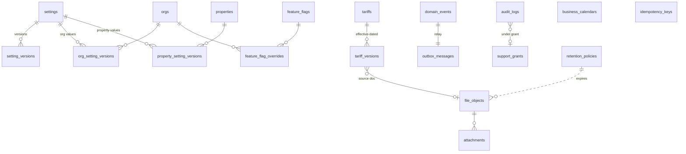

### 5.2 Platform — notifications & privacy
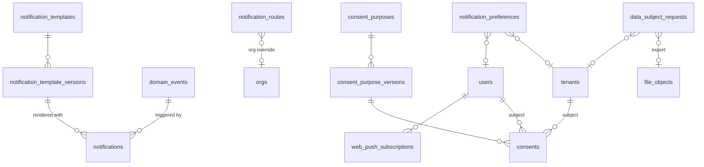

### 5.3 IAM & tenancy
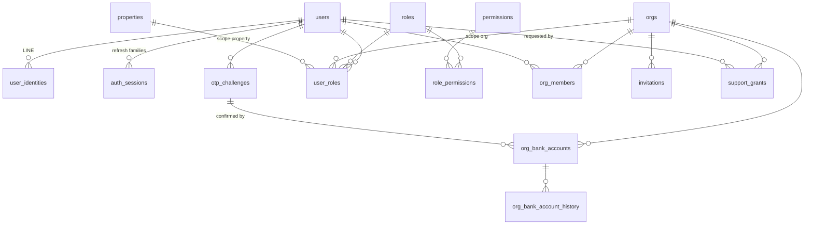

### 5.4 Property
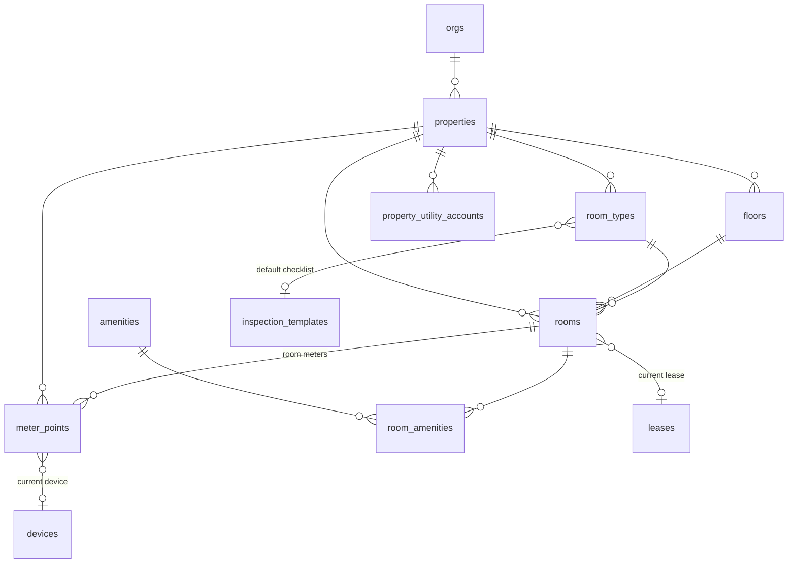

### 5.5 Tenants, leases, deposits, inspections
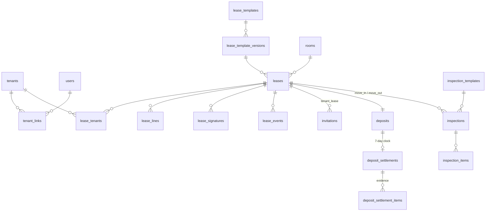

### 5.6 Devices, provisioning, config, OTA
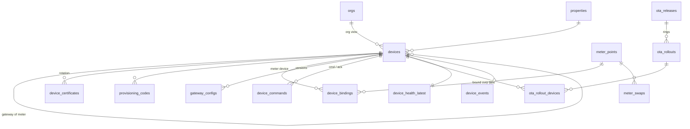

### 5.7 Readings, telemetry, utility loss
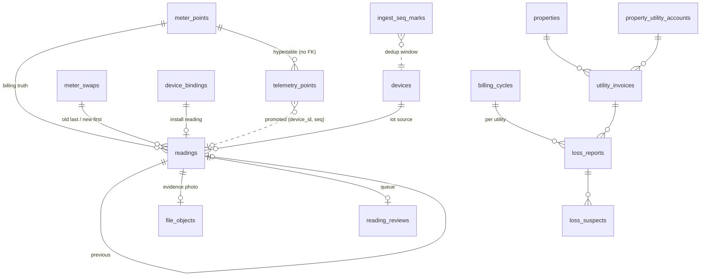

### 5.8 Billing cycles, bills, notes, documents
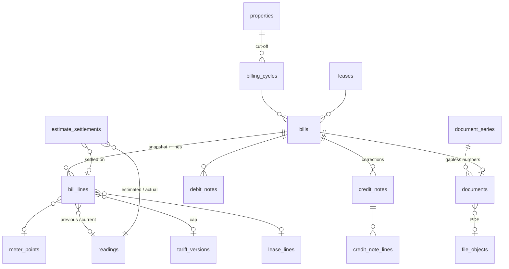

### 5.9 Payments & receivables
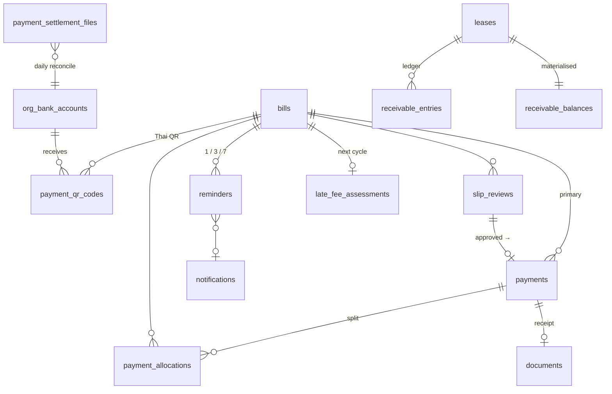

### 5.10 Platform business & compliance
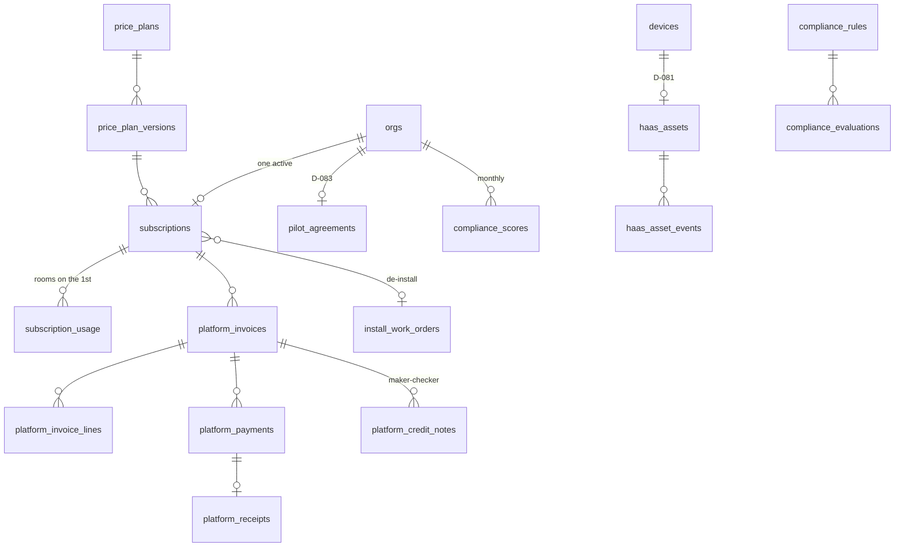

### 5.11 Operations (R2)
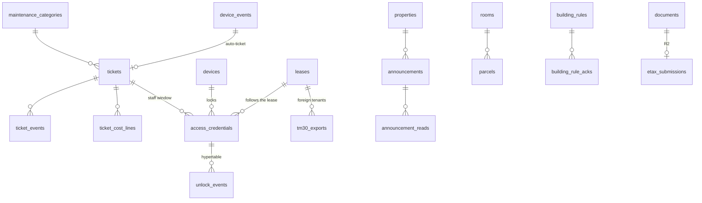

---

## 6. Decision → tables/columns coverage

| Decision | Data implication | Tables / columns | ⚖ placeholder until confirmed |
|---|---|---|---|
| D-001 | Platform company data for platform documents | `settings` keys `platform.company.*` (legal name, tax id, address, logo file id); `documents.org_id null` series | — |
| D-002 | One DB (PG 18 + Timescale), contract-generated enums | every enum here is a named OpenAPI component; hypertables §4.3 | — |
| D-003 | No getpack tables copied | own schema; only the platform *patterns* (idempotency, outbox, actor) reused | — |
| D-004 | `org_id` on every business row, composite indexes, RLS second line | §1.2 tenancy rule; `(org_id, …)` indexes on every business table; §4.5 RLS | — |
| D-005 | th default, en; tenant languages | `users.language`, `tenants.language` (th\|en\|my\|km\|lo\|zh), `*_template_versions.language`, `documents.language`, `name_th/name_en` on catalogues | — |
| D-010 | Multi-property per org, simple staff roles | `properties.org_id`, `user_roles.scope_type='property'`, `invitations.property_ids` | — |
| D-011 | Zero-touch loop as event chain | `domain_events` + `outbox_messages`; subscribers: `notifications`, `documents`, `payments → receipts`, `reminders` | — |
| D-012 | Reading sources, estimates flagged and settled | `readings.source` enum `iot\|ocr\|manual\|estimated`, `confidence`, `estimate_basis`; `bill_lines.is_estimated`; `estimate_settlements` | — |
| D-013 | Hardware-agnostic drivers | `devices.driver`, `device_bindings.bus_type/address/pin/litres_per_pulse/custom_register_map`, `gateway_configs.document` | — |
| D-014 | R1/R2/R3 scoping | §3.8 tables marked R2; migrated in B5/B6.2 only | — |
| D-020 | Rules in code with settings; legal refs | `compliance_rules` (legal_ref, severity), `compliance_evaluations`, `lease_template_versions.legal_ref/forbidden_clause_types`, `settings` for thresholds | ⚖ O-002: `compliance_rules.status = pending_legal_verification` for deposit_cap, late_fee_policy, estimate billing until counsel confirms; refusals still enforced with the current text |
| D-021 | Tariff cap, platform-maintained versions | `tariffs`, `tariff_versions.structure/cap_per_unit/effective_from/source_url/verified_by/state`; `bill_lines.price_per_unit <= cap_per_unit` CK; `leases.electric_rate_per_unit/water_rate_per_unit` (org rate ≤ cap) | seed `verified_by = null`, `state='entered'` until the platform admin verifies |
| D-022 | Per-utility line disclosure + raw readings as evidence | `bill_lines.previous_reading_id/current_reading_id/previous_register/current_register/reading_source/units/tariff_version_id/price_per_unit/amount`; `bills.snapshot.utilities[]`; `readings.evidence_file_id` | — |
| D-023 | Deposit cap, 7-day settlement, evidence-backed deductions, dashboard clock | `leases.deposit_amount/advance_rent_amount`, setting `deposit.max_months`; `deposits`, `deposit_settlements.deadline_at/state/is_late`, `deposit_settlement_items.evidence_file_ids/wear_category CK`, `inspections` move_in/move_out | ⚖ O-002: setting `deposit.max_months = 2` (1 + 1) and `deposit.refund_days = 7` seeded as **Proposed** with `D-023 ⚖` in the description |
| D-024 | No cut-off / lockout for arrears; late fee only if allowed | no column links `access_credentials` → `receivables`; `late_fee_assessments.allowed` + setting `late_fee.enabled` default **false**; `compliance_rules.no_cutoff` | ⚖ O-002: `late_fee.enabled=false`, `compliance.late_fee_policy` pending |
| D-025 | PDPA: consent versions, encrypted ID, retention classes, DSR, joint controller | `consent_purposes(+versions)`, `consents`, `tenants.document_no_enc/_hash`, `file_objects.retention_class`, `retention_policies`, `data_subject_requests.org_id` (joint controller), `audit_logs` for id-document downloads, `tenants.anonymised_at` | DPA template = setting `privacy.dpa_template_version` (⚖ counsel) |
| D-030 | Cumulative registers; telemetry for insight only | `readings` (normal table) vs `telemetry_points` ★; `bill_lines` FK only to `readings` | — |
| D-031 | Cut-off per property, ±2 h window, estimate policy | settings `billing.cutoff` (property scope), `readings.iot_window_minutes=120`, `billing.grace_hours`, `estimate_policy` (org, default block first 2 cycles); `billing_cycles.cut_off_at/readings_window_minutes/grace_deadline_at/estimate_policy` snapshots; `readings.source='estimated'` | — |
| D-032 | Utility loss per property per cycle, suspects | `property_utility_accounts`, `utility_invoices`, `loss_reports`, `loss_suspects`, `telemetry_15m` (night flow), `meter_points.kind=common_area\|main` | — |
| D-033 | Device registry, states, provisioning by QR, swaps keep history | `devices.status` enum (7 states), `provisioning_codes`, `device_bindings.install_register/install_reading_id`, `meter_swaps.old_last_register/new_first_register` + reading refs, `readings.swap_id` | — |
| D-034 | Stale/silent thresholds, heartbeat 60 s, offline after 5, auto-ticket | settings `health.stale_after.electric=2h`, `.water=6h`, `health.silent_after=24h`, `health.heartbeat_s=60`, `health.offline_after_missed=5`; `meter_points.health/health_changed_at`; `device_health` ★ + `device_health_latest.missed_heartbeats`; `device_events → tickets.source_device_event_id` (R2) | — |
| D-035 | OCR with monotonic + plausibility band, review queue, photo setting | `readings.ocr_raw_value/ocr_confidence/typed_value/review_state`, `reading_reviews.reason/band_low/band_high`, setting `readings.require_photo`, `readings.plausibility_band_pct=60` | — |
| D-040 | Immutable bills, snapshot, credit/debit notes | `bills.snapshot/snapshot_sha256`, immutability trigger §4.8, `credit_notes`/`debit_notes` with `bill_id`, `bill_lines` no-update trigger | — |
| D-041 | Line types enum with compliance flag; pro-rata | `bill_line_type` enum (14 values), `bill_line_type_rules`, `bill_lines.pro_rata/compliance_flags/compliance_rule_ids`, `lease_lines` | — |
| D-042 | Thai QR per bill via adapter per org, webhooks idempotent, settlement reconcile, no funds held | `org_bank_accounts.payment_provider/promptpay_*`, `payment_qr_codes`, `payments.provider_ref UQ`, `payment_settlement_files`, `bills.qr_*` | ⚖ O-001: `payment_provider` enum has `none` default; `payment_provider` enum values `kbank\|scb\|opn` exist, none enabled (feature_flags `payments.provider.*` off) |
| D-043 | Slip fallback with verifier, duplicate check, review queue | `slip_reviews` (`trans_ref UQ`, `duplicate_of_id`, `state`), setting `payments.allow_slip=true` | — |
| D-044 | Receipt on full payment, partial payments, series per org per year | `payments.receipt_document_id`, `payment_allocations`, `documents.doc_type=receipt`, `document_series(org, receipt, fiscal_year)`, setting `payments.allow_partial` | — |
| D-045 | Reminders 1/3/7, aging, late fee only when allowed | `reminders` (step, schedule from setting `reminders.schedule=[1,3,7]`, `billing.grace_days`), `receivable_balances.aging/days_overdue`, `late_fee_assessments` | ⚖ O-002 as D-024 |
| D-046 | Money numeric(14,2), quantities numeric(12,3), THB | §1.2 types; `CK(amount = round(amount,2))` on every money column; `price_per_unit numeric(14,4)` | — |
| D-050 | Document types, gapless series per org/type/year; e-Tax adapter R2 | `document_type` enum (13 values), `document_series`, `documents`, §4.4; `etax_submissions` (R2) | ⚖ O-004: `tax_invoice`/`receipt_tax_invoice` types exist but are issued only when `orgs.vat_registered = true` (default false) |
| D-051 | No GL; income/expense, VAT figures, exports; WHT as deduction | `export_jobs.kind` (flowaccount_csv, peak_csv, vat_pp30, income_expense), `payments.wht_amount`, `ticket_cost_lines` + `utility_invoices` as expenses | — |
| D-052 | TM30 data pack R2 | `tenants.nationality/document_type/passport (document_no_enc)/date_of_birth/gender/visa_type/arrival_date`, `tm30_exports` | — |
| D-060 | LIFF-first, magic link fallback | `user_identities(provider=line\|line_liff)`, `otp_challenges.purpose=tenant_login`, `users.kind=tenant_user` | — |
| D-061 | Invite → link → consent → sign; one LINE account many rooms | `invitations.kind=tenant_lease`, `tenant_links`, `consents`, `lease_signatures`; `tenant_links UQ(tenant, user) WHERE active` allows one user → many tenants/leases | — |
| D-062 | e-signature evidence | `lease_signatures.method/otp_challenge_id/line_user_id/signature_image_file_id/signed_pdf_file_id/pdf_sha256/ip/user_agent`, `leases.contract_sha256`, `audit_logs` | ⚖ counsel: `signature_method` includes `scan_upload` fallback |
| D-063 | Tenant sees bills, receipts, daily usage, notices, docs, consent | `bills`/`documents`/`payments` by `lease_id`; `telemetry_1d` by `meter_point_id` of the lease's room; `leases.notice_*`; `consents` | — |
| D-064 | Languages | `tenants.language` 6 values; `notification_template_versions.language`; `announcements.translations` (R2) | — |
| D-070 | Locks as devices, credentials, unlock log visible to tenant | `devices.kind=lock`, `access_credentials`, `unlock_events` ★ filtered by `lease_id`/room | — |
| D-071 | Access follows the lease | `access_credentials.lease_id` required for tenants, revoke on `lease_events(ended\|terminated)`; no FK to billing | — |
| D-072 | Tickets, SLA per category, auto-tickets | `maintenance_categories.default_sla_hours`, `tickets.sla_due_at/source_device_event_id`, `ticket_cost_lines` | — |
| D-073 | Announcements with read receipts, parcels, rules, contacts | `announcements`, `announcement_reads`, `parcels`, `building_rules(+acks)`, `contacts` | — |
| D-080 | Price plans as versioned settings; platform AR separate | `price_plans`, `price_plan_versions` (price_per_room, min_monthly, term_months, vat), `platform_invoices` (org_id null series) | Proposed values seeded as versions with `state='published'` and `notes='D-080 proposed, confirm by pilot'` |
| D-081 | HaaS asset register | `haas_assets` (installed_at, term, monthly_value, state, replaced_by), `haas_asset_events`, `devices.ownership=platform_haas`, `install_work_orders.kind=deinstall` | — |
| D-082 | Subscription lifecycle, read-only suspension, room counting | `subscriptions.state` enum, `orgs.status=read_only`, `subscription_usage.rooms_counted` (rooms.status <> inactive on the 1st), setting `subscription.trial_days=30` | — |
| D-083 | Pilot agreement, KPIs | `pilot_agreements.kpi_targets/baseline/kpi_review_at`, `subscriptions.discount_pct/pilot_agreement_id`, `kpi_snapshots` | — |
| D-090 | Org roles, platform roles, support grants | `roles` (8 seeded), `user_roles.scope_type`, `support_grants`, `audit_logs.support_grant_id` | — |
| D-091 | Permission catalogue, maker-checker | `permissions`, `role_permissions`; `org_bank_accounts.confirmed_by_otp_id` + CK; `platform_credit_notes.approved_by <> requested_by`; `tariff_versions.verified_by <> entered_by` | — |
| D-100 | Design — no data | `orgs.logo_file_id` only | — |
| D-130 | Envelope fields, dedup `(meterId, seq)`, clock_suspect | `telemetry_points` columns = `Reading` DTO; `readings.seq/quality`, `UQ(device_id, seq)`; `ingest_seq_marks`; `devices.last_seq`; `device_certificates`, `devices.mqtt_client_id` | — |
| D-131 | Config push, applied version, OTA rings | `gateway_configs.version/document/published_at/applied_at`, `devices.config_applied_version`, `device_events.config_applied\|config_rejected\|config_drift`, `ota_releases.signature`, `ota_rollouts.ring`, `devices.ota_ring` | — |
| D-132 | Gateway hardware baseline | `devices.hardware_rev/model/firmware_version`, `device_health.link/rssi/disk_free_mb` | ⚖ O-003: `devices.model/driver` are free text validated against the edge driver list at provisioning; no enum until the pilot models are chosen |
| O-001 | Payment provider | `payment_provider` enum `kbank\|scb\|opn\|none`; `org_bank_accounts.payment_provider` default `none`; adapter chosen per org | ⚖ enum ships with all three; feature flags decide |
| O-002 | สคบ. values | settings `deposit.max_months`, `deposit.refund_days`, `late_fee.enabled`, `estimate_policy`; `compliance_rules.status` | ⚖ seeded Proposed values 2 / 7 / false / block; rules `pending_legal_verification` |
| O-003 | Pilot meter/gateway models | `devices.model`, `devices.driver`, `device_bindings.bus_type` | ⚖ free text; `bus_type` enum already covers modbus_rtu/gpio/lorawan |
| O-004 | Pilot org VAT | `orgs.vat_registered`, `bills.vat_amount`, `bill_lines.vat_applicable`, `document_type` tax_invoice/receipt_tax_invoice, `export_jobs.kind=vat_pp30` | ⚖ default `false`; all VAT columns present and zero |

Every D-### in `decisions.md` appears above; D-100 and D-014 have no tables of their own and say so.

---

## 7. Migration plan for 1.2 step 2 & open questions

### 7.1 Which tables migrate when
| Migration (Prisma + raw SQL tail) | Tables | Deliverable |
|---|---|---|
| `0001_extensions` | `timescaledb`, `pgcrypto`, `pg_trgm`, `citext`, `btree_gist`; helper functions `set_updated_at()`, `deny_mutation()`, `close_previous_version()`; all enums used by B1 tables | B1.2 step 2 |
| `0002_iam` | `users`, `user_identities`, `auth_sessions`, `otp_challenges`, `roles`, `permissions`, `role_permissions`, `user_roles`, `support_grants` | B1.2 step 2 |
| `0003_tenancy` | `orgs`, `org_members`, `invitations` (with `lease_id` nullable, FK added in B2.3), `org_bank_accounts`, `org_bank_account_history`, `org_setting_versions` (`property_setting_versions` waits for `properties` in B2.1) | B1.2 step 2 |
| `0004_platform_config` | `settings`, `setting_versions`, `feature_flags`, `feature_flag_overrides`, `tariffs`, `tariff_versions`, `business_calendars` | B1.2 step 2 |
| `0005_platform_files_audit_events` | `file_objects`, `attachments`, `audit_logs` (partitioned), `domain_events`, `outbox_messages`, `idempotency_keys` | B1.2 step 2 |
| `0006_platform_notifications` | `notification_templates`, `notification_template_versions`, `notification_routes`, `notification_preferences`, `notifications`, `web_push_subscriptions` (`tenant_id` FK deferred to B2.2 via `ALTER … ADD CONSTRAINT`) | B1.2 step 2 |
| `0007_platform_privacy` | `consent_purposes`, `consent_purpose_versions`, `consents`, `data_subject_requests`, `retention_policies`, view `v_consent_state` | B1.2 step 2 |
| `0008_rls_reporting_role` | role `getproperty_reporting`, RLS policies on every B1 `org_id` table (re-run per later migration) | B1.2 step 2 |
| seeds | roles/permissions, settings + versions with D-### descriptions, tariff versions (MEA/PEA 1.1/1.2 + Ft, MWA/PWA residential), notification templates skeleton, consent purposes, Thai holidays 2026–2027, dev org "หอพักตัวอย่าง" with 2 floors × 6 rooms (properties/rooms seed runs after B2.1; B1.2 seeds the org and users only) | B1.2 step 3 |
| B2.1 | `properties`, `property_utility_accounts`, `floors`, `room_types`, `rooms`, `amenities`, `room_amenities`, `meter_points`, `property_setting_versions`; `user_roles.property_id` FK | B2 |
| B2.2 | `tenants`, `tenant_links`; `notification_preferences.tenant_id` FK; `consents` subject FK check | B2 |
| B2.3 | `lease_templates(+versions)`, `leases`, `lease_tenants`, `lease_lines`, `lease_signatures`, `lease_events`; `invitations.lease_id` FK; `rooms.current_lease_id` FK; `document_series`/`documents` **stub** (types contract/inspection_report) if B4.3 has not landed | B2 |
| B2.4 | `deposits`, `deposit_settlements`, `deposit_settlement_items`, `inspection_templates`, `inspections`, `inspection_items` | B2 |
| B3.1 | `devices`, `device_certificates`, `provisioning_codes`, `device_bindings`, `gateway_configs`, `meter_swaps`, `ota_releases`, `ota_rollouts`, `ota_rollout_devices`, `device_commands`; `meter_points.current_device_id` FK | B3 |
| B3.2 | `telemetry_points` ★ + aggregates + policies, `ingest_seq_marks`, `device_health` ★, `device_health_latest`, `device_events` (partitioned) | B3 |
| B3.3 | `readings`, `reading_reviews`; monotonicity trigger; `device_bindings.install_reading_id` / `meter_swaps.*_reading_id` FKs | B3 |
| B3.4 | `utility_invoices`, `loss_reports`, `loss_suspects` (FK to `billing_cycles` deferred if B4.2 not landed) | B3 |
| B4.1 | `compliance_rules`, `compliance_evaluations`, `compliance_scores` | B4 |
| B4.2 | `billing_cycles`, `bills` (+ trigger), `bill_lines` (+ trigger), `bill_line_type_rules`, `credit_notes(+lines)`, `debit_notes(+lines)`, `estimate_settlements` | B4 |
| B4.3 | `document_series`, `documents` (full), `export_jobs` | B4 |
| B4.4 | `payment_qr_codes`, `payments`, `payment_allocations`, `slip_reviews`, `payment_settlement_files` | B4 |
| B4.5 | `receivable_entries`, `receivable_balances`, `reminders`, `late_fee_assessments` | B4 |
| B5.x / B6.2 | §3.8 tables (R2) | B5, B6 |
| B6.1 | `price_plans(+versions)`, `subscriptions(+events)`, `subscription_usage`, `platform_invoices(+lines)`, `platform_payments`, `platform_receipts`, `platform_credit_notes`, `haas_assets(+events)`, `pilot_agreements`, `site_survey_requests`, `install_work_orders` | B6 |
| B6.3 | `analytics_facts` ★, `analytics_rollups`, `kpi_snapshots`, `benchmark_buckets`, `csat_surveys` | B6 |

Forward references across deliverables are handled by **nullable columns without FK** at creation and `ALTER TABLE … ADD CONSTRAINT … NOT VALID; VALIDATE CONSTRAINT` in the later migration (listed per row above), so each deliverable's migration is self-contained and CI's Prisma drift check stays green.

### 7.2 Open questions for the reviewer (max 10)
1. **Tariff cap semantics** — `tariff_versions.cap_per_unit` is proposed as *highest marginal tier + Ft, excl. VAT*. For a tiered residential tariff the lawful per-unit charge actually depends on the month's consumption; should the compliance engine compare the org's **flat rate** to the highest tier (strict, proposed) or to the **effective average rate** of the tenant's consumption that month (looser, needs the units first)? Affects `bill_lines.cap_per_unit` and golden tests.
2. **Service charge pass-through** — may an org bill the utility's monthly service charge (MEA ฿24.62 etc.) per room when a building has one utility account? Proposed: not billable as a separate line (`bill_line_type` has no `service_charge`); included in the cap basis only. Confirm (⚖ O-002).
3. **Water minimum charge** — keep `leases.water_minimum_charge` (org-level minimum under cap) or forbid any minimum and bill units only? Proposed: allowed when ≤ the utility's own minimum (`structure.minimumCharge`).
4. **`readings` uniqueness** — `UQ(meter_point_id, read_at, source)` means a corrected manual reading at the same `read_at` must use a new `read_at` or supersede the old row (`superseded_by_reading_id`, `review_state=corrected`). Accept the supersede model, or relax to `UQ(meter_point_id, read_at, source) WHERE review_state in ('accepted','pending_review')`?
5. **Dedup table vs. hypertable index** — `ingest_seq_marks` (90-day window) + `devices.last_seq` watermark is proposed because a hypertable unique index must include `time`. Alternative: make `readings.UQ(device_id, seq)` the only hard guarantee and accept duplicate `telemetry_points` rows (aggregates use `last()/first()` so duplicates are harmless). Which one?
6. **Org settings catalogue** — one `settings` catalogue with `scope_allowed` (proposed) vs. a separate `org_settings` catalogue table as the B1 prompt names it. The single catalogue keeps one `at()` and one seed; confirm the naming deviation is acceptable (`org_setting_versions` exists as named).
7. **Invitations** — one table for org-member and tenant-lease invitations (proposed, `kind` discriminator) vs. two tables (`invitations` in B1, `lease_invitations` in B2.2)?
8. **Platform documents series** — `document_series.org_id null` for Collective Group's own invoices/receipts (proposed) vs. modelling Collective Group as a special `orgs` row. Null keeps D-004 clean ("the platform is not a landlord") but needs `coalesce(org_id,0)` in unique indexes.
9. **Audit/evaluation partitioning** — `audit_logs`, `device_events`, `compliance_evaluations` as monthly **native partitions** from day one (proposed; Prisma sees a plain table, partitioning in raw SQL) vs. plain tables until volume demands it.
10. **Phone storage** — `users.phone_e164`/`tenants.phone_e164` stored in clear (needed for OTP/SMS/LINE matching) with `phone_hash` for lookup and log redaction, vs. encrypted like ID numbers (then every SMS send decrypts). Proposed: clear + redaction; confirm with the PDPA review.

---
*Table count: 141 tables (137 relational + 4 hypertables: `telemetry_points`, `device_health`, `unlock_events`, `analytics_facts`) + 3 continuous aggregates (`telemetry_15m/1h/1d`) + 2 views (`v_consent_state`, `staff_tasks`). B1.2 step 2 migrates 39 of them (§3.1 + §3.2 without `property_setting_versions`).*
