# Schema design v2 — getproperty-api (schema lock · ล็อก data model ตาม platform blueprint)

> **Status: v2 — locked 2026-10-17 for B1.2 step 2.** v1 (2026-10-16, reviewed: D-140–D-149) is superseded by the platform blueprint decisions **D-150–D-161** (`docs/platform-blueprint.md`, ADR-0009, ADR-0010). Every v1 business rule and constraint carries over unless a blueprint decision changes it; the explicit **v1 → v2 rename map** is §8. Nothing here is migrated yet: `collective-asset-core` v0.1.0 creates the `core` schema (§7.1), then B1.2 step 2b creates the foundation tables of this repo (§7.2), and B2–B6 migrate the rest **following this design**. A deviation discovered later is a PR to this file first (and, for `core.*`, to the package).
> Inputs: `docs/decisions.md` (every D-### / O-###), `docs/platform-blueprint.md`, `docs/prompts/00-master-plan.md` §4–§5, ADR-0001–0004 (as amended) and 0009–0010, `docs/contract/api-conventions.md` §3/§8, `docs/contract/device-protocol.md` + `src/modules/ingest/protocol/*.dto.ts`, `docs/compliance/legal-reference.md`, the B2–B6 prompts.
> Legend: ⚖ = value or shape waits for a legal / bank / pilot answer (O-001–O-005); the placeholder the migration will use is stated. ★ = hypertable (TimescaleDB). ⟲ = append-only (trigger). ◇ = Phase 2–4 sketch only (not migrated in Phase 1). **R2** = migrated in an R2 deliverable.

## Contents
1. [Purpose & conventions](#1-purpose--conventions) — 1.1 purpose · 1.2 naming & types · 1.3 shorthand · 1.4 schemas, ownership & dependency rules
2. [Bounded contexts & aggregates](#2-bounded-contexts--aggregates)
3. [Tables per schema](#3-tables-per-schema) — 3.1 `core` · 3.2 `platform` · 3.3 `ops` · 3.4 `smart` · 3.5 `bridge` · 3.6 `juristic` · 3.7 Phase 2–4 sketches
4. [Patterns](#4-patterns) — effective dating · snapshots (tariff, rate plan, invoice) · readings vs telemetry · gapless numbering · tenancy, RLS & `asset_access_grant` · owner vs operator tenant · PII encryption per tenant key · audit / event / integration envelopes · immutability triggers
5. [ER diagrams](#5-er-diagrams) (Mermaid, ≤ 15 entities each)
6. [Decision → tables/columns coverage](#6-decision--tablescolumns-coverage)
7. [Migration plan & open questions](#7-migration-plan--open-questions) — 7.1 `collective-asset-core` v0.1.0 · 7.2 getproperty-api B1.2 · 7.3 later deliverables · 7.4 open questions
8. [v1 → v2 rename map](#8-v1--v2-rename-map)

---

## 1. Purpose & conventions

### 1.1 Purpose
One relational database (PostgreSQL 18 + TimescaleDB, ADR-0001) for Collective Group's **Building Operations platform** (D-150): four tenant types — `apartment` (first customer), `condo_juristic`, `pm_company`, `landlord` — on one neutral core, so a tenant type can be added **without migrating** group A tables. Rows must still be **provable afterwards**: an invoice from November must be re-derivable from the readings, rate plan version, utility tariff version, lease lines and settings in force in November (D-040); a สคบ. dispute must find the evidence and the owner's acknowledgement of any above-tariff rate (D-021a, D-022, D-023); and no tenant may ever see another tenant's rows except through an explicit, audited grant (D-152). The design therefore favours: neutral names (`unit`, `party`, `invoice`), relationships over role tables (`unit_ownership`, `occupancy`, `lease`), versioned configuration over mutable rows, snapshots on financial documents, append-only tables for anything issued, `tenant_id` everywhere, and row-level security enforced by the database for the application itself.

The two questions that distinguish the tenant types — *who owns the unit* and *who pays which bill* — are answered by data, not by schema: `core.unit_ownership` separates ownership from `core.occupancy`, and `ops.invoice.billed_party_id` names the payer as a party (an apartment's lessee, a condo co-owner, a landlord paying the juristic person's common fee).

### 1.2 Naming & types (applies to every table unless a table says otherwise)
| Rule | Convention |
|---|---|
| Names | `snake_case`, **singular** table names, always schema-qualified in SQL and docs (`core.unit`, `ops.invoice_line`). Enum types are named after the column and live in the table's schema (`core.unit_type`, `ops.invoice_status`); a name that would clash gets the table prefix. FK columns `<entity>_id`; FKs to a differently named role use a role prefix (`lessee_party_id`, `billed_party_id`, `owner_tenant_id`). Forbidden as names (D-151): `org`, `apartment`/`dorm`, `room`, `bill`, `meter_point`, `customer`/`resident`/`owner` tables, and `tenant` in the sense of a renter. |
| Primary key | `id uuid primary key default uuidv7()` on every relational table (D-152). The id is also the public id: URLs, payloads, tokens, cursors and integration events carry it (contract §3). Code generates UUIDv7 (`src/common/ids/uuidv7.ts`) when the id must be known before insert (event envelopes, idempotent imports). Hypertables have no `id`. Pure link tables use a composite PK and say so. |
| Tenancy | `tenant_id uuid not null references core.tenant(id)` on **every tenant-owned table** (D-152); nullable only on tables that also hold platform rows (documents, audit, settings versions) and they say so. `building_id` (denormalised) on every row below a building — it is the RLS key for cross-tenant access (§4.5). Every secondary index on a tenant table starts with `tenant_id` or `building_id`; every unique business key is composite with `tenant_id` (unit no. per building, invoice numbers per tenant, device serials globally). |
| Audit columns | `created_at timestamptz not null default now()`, `created_by uuid null` (→ `core.user_account`, no FK on hypertables/append-only logs), `updated_at timestamptz not null default now()` (trigger `core.set_updated_at`), `updated_by uuid null`. System/device/webhook actors leave `*_by` null and are named in `platform.audit_log.actor`. Written here as **`audit`**. |
| Soft delete | `deleted_at timestamptz null` (+ `deleted_by`) **only where soft delete applies** (D-152): `core.tenant`, `core.property`, `core.building`, `core.floor`, `core.unit`, `core.party` (plus `anonymised_at` for PDPA erasure), `core.asset_item` (plus `retired_at`), `core.document`, `core.membership`, `ops.unit_profile`, `ops.rate_plan`, `ops.service_category`, `ops.contact`. Soft-deleted rows stay visible to history joins; partial unique indexes add `where deleted_at is null`. Financial and evidence tables are never deleted (append-only or state machines). Written as **`soft`**. |
| Optimistic concurrency | `version int not null default 1`, bumped by every update on editable aggregates (ETag / `If-Match`, contract §3): tenant, building, unit, party, lease, rate plan, device, invoice (draft), settings. Written as **`etag`**. |
| Time | `timestamptz` (UTC on disk); business rules in `Asia/Bangkok` in code. Date-only business values (`effective_from`, `period_start`, `valid_from` of ownership) are `date`. |
| Money | `numeric(14,2)` THB only in Phase 1 (D-046, blueprint rule 4); `currency char(3) default 'THB'` only on tables that may one day carry another currency (platform invoices, rate plans). Rounding half-up to satang per line, then totals — in code (`decimal.js`), enforced by property tests, and by `CHECK (amount = round(amount, 2))`. |
| Quantities & rates | Meter registers and units `numeric(12,3)`; price per unit `numeric(14,4)`; percentages and shares `numeric(7,4)` (`share_pct` 0–100); `ownership_ratio numeric(9,6)` (fraction, condo ratio per the land office registration); areas `numeric(9,2)` m². |
| Enums | PostgreSQL `CREATE TYPE … AS ENUM` for every status and for `core.tenant_type`, `core.unit_type`, `ops.invoice_line_source_type` (blueprint rule 3); each is a named OpenAPI component when exposed. Open/extensible sets (setting keys, permission keys, event types, module keys, template keys) are `text` with a catalogue table or CHECK. Values are `snake_case` and identical to the API strings. Additions are `ALTER TYPE … ADD VALUE` migrations (never renames) — additive, so allowed inside a `collective-asset-core` major version. |
| JSON | `jsonb` for snapshots (invoice snapshot, utility tariff structure, gateway config document, notification payload), for **rate plan tiers** (interpreted by the billing engine, blueprint rule 7), for `membership.module_scopes`, `tenant.settings` (non-legal UI preferences only) and provider payloads; never for data that is queried relationally or that a decision makes an effective-dated setting. Every jsonb column has a documented shape (§4.2) validated in code (zod). |
| Constraints | FKs everywhere (`on delete restrict` by default; `cascade` only for pure child rows: lines, items, versions); `CHECK` on ranges, sign and rounding; exclusion constraints (`btree_gist`) for non-overlapping ranges (meter assignments, ownership/occupancy periods, active leases on a unit, versions, operator periods, facility bookings). |
| Text search | `pg_trgm` GIN on human business keys and names searched by `?q=` (unit no., party names, invoice numbers, device serials). `citext` for emails, codes, serials. |
| RLS | Enabled **and forced** on every table with `tenant_id`; policies keyed on `core.current_tenant_id()` = `current_setting('app.tenant_id')` and widened for building-scoped rows by owner/operator tenancy and `core.asset_access_grant` (§4.5). The application connects as `gp_app` (not the owner, no `BYPASSRLS`); the platform surface and cross-tenant jobs use `gp_platform` (`BYPASSRLS`, every use audited); exports/BI use `gp_reporting` (read-only, RLS). Repositories still add `tenant_id` to every query (first line; 404 semantics). |
| Extensions | Created by `collective-asset-core` 0001: `pgcrypto`, `citext`, `btree_gist`, `pg_trgm` (+ the `uuidv7()` guard for servers older than PG 18). Created by getproperty-api B1.2: `timescaledb` (conditionally, see O-005); `vector` (pgvector) only in Phase 3 for B2. |
| Prisma | `previewFeatures`/`schemas = ["core","platform","ops","smart","bridge","juristic"]` (multiSchema). `core.prisma` is copied from the package and never migrated by this repo. Relational tables of the other schemas are modelled in `prisma/schema/<schema>-<context>.prisma`; hypertables, continuous aggregates, policies, triggers, RLS, exclusion constraints and partial/expression indexes live in raw SQL tails of the migrations. `@@map`/`@map` keep snake_case. |

### 1.3 Shorthand used in §3
- `PK` = `id uuid default uuidv7() primary key`; `ten` = `tenant_id uuid not null → core.tenant`; `bld` = `building_id uuid not null → core.building`; `audit`, `soft`, `etag` as above.
- `enum(a|b|c)` = a Postgres enum named after the column unless a name is given.
- `UQ(…)`, `IX(…)`, `CK(…)`, `EX(…)` = unique index, index, check, exclusion constraint. `→ s.t` = FK to `s.t(id)`; `⇢ s.t` = logical reference without FK (cross-package, hypertable or polymorphic).
- `*_enc bytea` + `*_hash bytea` = field-encrypted column (per-tenant key, §4.7) + HMAC lookup hash.
- `RLS:T` = tenant policy; `RLS:B(module)` = building-scoped policy with grants for `module`; `RLS:U(module)` = unit-scoped (unit grants too); `RLS:P` = platform table (read policy only, writes by `gp_platform`). See §4.5.

### 1.4 Schemas, ownership & dependency rules (D-152, D-153)
| Schema | Content | Owner / migrations | Phase |
|---|---|---|---|
| `core` | tenancy (`tenant`, `membership`, per-tenant data keys), identity (`user_account`, `user_identity`), asset hierarchy (`property` → `building` → `floor` → `unit`), `party` and its relations (`party_user_link`, `unit_ownership`, `occupancy`), `asset_item`, `meter_assignment`, `document`, `asset_access_grant`, `building_operator_period` | **`collective-asset-core`** package (ADR-0010); runs first; shared with getbuild (each product its own database) | 1 (v0.1.0) |
| `platform` | settings & flags, utility tariffs (สคบ. cap reference), sessions/OTP/credentials, roles & permissions, support grants, invitations, tenant bank accounts, attachments, audit, domain events, outbox, idempotency, notifications, privacy, compliance, business calendar, subscriptions & price plans & platform AR & HaaS, analytics, AI usage | getproperty-api | 1 |
| `ops` | group A: workflow engine, unit profiles, leases, deposits, inspections, rate plans, billing cycles, invoices & lines, notes, payments, receipts, tax invoices, receivables, dunning, document series, exports, utility invoices & loss; R2: service requests, work orders, announcements, parcels, facilities & bookings, rules, contacts, e-Tax, TM30; later: C3 portfolio | getproperty-api | 1 (+R2) |
| `smart` | group C + A3 hardware: devices, certificates, provisioning, meter channels, gateway configs, OTA, commands, telemetry ★, health ★, device events, **meter readings** (billing truth), reviews, reading batches, meter status; R2: access credentials & events ★; later: energy (C2) | getproperty-api | 1 (+R2) |
| `bridge` | `integration_event` (in/out events with getbuild/getpack, D-153 contracts); later D1 post-sale, D2 landlord tier | getproperty-api | 1 (table only) |
| `juristic` | group B (AGM & e-voting, AI juristic assistant, sinking fund & inspection) | getproperty-api | created empty; tables Phase 2/3 |

Dependency rules: `core` references nothing outside `core`. App schemas may reference `core` (real FKs — core is migrated first) and each other in deliverable order (`platform` ← `ops`/`smart`/`bridge`; `ops` ↔ `smart` through FKs added by the later deliverable with `NOT VALID` + `VALIDATE`). An app migration never alters a `core` table; it may add **its own** tables that hang off core rows (`ops.unit_detail`, `ops.occupant_profile`). Cross-product consistency (getbuild ↔ getproperty) is by events (`bridge.integration_event`), never by cross-database FKs.

---

## 2. Bounded contexts & aggregates

| Context (Nest module) | Aggregates (root in bold) | Schema | Prompt |
|---|---|---|---|
| **Tenancy & identity** (`core/tenancy`, `core/identity`) | **Tenant** (data keys, memberships, settings versions, bank accounts + history, feature-flag overrides), **UserAccount** (identities, credential, sessions, OTP challenges, platform role assignments), **Role**/Permission, **SupportGrant**, **Invitation** | core, platform | B1 |
| **Asset core** (`core/asset`) | **Property**, **Building** (floors, operator periods), **Unit**, **Party** (user links, ownerships, occupancies), **AssetItem** (meter assignments), **Document**, **AssetAccessGrant** | core | package + B1.3/B2 |
| **Platform services** (`core/*`) | **Setting** (+versions), **FeatureFlag**, **UtilityTariff** (+versions), Attachment, **AuditLog**, **DomainEvent**/OutboxMessage, IdempotencyKey, **NotificationTemplate** (+versions), **Notification**, **ConsentPurpose** (+versions), **Consent**, **DataSubjectRequest**, **RetentionPolicy**, **BusinessCalendar**, **ComplianceRule**, **ComplianceEvaluation** ⟲, **ComplianceAcknowledgement** ⟲, ComplianceScore | platform | B1, B4.1 |
| **Workflow** (`core/workflow`, D-159) | **WorkflowDefinition**, **WorkflowInstance** (events ⟲, timers) | ops | B1.3 |
| **A1 Lease & occupant** (`modules/ops-units`, `ops-parties`, `ops-leases`, `ops-deposits`, `ops-inspections`) | **UnitProfile**, UnitDetail, OccupantProfile, **LeaseTemplate** (+versions), **Lease** (parties, lines, signatures, events ⟲), **Deposit** (settlement, items), **Inspection** (items; templates) | ops (+core) | B2 |
| **A3 Smart meter** (`modules/smart-*`, `ops-utility-loss`) | **Device** (certificates, provisioning codes, meter channels, commands), **GatewayConfig**, **MeterSwap**, **OtaRelease**/Rollout, **MeterReading** (reviews), ReadingBatch, MeterStatus, **UtilityAccount**, **UtilityInvoice**, **LossReport**; telemetry_point ★, device_health ★, device_event | smart, ops | B3 |
| **A2 Billing & accounting** (`modules/ops-billing`, `ops-payments`, `ops-receivables`, `ops-documents`, `ops-exports`) | **RatePlan** (+versions), **BillingCycle**, **Invoice** ⟲ (lines), **CreditNote** ⟲, **DebitNote** ⟲, **EstimateSettlement**, **Payment** (allocations, QR codes), **SlipReview**, **Receipt** ⟲, **TaxInvoice** ⟲, **ReceivableBalance** (entries ⟲), DunningReminder, PenaltyAssessment, **DocumentSeries**, SettlementFile, ExportJob | ops | B4 |
| **A4 Service & community** (R2) (`modules/ops-service`, `smart-access`, `ops-community`, `ops-staff-tasks`) | **ServiceRequest**, **WorkOrder** (cost lines), ServiceCategory, **AccessCredential**, access_event ★, **Announcement** (reads), **Parcel**, **Facility** (bookings), **BuildingRule** (acks), **Contact**, StaffTask (view), **EtaxSubmission**, **Tm30Export** | ops, smart | B5, B6.2 |
| **Platform business** (`modules/platform-*`) | **PricePlan** (+versions), **Subscription** (events, usage), **PlatformInvoice** ⟲ (lines, payments, receipts, credit notes), **HaasAsset** (events), **PilotAgreement**, SiteSurveyRequest, **InstallOrder**, **AiUsageRecord** | platform | B6.1, B6.4 |
| **Analytics** (`modules/platform-analytics`) | **AnalyticsFact** ★, AnalyticsRollup, KpiSnapshot, BenchmarkBucket, CsatResponse | platform | B6.3 |
| **Integration** (`modules/bridge-integration`) | **IntegrationEvent** | bridge | B1.2 (table), consumers D1/D2 |

Aggregate rule: a transaction writes one aggregate root plus its children, its `platform.audit_log` row (audited actions) and its `platform.domain_event` + `platform.outbox_message` rows (`withTx`, which also sets `app.tenant_id`). Cross-aggregate effects (receipt after payment, occupancy after lease activation, credential after lease activation, loss report after invoices, integration event after a warranty request) are **subscribers**.

---
## 3. Tables per schema

### 3.1 `core` — collective-asset-core v0.1.0 (ADR-0010)

#### 3.1.1 Tenancy & identity
```
core.tenant                               the paying customer organisation (D-151); tenancy root          RLS: id = current_tenant_id()
  PK · type enum tenant_type(apartment|condo_juristic|pm_company|landlord) default 'apartment'
  slug citext UQ · display_name text · legal_name text · legal_form enum tenant_legal_form(person|company|juristic_person)
  tax_id text null CK(tax_id ~ '^[0-9]{13}$') · vat_registered bool default false (⚖ O-004: VAT documents only when true)
  address jsonb (line1, line2, subdistrict, district, province, postcode, country='TH') · logo_document_id → core.document null (FK added after core.document)
  plan text null (price plan key mirrored from platform.subscription for display; the subscription is the truth)
  settings jsonb default '{}' (UI preferences only — anything a decision names is a setting with effective dates)
  default_language char(2) default 'th' · timezone text default 'Asia/Bangkok'
  status enum tenant_status(active|read_only|deactivated) · deactivated_reason text
  legal_party_id → core.party null (the tenant's own legal entity as a party: owner of an apartment's units, landlord) — deferrable FK
  source_ref text null (e.g. getbuild developer tenant id) · audit · soft · etag
  IX(type, status) · GIN trgm(display_name)
  -- read_only mirrors platform.subscription.state = suspended (D-082); the guard reads core.tenant.status

core.tenant_data_key                      per-tenant data-encryption keys for PII columns (blueprint rule 5)   RLS: T (read by gp_app only through core.tenant_dek())
  PK · ten · kid smallint (1..32767, unique per tenant) · wrapped_dek bytea (DEK wrapped by the KMS KEK) · kek_ref text (KMS key resource name)
  algorithm text default 'AES-256-GCM' · state enum data_key_state(active|decrypt_only|destroyed) · created_at · rotated_at null · destroyed_at null
  UQ(tenant_id, kid) · partial UQ(tenant_id) WHERE state = 'active'

core.membership                           a user working for a tenant (operator audience)                 RLS: T
  PK · ten · user_id → core.user_account · role text (tenant role key: owner|manager|staff|accountant — validated against the app's role catalogue)
  module_scopes jsonb default '{}'        -- {"modules": ["ops.billing", …] | null (all), "buildingIds": [uuid, …] | null (all)} — staff limited to buildings (D-090)
  status enum membership_status(invited|active|suspended|removed) · joined_at · removed_at · removed_reason · audit · soft
  UQ(tenant_id, user_id) WHERE deleted_at is null · IX(user_id)

core.user_account                         a login (user ≠ party, blueprint)                              RLS: P (identity service uses gp_platform for lookups by phone/LINE)
  PK · email citext null UQ · email_verified_at null · phone_e164 text null · phone_hash bytea null UQ · phone_verified_at null   (D-148: phone clear + hash, redacted in logs)
  line_user_id text null UQ (primary LINE identity; full list in user_identity) · display_name text · language char(2) default 'th' · timezone default 'Asia/Bangkok'
  status enum user_status(active|locked|disabled) · disabled_at null · disabled_reason · last_login_at · audit · etag
  CK(email is not null or phone_e164 is not null or line_user_id is not null)
  -- credentials (password hash, TOTP) are app-specific: platform.user_credential

core.user_identity                        external identities (LINE for residents/technicians/owners)        RLS: P
  PK · user_id → core.user_account · provider enum identity_provider(line|line_liff|google) · provider_subject text · display_name · picture_url · linked_at · last_seen_at
  raw_claims jsonb (minimised) · audit · UQ(provider, provider_subject) · IX(user_id)
```

#### 3.1.2 Asset hierarchy
```
core.property                             group of buildings managed together (getbuild: project)          RLS: T
  PK · ten (operator tenant) · code citext · name text · address jsonb · province_code text · lat numeric(9,6) null · lng numeric(9,6) null
  status enum property_status(active|inactive) · source_ref text null · audit · soft · etag
  UQ(tenant_id, code) WHERE deleted_at is null · IX(tenant_id, status) · GIN trgm(name)

core.building                             the unit of operation; owner vs operator (D-151, §4.6)          RLS: B(any) — see §4.5
  PK · ten (tenant that created it — the data-owner tenant, normally = owner_tenant_id ?? operator_tenant_id) · property_id → core.property
  code citext · name text · type enum building_type(apartment|condo|house_cluster|mixed_use) · floors_count smallint · address jsonb null (defaults to property)
  owner_tenant_id → core.tenant null (null during a developer's post-sale period) · operator_tenant_id → core.tenant not null
  registration_no text null (อาคารชุด registration / building permit) · handed_over_at timestamptz null · source_ref text null (getbuild building id)
  unit_count_cached int · status enum building_status(active|inactive) · audit · soft · etag
  UQ(property_id, code) WHERE deleted_at is null · IX(operator_tenant_id) · IX(owner_tenant_id) · UQ(source_ref) WHERE source_ref is not null
  -- apartment: owner_tenant_id = operator_tenant_id = tenant_id (blueprint checklist)

core.building_operator_period             history of owner/operator (operator change = new period, no data copy)   RLS: B(any)   ⟲ (closed rows immutable)
  PK · ten · bld · owner_tenant_id → core.tenant null · operator_tenant_id → core.tenant · valid_from timestamptz · valid_to timestamptz null
  reason enum operator_change_reason(initial|pm_contract_start|pm_contract_end|juristic_formed|handover|other) · source_ref text null (integration event id) · audit
  EX(building_id with =, tstzrange(valid_from, valid_to) with &&)

core.floor
  PK · ten · bld · level smallint · name text · sort_order smallint · plan_document_id → core.document null · audit · soft   RLS: B(any)
  UQ(building_id, level) WHERE deleted_at is null

core.unit                                 room / condo unit / house / shop / parking — all units (D-151)   RLS: U(any)
  PK · ten · bld · property_id → core.property (denormalised) · floor_id → core.floor null (houses)
  unit_no citext · type enum unit_type(room|condo_unit|house|shop|parking) default 'room' · area_sqm numeric(9,2) null
  ownership_ratio numeric(9,6) null CK(ownership_ratio is null or (ownership_ratio > 0 and ownership_ratio <= 1))   -- condo only; null for apartments (blueprint)
  status enum unit_status(vacant|occupied|reserved|maintenance|inactive) default 'vacant' · status_changed_at timestamptz
  base_rent numeric(14,2) null CK(base_rent >= 0) · title_deed_no text null (condo) · source_ref text null · audit · soft · etag
  UQ(building_id, unit_no) WHERE deleted_at is null · IX(tenant_id, building_id, status) · GIN trgm(unit_no)
  -- D-082/D-156 unit counting = units with status <> 'inactive' (and deleted_at null) on the 1st of the month
```

#### 3.1.3 Parties and their relationships
```
core.party                                any person or company: lessee, co-owner, co-occupant, technician, guarantor, the tenant's own legal entity (D-151)   RLS: T
  PK · ten · type enum party_type(person|company) · display_name text · first_name text null · last_name text null · company_name text null · tax_id text null (companies)
  phone_e164 text null · phone_hash bytea null · email citext null · line_user_id text null · language char(2) default 'th' (th|en|my|km|lo|zh, D-064)
  nationality char(2) null · id_document_type enum id_document_type(thai_national_id|passport|other) null
  id_number_enc bytea null · id_number_hash bytea null · id_document_country char(2) null · id_expires_on date null   (encrypted with the tenant's DEK, D-148, blueprint rule 5)
  date_of_birth date null · gender char(1) null (TM30 fields used by getproperty; null elsewhere) · address jsonb null
  emergency_contact jsonb null ({name, relation, phoneEnc}) · notes text
  anonymised_at timestamptz null (PDPA erasure) · source_ref text null (getbuild party id) · audit · soft · etag
  IX(tenant_id, phone_hash) · IX(tenant_id, id_number_hash) · IX(tenant_id, line_user_id) · GIN trgm(display_name)
  -- ID document images: core.document kind id_document scoped to the party (download audited)

core.party_user_link                      party ↔ login (one LINE account across many parties/tenants, D-061; identity.party.linked)   RLS: T
  PK · ten · party_id → core.party · user_id → core.user_account · identity_id → core.user_identity null
  state enum party_link_state(active|unlinked) · linked_at · linked_via enum(invitation|line_match|integration|admin) · unlinked_at · unlinked_by · unlink_reason · audit
  UQ(party_id, user_id) WHERE state = 'active' · IX(user_id)

core.unit_ownership                       who owns a unit, with share (condo co-owners, landlords; apartments: one row = the tenant's legal party)   RLS: U(ownership)
  PK · ten · bld · unit_id → core.unit · party_id → core.party · share_pct numeric(7,4) CK(share_pct > 0 and share_pct <= 100)
  valid_from date · valid_to date null · source enum ownership_source(manual|import|getbuild_transfer|land_office) · source_ref text null · audit
  EX(unit_id with =, party_id with =, daterange(valid_from, valid_to) with &&) · IX(party_id) · IX(tenant_id, building_id)
  -- Σ share_pct per unit per day ≤ 100 checked in the service (and by a deferred constraint trigger)

core.occupancy                            who actually lives in a unit (separate from contracts)          RLS: U(occupancy)
  PK · ten · bld · unit_id → core.unit · party_id → core.party · role enum occupancy_role(tenant|co_tenant|owner_occupier|family|staff)
  lease_id ⇢ ops.lease null (no FK: core never references app schemas) · valid_from date · valid_to date null · moved_in_at timestamptz null · moved_out_at timestamptz null · audit
  EX(unit_id with =, party_id with =, daterange(valid_from, valid_to) with &&) · IX(party_id) · IX(tenant_id, building_id, unit_id)
  -- `tenant` here is the occupancy role "lessee" named in D-151; it never denotes the SaaS tenant
```

#### 3.1.4 Asset items and meter assignments
```
core.asset_item                           meters, gateways, locks, breakers, pumps, lifts, cameras, appliances … (blueprint)   RLS: B(asset)
  PK · ten · bld · floor_id → core.floor null · unit_id → core.unit null (null = common area)
  category enum asset_category(meter_electric|meter_water|gateway|lock|breaker|door_controller|camera|sensor|pump|lift|generator|hvac|fire_safety|water_tank|appliance|furniture|other)
  name text · manufacturer text null · model text null · serial citext null · qr_code text null · location text null
  install_date date null · expected_life_years numeric(5,2) null · warranty_until date null · warranty_party_id → core.party null (developer/contractor; blueprint A4.6 warranty link)
  status enum asset_status(active|inactive|retired) · retired_at null · retired_reason text · meta jsonb (category-specific, documented per category) · source_ref text null (getbuild asset id) · audit · soft
  IX(tenant_id, building_id, category) · UQ(building_id, category, serial) WHERE serial is not null and deleted_at is null · IX(unit_id)
  -- device hardware details live in smart.device (asset_item_id); a manual (Lite) meter is an asset_item without a device
  -- breakers are modelled so prepaid/cut-off could be added later without migration, but no cut-off exists (D-024, D-157)

core.meter_assignment                     a meter bound to a unit or a common area over time (blueprint; replaces v1 meter_points + device_bindings)   RLS: U(metering)
  PK · ten · bld · asset_item_id → core.asset_item (category meter_*) · unit_id → core.unit null
  purpose enum meter_purpose(unit|common_area|main) · utility enum utility(electric|water) · code citext (display, e.g. 'A-201E', 'MAIN-W') · common_area_label text null
  valid_from timestamptz · valid_to timestamptz null · multiplier numeric(12,6) default 1 CK(> 0) · initial_reading numeric(12,3) CK(>= 0) · final_reading numeric(12,3) null
  rollover_at numeric(12,3) default 99999.999 · close_reason enum meter_close_reason(swap|unit_merge|removed|reassigned|other) null · audit
  CK((purpose = 'unit') = (unit_id is not null)) · CK(valid_to is null or final_reading is not null)
  EX(asset_item_id with =, tstzrange(valid_from, valid_to) with &&)
  EX(unit_id with =, utility with =, tstzrange(valid_from, valid_to) with &&) WHERE purpose = 'unit'
  UQ(building_id, code, valid_from) · IX(tenant_id, building_id, utility, purpose)
  -- meter unit is derived: electric → kwh, water → m3. A swap closes one assignment (final_reading) and opens the next (initial_reading) at the same instant.
```

#### 3.1.5 Documents and cross-tenant grants
```
core.document                             every stored file: contracts, as-built drawings, photos, slips, ID images, PDFs, exports, OTA artefacts   RLS: T, plus tenant_id IS NULL rows readable only by gp_platform
  PK · tenant_id → core.tenant null (null = platform file) · scope_type enum document_scope(tenant|property|building|floor|unit|party|asset_item|platform) · scope_id uuid null
  building_id → core.building null (denormalised for RLS:B when scope is building or below)
  kind enum document_kind(contract|as_built|floor_plan|certificate|warranty|meter_photo|inspection_photo|service_photo|slip|id_document|logo|pdf_invoice|pdf_receipt|pdf_tax_invoice|pdf_note|pdf_statement|pdf_report|utility_invoice|export|ota_artifact|log_bundle|tariff_source|other)
  title text null · storage_bucket text · storage_key text UQ · mime_type text · size_bytes bigint CK > 0 · sha256 bytea CK length 32 · width int null · height int null
  version_of_document_id → core.document null · version_no int default 1
  retention_class text (key of platform.retention_policy) · expires_at timestamptz null · scan_status enum document_scan_status(pending|clean|infected|failed|skipped) · scanned_at null
  upload_state enum document_upload_state(presigned|uploaded|verified|deleted) · uploaded_at null · thumbnail_key text null · source_ref text null
  audit · soft (+ delete_reason: retention job or DSR erasure)
  IX(tenant_id, scope_type, scope_id) · IX(tenant_id, kind, created_at) · IX(expires_at) WHERE deleted_at is null · IX(sha256)

core.asset_access_grant                   the only way a tenant reads/writes another tenant's building or unit (D-152, §4.5)   RLS: grantor or grantee
  PK · ten (grantor: owner or operator tenant of the building) · grantee_tenant_id → core.tenant · bld · unit_id → core.unit null (null = whole building)
  scope enum grant_scope(building|unit) · modules text[] (module keys from the package's grant rules: 'core.asset','ops.lease','ops.billing','ops.service','ops.community','smart.metering','smart.access','juristic','warranty','*')
  access enum grant_access(read|write) · reason enum grant_reason(pm_contract|landlord_unit|owner_portal|contractor|developer_post_sale|warranty|juristic_handover|support_other)
  valid_from timestamptz · valid_to timestamptz null · revoked_at null · revoked_by null · revoke_reason text null · source_ref text null (integration event / service contract id) · audit
  CK((scope = 'unit') = (unit_id is not null)) · CK(grantee_tenant_id <> tenant_id)
  IX(grantee_tenant_id, building_id) WHERE revoked_at is null · IX(grantee_tenant_id, unit_id) WHERE revoked_at is null and unit_id is not null · IX(tenant_id, building_id)
  -- examples: landlord unit in a juristic-run condo (scope unit, modules {ops.lease, ops.billing, ops.service}, write);
  --           PM company managing a condo (is operator → no grant needed; grants to its sub-contractors);
  --           developer after juristic.formed (modules {warranty}, write, valid_to = warranty end)
```
Core helper functions (package migration 0002, `STABLE`, `SECURITY DEFINER` where noted, `search_path` pinned): `core.current_tenant_id()` → `nullif(current_setting('app.tenant_id', true), '')::uuid`; `core.accessible_building_ids(module text)` → `uuid[]` of buildings where the current tenant is owner or operator (current `building`), or holds an active building-scope grant covering `module` (SECURITY DEFINER); `core.accessible_unit_ids(module text)` → `uuid[]` from active unit-scope grants; `core.acts_for(row_tenant uuid, building uuid)` → true when the current tenant is the building's operator and `row_tenant` is its owner (writes on behalf, §4.6); `core.tenant_dek(kid)` (SECURITY DEFINER, returns the wrapped key of the current tenant only); trigger functions `core.set_updated_at()`, `core.deny_mutation()`, `core.close_previous_period()`.

### 3.2 `platform` — getproperty-api

#### 3.2.1 Settings & feature flags (ADR-0004, D-144)
```
platform.setting                          setting catalogue; one row per key (D-144: one catalogue, scope_allowed)   RLS: P
  PK · key text UQ (e.g. 'billing.cutoff_default', 'readings.iot_window_minutes', 'compliance.tariff_cap.severity', 'tenant.subject_to_ocpb_2568')
  value_type enum setting_value_type(string|int|decimal|bool|json|duration|money|date|time)
  scope_allowed enum[] setting_scope(platform|tenant|property)   -- where overrides may exist (D-031 billing cut-off: platform+tenant+property)
  description text (MUST cite the decision id) · editable_by text[] (permission keys) · json_schema jsonb null · is_secret bool default false · audit

platform.setting_version                  effective-dated platform values                                    RLS: P
  PK · setting_id → platform.setting · value jsonb · effective_from timestamptz · effective_to timestamptz null (closed by trigger) · reason text · created_at · created_by
  UQ(setting_id, effective_from) · EX(setting_id with =, tstzrange(effective_from, effective_to) with &&)
  CK(effective_from >= created_at - interval '5 minutes')  -- no backdating (settings.backdated)

platform.tenant_setting_version           effective-dated tenant values (billing.cutoff, estimate_policy, reminders.schedule, late_fee.enabled, payments.allow_slip,
                                          payments.allow_partial, readings.require_photo, documents.*, notifications.quiet_hours, compliance.tariff_cap.severity override …)   RLS: T
  PK · ten · setting_id → platform.setting · value jsonb · effective_from · effective_to null · reason · created_at · created_by
  UQ(tenant_id, setting_id, effective_from) · EX(tenant_id with =, setting_id with =, tstzrange(effective_from, effective_to) with &&)

platform.property_setting_version         property-scoped values (billing.cutoff, utility.electric_provider, utility.water_provider, health.*)   RLS: T (property belongs to the tenant)
  PK · ten · property_id → core.property · setting_id · value · effective_from · effective_to null · reason · created_at · created_by
  UQ(property_id, setting_id, effective_from) · EX(property_id with =, setting_id with =, tstzrange(effective_from, effective_to) with &&)

platform.feature_flag                     PK · key text UQ · description · default_enabled bool · rollout_pct smallint CK 0..100 · audit                RLS: P
platform.feature_flag_override            PK · feature_flag_id → platform.feature_flag · ten · enabled bool · reason · audit · UQ(feature_flag_id, tenant_id)   RLS: T
```

#### 3.2.2 Utility tariffs — the สคบ. cap reference (D-021, D-021a, D-140)
```
platform.utility_tariff                   one row per (utility, provider, customer class); platform-level      RLS: P
  PK · utility core.utility · provider enum utility_provider(mea|pea|mwa|pwa) · tariff_code text ('1.1', '1.2', 'residential') · name_th · name_en
  is_active bool · audit · UQ(provider, tariff_code)

platform.utility_tariff_version           effective-dated published rate tables                                RLS: P
  PK · utility_tariff_id → platform.utility_tariff · effective_from date · effective_to date null
  structure jsonb (§4.2.1: tiers | flat, ft, service charge, minimum charge, vat handling)
  ceiling_per_unit numeric(14,4) (highest marginal tier + Ft excl. VAT — an upper bound for UI hints only)
  cap_basis text default 'effective_average_rate' (D-140: the cap compared is the effective average rate for the period's consumption, computed by the engine from `structure`; service charge folded in)
  source_url text · source_document_id → core.document null · source_published_at date
  state enum tariff_version_state(draft|entered|verified|published|superseded) · entered_by · verified_by null · verified_at · published_by null · published_at · notes · audit
  UQ(utility_tariff_id, effective_from) · EX(utility_tariff_id with =, daterange(effective_from, effective_to) with &&) WHERE state in ('published','superseded')
  CK(verified_by is distinct from entered_by)  -- maker-checker (B6.4)
```

#### 3.2.3 Identity sessions, credentials, roles, support, invitations (ADR-0003, D-090, D-091, D-145)
```
platform.user_credential                  app-specific secrets of a core.user_account                         RLS: P (gp_platform only)
  user_id → core.user_account PK · password_hash text null (argon2id) · password_changed_at · totp_secret_enc bytea null (platform key) · totp_enabled_at null
  totp_recovery_codes_hash bytea[] null · failed_login_count smallint · locked_until timestamptz null · audit

platform.auth_session                     refresh-token families                                               RLS: P
  PK (= sid) · user_id → core.user_account null · device_id ⇢ smart.device null (CK one of) · audience enum audience(operator|resident|technician|platform|device)
  family_id uuid · refresh_token_hash bytea UQ · parent_token_hash bytea null · issued_at · expires_at · rotated_at null · revoked_at null
  revoke_reason enum session_revoke_reason(logout|reuse_detected|password_change|admin|expired) null · ip inet · user_agent · scopes text[] · last_used_at
  IX(user_id, revoked_at) · IX(family_id) · IX(expires_at)

platform.otp_challenge                    SMS OTP (login, bank-account change, e-sign)                         RLS: P
  PK · purpose enum otp_purpose(operator_login|resident_login|technician_login|bank_account_change|lease_signature|phone_verify) · phone_e164 · phone_hash
  code_hash bytea · attempts smallint · max_attempts smallint default 5 · expires_at · consumed_at null · subject_type text null · subject_id uuid null · ip · created_at
  IX(phone_hash, purpose, created_at desc) · IX(expires_at)

platform.role                             seeded from code: tenant roles + platform roles                      RLS: P
  PK · key text UQ ('owner','manager','staff','accountant','platform_admin','support','field_engineer','finance') · scope_kind enum role_scope_kind(tenant|platform)
  name_th · name_en · description · is_system bool default true · audit
platform.permission                       `resource.action` catalogue generated from code → docs/rbac.md       RLS: P
  PK · key text UQ · resource · action · description · surfaces text[] (owner|staff|admin) · created_at
platform.role_permission                  PK(role_id → platform.role, permission_id → platform.permission)       RLS: P
platform.platform_role_assignment         Collective staff roles (tenant roles live on core.membership.role)     RLS: P
  PK · user_id → core.user_account · role_id → platform.role (scope_kind platform) · granted_by · granted_at · expires_at null · revoked_at null · audit
  UQ(user_id, role_id) WHERE revoked_at is null

platform.support_grant                    time-boxed Support read access into a tenant (D-090, contract §8)     RLS: T (tenant Owner sees and approves)
  PK · ten · requested_by → core.user_account · reason text · ticket_ref text null · state enum support_grant_state(requested|approved|active|expired|revoked|denied)
  approved_by null · approved_via enum support_grant_approval_via(in_app|platform_admin_incident) · approved_at · valid_from · valid_to (≤ +support.grant_max_hours) · revoked_at · revoked_by · audit
  IX(tenant_id, state, valid_to) · IX(requested_by, state)

platform.invitation                       tenant-member and lease-resident invitations (D-145: one table, kind)    RLS: T
  PK · ten · kind enum invitation_kind(tenant_member|lease_resident) · role text null (tenant_member) · building_ids uuid[] null (building-scoped staff)
  lease_id ⇢ ops.lease null (FK added in B2.3) · party_id → core.party null (lease_resident) · phone_e164 null · email citext null
  code_hash bytea UQ · channel enum invitation_channel(sms|line_qr|email|link) · state enum invitation_state(pending|accepted|expired|revoked)
  expires_at · accepted_at · accepted_by_user_id → core.user_account null · invited_by · audit
  CK((kind = 'tenant_member' and role is not null) or (kind = 'lease_resident' and lease_id is not null)) · IX(tenant_id, state) · IX(lease_id)
```

#### 3.2.4 Tenant bank accounts (D-042, D-091 maker-checker by OTP)
```
platform.tenant_bank_account              accounts that receive residents' money; the platform never holds funds   RLS: T
  PK · ten · bank_code text (BOT 3-digit) · bank_name_th · branch text null · account_no_enc bytea (tenant DEK) · account_no_hash bytea · account_no_masked text · account_name text
  promptpay_id_type enum promptpay_id_type(national_id|tax_id|phone|ewallet|bank_account) null · promptpay_id_enc bytea null
  payment_provider enum payment_provider(kbank|scb|opn|none) default 'none' (⚖ O-001) · provider_merchant_ref_enc bytea null
  building_ids uuid[] null (null = all buildings; a PM company may collect into the owner's account per building) · is_default bool
  state enum bank_account_state(pending_otp|active|replaced|removed) · effective_from · effective_to null · confirmed_by_otp_id → platform.otp_challenge null · confirmed_at · audit
  partial UQ(tenant_id) WHERE is_default and state = 'active' · CK(state <> 'active' or confirmed_at is not null)
platform.tenant_bank_account_history ⟲    PK · ten · bank_account_id → platform.tenant_bank_account · change enum bank_change(created|activated|replaced|removed|default_changed)
                                          before jsonb (masked) · after jsonb (masked) · otp_challenge_id null · actor jsonb · occurred_at · IX(tenant_id, occurred_at desc)   RLS: T
```

#### 3.2.5 Attachments, audit, domain events, outbox, idempotency
```
platform.attachment                       polymorphic link core.document ↔ any app row (photos, evidence)         RLS: T
  PK · ten · document_id → core.document · subject_type text ('ops.inspection_item', 'ops.service_request', …) · subject_id uuid · building_id null
  role text ('evidence','photo_before','photo_after','signed_pdf','slip','id_document_front','id_document_back') · position smallint · caption · audit
  UQ(document_id, subject_type, subject_id, role) · IX(subject_type, subject_id)

platform.audit_log ⟲                      security, money, PDPA actions — never updated/deleted; 10-year retention (blueprint)   RLS: T (tenant_id null rows platform-only)
  PK (uuidv7) · occurred_at · tenant_id null · building_id null · actor jsonb (§4.8) · action text ('auth.login','tenant.bank_account.changed','pii.decrypted','grant.created',
  'building.operator_changed','export.created','support_grant.used','consent.changed','dsr.fulfilled','auth.permission_denied','compliance.acknowledged', …)
  subject_type · subject_id uuid null · outcome enum audit_outcome(success|denied|failure) · request_id · ip inet null · user_agent · support_grant_id → platform.support_grant null
  before jsonb null · after jsonb null (diff, secrets redacted) · metadata jsonb
  IX(tenant_id, occurred_at desc) · IX(subject_type, subject_id) · IX((actor->>'id'), occurred_at) · IX(action, occurred_at) · IX(support_grant_id)
  -- D-147: plain table with indexes in R1; partition when > 1M rows

platform.domain_event ⟲                   every state change (envelope §4.8)                                   RLS: T
  PK (= envelope id, uuidv7 from code) · type text ('invoice.issued') · aggregate_type · aggregate_id uuid · tenant_id null · building_id null · actor jsonb · occurred_at
  correlation_id uuid · causation_id uuid null · payload jsonb · schema_version smallint default 1
  IX(aggregate_type, aggregate_id, occurred_at) · IX(tenant_id, type, occurred_at) · IX(correlation_id)

platform.outbox_message                   relay queue for domain events (same tx)                              RLS: P
  PK · event_id → platform.domain_event UQ · topic text · state enum outbox_state(pending|publishing|published|failed|dead) · attempts smallint · next_attempt_at · last_error · published_at · created_at
  IX(state, next_attempt_at) WHERE state in ('pending','failed') · IX(created_at)

platform.idempotency_key                  durable tier behind Redis (contract §3)                             RLS: P
  scope text (actorKey|METHOD|path) · key uuid · request_sha256 bytea · status enum idempotency_status(in_progress|completed) · response_status smallint null
  response_headers jsonb null · response_body jsonb null · locked_until null · expires_at (24 h) · created_at · updated_at · PK(scope, key) · IX(expires_at)
```

#### 3.2.6 Notifications & realtime
```
platform.notification_template            PK · key text · channel enum notification_channel(line|sms|email|in_app|web_push)
                                          audience enum notification_audience(resident|technician|owner|manager|staff|accountant|platform) · description · is_system · audit · UQ(key, channel, audience)   RLS: P
platform.notification_template_version    PK · template_id → platform.notification_template · version int · language char(2) · subject null · body text
                                          format enum template_format(handlebars_text|line_flex_json|mjml|plain) · state enum template_version_state(draft|published|retired)
                                          published_at · published_by · sample_data jsonb · audit · UQ(template_id, language, version) · partial UQ(template_id, language) WHERE state = 'published'   RLS: P
platform.notification_route               PK · tenant_id null (null = platform default) · event_type text · audience · channel · enabled bool · urgent bool · audit
                                          UQ(coalesce(tenant_id, '00000000-0000-0000-0000-000000000000'), event_type, audience, channel)   RLS: T (+ null rows readable)
platform.notification_preference          PK · tenant_id null · user_id → core.user_account null · party_id → core.party null (CK exactly one) · channel · enabled bool
                                          quiet_hours_start time null · quiet_hours_end time null · language char(2) · audit · UQ(user_id, channel) · UQ(party_id, channel)   RLS: T
platform.notification                     delivery log; idempotent per (event, recipient, channel)                RLS: T
  PK · tenant_id null · building_id null · event_id → platform.domain_event null · template_version_id null
  recipient_type enum notification_recipient(user|party|phone|email|line_user) · recipient_id uuid null · recipient_address text null (redacted in logs) · channel
  state enum notification_state(queued|held_quiet_hours|held_no_consent|sent|delivered|failed|read|cancelled) · scheduled_for · sent_at · delivered_at · read_at · failed_reason
  provider · provider_message_id · rendered jsonb · attempts smallint
  UQ(event_id, recipient_type, recipient_id, channel) WHERE event_id is not null · IX(tenant_id, recipient_type, recipient_id, created_at desc) · IX(state, scheduled_for)
platform.web_push_subscription            PK · user_id → core.user_account · endpoint text UQ · p256dh · auth · user_agent · expires_at null · last_used_at · audit   RLS: P
```

#### 3.2.7 Privacy (D-025)
```
platform.consent_purpose                  PK · key text UQ ('resident.service','resident.marketing','tenant.terms','tenant.dpa','analytics.anonymised') · audience notification_audience · required bool · audit   RLS: P
platform.consent_purpose_version          PK · purpose_id → platform.consent_purpose · version int · language · title · body_markdown · effective_from · audit · UQ(purpose_id, language, version)   RLS: P
platform.consent ⟲                        consent log (withdrawal = new row)                                    RLS: T
  PK · tenant_id null · subject_type enum consent_subject(party|user) · subject_id uuid · purpose_version_id → platform.consent_purpose_version · granted bool
  captured_at · channel enum consent_channel(liff|web|paper|sms) · ip null · user_agent · evidence_document_id → core.document null · IX(subject_type, subject_id, captured_at desc)
  -- current state = latest row per (subject, purpose): view platform.v_consent_state
platform.data_subject_request             DSR workflow; tenant = controller, Collective = processor (blueprint compliance)   RLS: T
  PK · tenant_id null · subject_type consent_subject · subject_id uuid null · requester_contact_enc bytea · kind enum dsr_kind(access|rectification|erasure|portability|objection|restriction)
  state enum dsr_state(received|verifying|in_progress|fulfilled|rejected|withdrawn) · received_at · due_at (+30 d) · fulfilled_at · handled_by · export_document_id → core.document null · notes · audit
platform.retention_policy                 PK · target enum retention_target(document_class|table) · target_key text · retain_for interval · basis text · action enum retention_action(delete|anonymise|archive)
                                          legal_ref text null · effective_from date · audit · UQ(target, target_key, effective_from)   RLS: P
```

#### 3.2.8 Compliance (D-020, D-021a, D-149)
```
platform.compliance_rule                  mirror of the code registry (code is the truth)                         RLS: P
  id text PK ('compliance.tariff_cap','compliance.bill_disclosure','compliance.invoice_lead_time','compliance.water_minimum','compliance.deposit_cap','compliance.deposit_wear',
  'compliance.deposit_deadline','compliance.no_renewal_fee','compliance.no_midterm_increase','compliance.notice_period','compliance.no_cutoff','compliance.late_fee_policy', …)
  legal_ref text (clause ids of docs/compliance/legal-reference.md) · default_severity enum compliance_severity(block|warn) · applies_to text[] (lease|rate_plan|invoice|deposit|access)
  description_th · description_en · settings_used text[] · status enum rule_status(active|pending_legal_verification|verified|retired) (D-149: seeded pending) · synced_at
  -- effective severity = setting compliance.<rule>.severity (platform, overridable per tenant by the platform admin, D-021a)

platform.compliance_evaluation ⟲          every warn/block decision (evidence for disputes)                      RLS: T
  PK · ten · building_id null · rule_id → platform.compliance_rule · subject_type · subject_id uuid · outcome enum compliance_outcome(pass|warn|block)
  severity_applied compliance_severity · context jsonb (values compared, setting versions, utility tariff version, consumption) · legal_ref · actor jsonb · occurred_at
  IX(tenant_id, rule_id, occurred_at desc) · IX(subject_type, subject_id)   -- D-147: no partitioning in R1

platform.compliance_acknowledgement ⟲     the Owner's acknowledgement of a warning (D-021a; legal-reference §4)   RLS: T
  PK · ten · building_id null · rule_id → platform.compliance_rule · evaluation_id → platform.compliance_evaluation · subject_type ('ops.rate_plan_version'|'ops.invoice_line'|…) · subject_id uuid
  acknowledged_by → core.user_account · acknowledged_at · ip inet · user_agent · shown jsonb ({tenantRate, capPerUnit, units, utilityTariffVersionId, effectiveFrom, utility, provider})
  legal_text_key text · legal_text_version int · language char(2) · IX(tenant_id, rule_id, acknowledged_at desc) · IX(subject_type, subject_id)

platform.compliance_score                 per tenant × month (B4.1.3)                                            RLS: T
  PK · ten · month date · score numeric(5,2) · invoices_total int · lines_above_cap int · lines_above_cap_acknowledged int · deposits_due int · deposits_refunded_on_time int
  leases_total int · leases_on_standard_template int · details jsonb · computed_at · UQ(tenant_id, month)
```

#### 3.2.9 Business calendar
```
platform.business_calendar                PK · calendar enum calendar_kind(th_public|th_bank) · holiday_date date · name_th · name_en · source_url · audit · UQ(calendar, holiday_date)   RLS: P
```

#### 3.2.10 Platform business: price plans, subscriptions, platform AR, HaaS (D-081–D-083, D-156) — B6.1
```
platform.price_plan                       PK · key text UQ ('apartment_starter','apartment_smart','meter_rental','condo_juristic','juristic_pro','access_addon','pm_portfolio',
                                          'landlord','inspection_report') · tenant_type core.tenant_type null · name_th · name_en
                                          kind enum plan_kind(software|addon|hardware_rental|hardware_sale|service) · is_active · audit   RLS: P
platform.price_plan_version               D-156 values (Proposed until the pilot)                                RLS: P
  PK · plan_id → platform.price_plan · version int · effective_from date · effective_to null
  billing_unit enum plan_billing_unit(per_unit|per_meter_point|per_building|per_tenant|per_report) · tiers jsonb ([{fromUnits, toUnits, pricePerUnit}] e.g. condo 15/12/10; landlord 0/99/299 as flat steps)
  min_units int null (20 apartment, 100 condo) · min_monthly numeric(14,2) null · annual_discount_pct numeric(7,4) default 15 · term_months smallint null
  setup_fee numeric(14,2) default 0 · included_allowances jsonb ({ocrPhotosPerMonth: 500, ocrOveragePerPhoto: "0.50"}, D-161) · vat_rate numeric(5,4) default 0.07 · currency char(3) 'THB'
  terms jsonb · state template_version_state · published_by · audit · UQ(plan_id, version) · EX(plan_id with =, daterange(effective_from, effective_to) with &&) WHERE state = 'published'

platform.subscription                     one active per tenant (D-082)                                         RLS: T
  PK · ten · plan_version_id → platform.price_plan_version · addon_plan_version_ids uuid[] · state enum subscription_status(trial|active|past_due|suspended|cancelled)
  trial_ends_at · started_at · term_start date · term_end date · billing_period enum(monthly|annual) · billing_day smallint default 1 · next_invoice_at
  discount_pct numeric(7,4) default 0 · discount_reason · pilot_agreement_id → platform.pilot_agreement null · past_due_since · suspended_at · cancelled_at · cancel_reason · cancel_effective_date
  deinstall_order_id → platform.install_order null · audit · etag · partial UQ(tenant_id) WHERE state in ('trial','active','past_due','suspended')
platform.subscription_event ⟲             PK · ten · subscription_id · type · occurred_at · actor jsonb · data jsonb   RLS: T
platform.subscription_usage               monthly snapshot on the 1st (D-156: active units)                      RLS: T
  PK · ten · subscription_id · month date · units_counted int · meter_points_counted int · units_by_building jsonb · plan_version_id · amount_computed numeric(14,2) · snapshot_at · UQ(subscription_id, month)

platform.platform_invoice ⟲               Collective Group (Thailand) → tenant (company data from platform.setting platform.company.*)   RLS: T
  PK · ten · subscription_id · number citext (series platform_invoice, tenant_id NULL in ops.document_series, D-146) · document_id → core.document · period_start · period_end · issued_at · due_at
  subtotal · discount · vat_amount · total · paid_total · state enum platform_invoice_status(draft|issued|paid|partially_paid|overdue|void|credited) · snapshot jsonb · qr_payload · qr_reference UQ · voided_at · audit · UQ(number)
platform.platform_invoice_line            PK · invoice_id → platform.platform_invoice · line_no · kind enum platform_line_kind(subscription|addon|setup|hardware_rental|hardware_sale|ai_overage|inspection|adjustment)
                                          description · quantity numeric(12,3) · unit_price numeric(14,4) · amount numeric(14,2) · UQ(invoice_id, line_no)   RLS: T
platform.platform_payment                 PK · ten · invoice_id → platform.platform_invoice · amount · method enum platform_payment_method(qr|bank_transfer|card|offset) · provider · provider_ref UQ · paid_at · confirmed_at · state · receipt_id null · audit   RLS: T
platform.platform_receipt ⟲               PK · ten · payment_id → platform.platform_payment UQ · number citext UQ · document_id → core.document · issued_at   RLS: T
platform.platform_credit_note ⟲           PK · ten · invoice_id · number UQ · amount · reason · requested_by · approved_by CK(approved_by <> requested_by) (D-091) · issued_at · document_id   RLS: T

platform.haas_asset                       D-081 platform-owned hardware register (HaaS / meter rental)            RLS: T (tenant reads its own; platform writes)
  PK · device_id ⇢ smart.device UQ (FK added in B3.1) · ten · bld · subscription_id · installed_at date · term_months · term_end · monthly_value numeric(14,2) · acquisition_cost numeric(14,2)
  depreciation_method text default 'straight_line' · state enum haas_state(allocated|installed|in_service|replaced|deinstalled|written_off) · replaced_by_asset_id null · deinstall_order_id null · audit
platform.haas_asset_event ⟲               PK · haas_asset_id · type · occurred_at · actor · data jsonb · install_order_id null   RLS: T
platform.pilot_agreement                  D-083: PK · ten UQ · signed_at · discount_pct · term_months · reference_site_rights · anonymised_data_use · feedback_cadence · kpi_review_at · kpi_targets jsonb · baseline jsonb · agreement_document_id · audit   RLS: T
platform.site_survey_request              upgrade Starter → Smart: PK · ten · bld · requested_by · state enum(requested|scheduled|done|cancelled) · scheduled_for · assigned_to · findings jsonb · created_at   RLS: T
platform.install_order                    platform field work per building (install / de-install / replace hardware)   RLS: T
  PK · ten · bld · kind enum install_order_kind(install|deinstall|replace|site_survey) · subscription_id null · state enum(open|in_progress|done|cancelled) · assigned_to → core.user_account null
  due_at · items jsonb ([{unitId, assetItemId?, deviceKind, deviceId?, done}]) · completed_at · audit
```

#### 3.2.11 AI usage (D-161) — B6.4
```
platform.ai_usage_record                  one row per AI adapter call (OCR first; resident bot / legal Q&A / STT later)   RLS: T
  PK · ten · building_id null · feature enum ai_feature(meter_ocr|resident_bot|legal_qa|stt|minutes|other) · provider text · model text · prompt_version text null
  input_units int · output_units int · unit_kind enum(tokens|images|seconds|requests) · cost_thb numeric(14,4) · request_ref text · subject_type null · subject_id null · occurred_at
  IX(tenant_id, feature, occurred_at desc)
  -- monthly totals per tenant come from platform.analytics_rollup (fact 'ai.cost_thb'); overage beyond plan allowances → platform_invoice_line kind ai_overage
```

#### 3.2.12 Analytics (B6.3)
```
platform.analytics_fact ★                 time · tenant_id · building_id null · fact text ('cycle.time_to_issue_s','invoice.corrected','payment.on_time','payment.auto_reconciled','reminder.effective',
                                          'loss.pct','meter.uptime_pct','csat.rating','compliance.score','ai.cost_thb') · subject_type · subject_id · value numeric(18,6) · dims jsonb · IX(tenant_id, fact, time desc)   RLS: T
platform.analytics_rollup                 PK · tenant_id null · building_id null · fact · bucket enum(day|week|month) · bucket_start date · value · count · computed_at · UQ(…)   RLS: T
platform.kpi_snapshot                     PK · ten · window text ('90d') · as_of date · baseline jsonb · current jsonb (7 KPIs D-083 + Phase 1 acceptance) · computed_at · UQ(tenant_id, window, as_of)   RLS: T
platform.benchmark_bucket                 PK · metric · bucket_key (district, size band, tenant type) · k int CK >= 5 · p25 · p50 · p75 · as_of · UQ(metric, bucket_key, as_of)  -- never stores tenant ids   RLS: P
platform.csat_response                    PK · ten · party_id → core.party · lease_id ⇢ ops.lease null · service_request_id ⇢ ops.service_request null · question_key · rating smallint · comment · answered_at   RLS: T
```

### 3.3 `ops` — group A operations (getproperty-api)

#### 3.3.1 Workflow engine (D-159) — B1.3
```
ops.workflow_definition                   state machine + SLA policy, versioned, defined in code and seeded   RLS: T (+ tenant_id null = platform default)
  PK · tenant_id null (tenant override of a platform definition) · key text ('deposit_settlement','dunning','service_request','inspection','agm' later) · version int
  states jsonb ([{key, terminal, sla?}]) · transitions jsonb ([{from, event, to, guard?}]) · sla jsonb ({state: {duration|settingKey, calendar: business|calendar, warnBefore}})
  is_active bool · audit · UQ(coalesce(tenant_id, '00000000-0000-0000-0000-000000000000'), key, version)

ops.workflow_instance                     one per subject with a lifecycle/SLA (service request, overdue invoice, deposit settlement, inspection)   RLS: B(subject module)
  PK · ten · building_id null · definition_id → ops.workflow_definition · subject_type text · subject_id uuid · state text · state_entered_at
  sla_due_at timestamptz null · sla_warned_at null · sla_breached_at null · started_at · closed_at null · context jsonb · version
  UQ(subject_type, subject_id, definition_id) WHERE closed_at is null · IX(tenant_id, definition_id, state) · IX(sla_due_at) WHERE closed_at is null

ops.workflow_event ⟲                      PK · ten · instance_id → ops.workflow_instance · from_state · to_state · event text · actor jsonb · occurred_at · data jsonb · domain_event_id ⇢ platform.domain_event   RLS: B
                                          IX(instance_id, occurred_at)
ops.workflow_timer                        PK · ten · instance_id → ops.workflow_instance · kind enum workflow_timer_kind(sla_warn|sla_breach|step|reminder) · fire_at · fired_at null · cancelled_at null · attempt smallint
                                          IX(fire_at) WHERE fired_at is null and cancelled_at is null   RLS: B
```

#### 3.3.2 Units, utility accounts, occupant profiles (A1) — B2.1/B2.2
```
ops.unit_profile                          v1 room types: defaults for a group of units                          RLS: B(core.asset)
  PK · ten · bld · name text · area_sqm numeric(9,2) null · default_rent numeric(14,2) · default_deposit_months numeric(3,1) · default_lease_lines jsonb ([{kind, description, amount}])
  inspection_template_id → ops.inspection_template null · audit · soft · etag · UQ(building_id, name) WHERE deleted_at is null
ops.unit_detail                           1:1 operational extension of core.unit (getproperty-only columns)      RLS: U(ops.lease)
  unit_id → core.unit PK · ten · bld · unit_profile_id → ops.unit_profile null · current_lease_id → ops.lease null · status_reason text · notes text · audit · etag
ops.utility_account                       the building's accounts with MEA/PEA/MWA/PWA (D-032)                   RLS: B(ops.billing)
  PK · ten · bld · utility core.utility · provider platform.utility_provider · customer_no text · meter_no text null · label text · audit · UQ(building_id, utility, customer_no)
ops.occupant_profile                      1:1 extension of core.party for residents (TM30, D-052; A1.4)          RLS: T
  party_id → core.party PK · ten · visa_type text null · arrival_date date null · entry_port text null · passport_issued_country char(2) null · notes · audit
  -- vehicles and pets (blueprint A1.4) are ◇ ops.occupant_vehicle / ops.occupant_pet with C1 parking (Phase 3)
```

#### 3.3.3 Leases, signatures, deposits, inspections (A1) — B2.3/B2.4
```
ops.lease_template                        PK · tenant_id null (null = platform สคบ. template) · key text ('ocpb_2568_residential_th') · name · audit · UQ(coalesce(tenant_id, '0…0'), key)   RLS: T (+ null readable)
ops.lease_template_version                PK · template_id → ops.lease_template · version int · language · body_html (Handlebars) · clause_schema jsonb · forbidden_clause_types text[] · legal_ref
                                          state template_version_state · effective_from date · published_by · audit · UQ(template_id, language, version)   RLS: T (+ null readable)

ops.lease                                 a rental contract on a unit (apartment, landlord; condo juristic tenants do not use it)   RLS: U(ops.lease)
  PK · ten (lessor tenant) · bld · unit_id → core.unit · lessee_party_id → core.party · template_version_id → ops.lease_template_version · number citext (series 'contract', at signature)
  status enum lease_status(draft|pending_signature|active|notice_given|ending|ended|terminated|cancelled)
  start_date date · end_date date · months smallint · move_in_at null · move_out_at null
  rent numeric(14,2) CK > 0 · deposit_amount numeric(14,2) CK >= 0 · advance_rent_amount numeric(14,2) CK >= 0 · advance_rent_months numeric(3,1)
  billing_day smallint null (null = property cut-off) · utility_billing_mode enum utility_billing_mode(metered|included)
  power_rate_plan_id → ops.rate_plan null · water_rate_plan_id → ops.rate_plan null (null = the building/tenant default rate plan; FKs added in B4.2)
  keys_count smallint · parking_slots smallint · terms jsonb (agreed terms not modelled elsewhere: pets, notice, house rules version) · addendum jsonb null (validated against clause_schema)
  notice_given_at null · notice_by enum notice_party(lessee|lessor) null · notice_reason_code null · notice_effective_date null
  terminated_at null · termination_reason_code · termination_notes · rent_increase_recorded jsonb null (D-020)
  renewed_from_lease_id → ops.lease null · signed_document_id → core.document null · contract_sha256 bytea null · compliance_snapshot jsonb · audit · etag
  UQ(tenant_id, number) · IX(tenant_id, building_id, status) · IX(unit_id, status) · IX(lessee_party_id) · IX(tenant_id, end_date) WHERE status in ('active','notice_given','ending')
  EX(unit_id with =, daterange(start_date, end_date, '[]') with &&) WHERE status in ('active','notice_given','ending')
  -- deposit + advance ≤ setting deposit.max_months × rent: compliance engine (effective-dated, ⚖ O-002), not a CK
  -- activation creates core.occupancy (role tenant for the lessee, co_tenant/family for lease parties) — subscriber
ops.lease_party                           PK · ten · lease_id → ops.lease · party_id → core.party · role enum lease_party_role(lessee|co_tenant|guarantor|occupant) · is_signer bool · audit · UQ(lease_id, party_id)   RLS: U(ops.lease) via lease
ops.lease_line                            fixed monthly items agreed in the lease (D-041)                        RLS: via lease
  PK · ten · lease_id → ops.lease · kind enum lease_line_kind(internet|parking|cleaning|furniture|common_fee|water_minimum|other_fixed) · description · amount numeric(14,2) CK >= 0
  recurrence enum line_recurrence(monthly|once) · effective_from date · effective_to date null · sort_order · audit · IX(lease_id)
ops.lease_signature                       e-signature evidence (D-062)                                            RLS: via lease
  PK · ten · lease_id → ops.lease · signer_role enum signer_role(lessee|co_tenant|lessor|witness) · party_id → core.party null · user_id → core.user_account null
  method enum signature_method(draw_liff|draw_web|scan_upload) · otp_challenge_id → platform.otp_challenge null · line_user_id text null
  signature_image_document_id → core.document · signed_pdf_document_id → core.document null · pdf_sha256 bytea · signed_at · ip inet · user_agent · audit
  UQ(lease_id, signer_role, coalesce(party_id, '0…0'), coalesce(user_id, '0…0'))
ops.lease_event ⟲                         PK · ten · lease_id · type · occurred_at · actor jsonb · data jsonb · domain_event_id ⇢ platform.domain_event · IX(lease_id, occurred_at)   RLS: via lease

ops.deposit                               PK · ten · bld · lease_id → ops.lease UQ · amount_security numeric(14,2) · amount_advance_rent numeric(14,2) · received_at · received_payment_id → ops.payment null
                                          receipt_id → ops.receipt null · status enum deposit_status(pending|held|settling|refunded|forfeited_partially|forfeited|disputed) · held_at · settled_at
                                          deductions_summary jsonb (blueprint `deductions`; relational truth = settlement items) · audit · etag · IX(tenant_id, status)   RLS: U(ops.lease)
ops.deposit_settlement                    7-day clock (D-023) on a workflow instance                               RLS: U(ops.lease)
  PK · ten · bld · deposit_id → ops.deposit UQ · workflow_instance_id → ops.workflow_instance · opened_at · deadline_at (move_out + deposit.refund_days ⚖ O-002 default 7)
  status enum settlement_status(opened|inspected|proposed|agreed|disputed|refunded|closed)
  move_in_inspection_id → ops.inspection null · move_out_inspection_id → ops.inspection null · final_invoice_id → ops.invoice null
  deposit_held · deductions_total · utilities_final · proposed_refund · agreed_refund null (numeric(14,2)) · proposed_at · proposed_by
  resident_response enum resident_response(accepted|disputed) null · resident_responded_at · dispute_reason
  refunded_at null · refund_amount null · refund_method enum refund_method(bank_transfer|cash|offset) · refund_reference · refund_evidence_document_id → core.document null
  statement_number citext null (series deposit_statement) · statement_document_id → core.document null · closed_at · is_late bool generated (refunded_at > deadline_at) · audit · etag
  IX(tenant_id, status, deadline_at)
ops.deposit_settlement_item               deductions; each needs evidence (compliance.deposit_wear)               RLS: via settlement
  PK · ten · settlement_id → ops.deposit_settlement · kind enum deduction_kind(damage|missing_item|cleaning|unpaid_invoice|other) · description · amount numeric(14,2) CK > 0
  inspection_item_id → ops.inspection_item null · evidence_document_ids uuid[] (≥ 1 for damage/missing_item) · wear_category enum wear_category(normal_wear|damage) CK(<> 'normal_wear')
  resident_accepted bool null · audit · IX(settlement_id)
ops.inspection_template                   PK · ten · name · items jsonb ([{key, label_th, label_en, area}]) · audit   RLS: T
ops.inspection                            PK · ten · bld · unit_id → core.unit · lease_id → ops.lease null · type enum inspection_type(move_in|move_out|periodic) · template_id null
                                          status enum inspection_status(scheduled|in_progress|completed|signed) · scheduled_for · started_at · completed_at · inspector_user_id
                                          resident_signature_document_id null · staff_signature_document_id null · report_number citext null · report_document_id null · notes · audit · etag   RLS: U(ops.lease)
                                          IX(tenant_id, building_id, type, status) · IX(lease_id, type)
ops.inspection_item                       PK · ten · inspection_id → ops.inspection · item_key · label · condition enum item_condition(good|fair|damaged|missing|not_applicable) · notes
                                          meter_asset_item_id → core.asset_item null · meter_register numeric(12,3) null (also inserted into smart.meter_reading source manual) · audit · UQ(inspection_id, item_key)   RLS: via inspection
```

#### 3.3.4 Rate plans, billing cycles, invoices, notes (A2) — B4.2
```
ops.rate_plan                             a tenant-set tariff for power / water / common fee / rent / service (D-151, D-021a)   RLS: B(ops.billing) (building_id null = tenant-wide: RLS:T)
  PK · ten · building_id → core.building null · kind enum rate_plan_kind(power|water|common_fee|fund|rent|service) · name text · is_default bool · audit · soft · etag
  partial UQ(tenant_id, coalesce(building_id, '0…0'), kind) WHERE is_default and deleted_at is null
ops.rate_plan_version                     effective-dated tiers interpreted by the billing engine (blueprint rule 7)   RLS: via plan
  PK · ten · rate_plan_id → ops.rate_plan · effective_from date · effective_to date null · tiers jsonb (§4.2.2)
  basis enum rate_basis(per_unit|per_sqm|per_ownership_ratio|fixed) · minimum_charge numeric(14,2) null (water: ≤ the utility's own minimum, D-141) · currency char(3) 'THB'
  cap_check jsonb null (power/water: {utilityTariffVersionId, representativeUnits, effectiveAverageRate, tenantRate}) · above_cap bool default false
  compliance_acknowledgement_id → platform.compliance_acknowledgement null · audit
  UQ(rate_plan_id, effective_from) · EX(rate_plan_id with =, daterange(effective_from, effective_to) with &&) · CK(not above_cap or compliance_acknowledgement_id is not null)

ops.billing_cycle                         PK · ten · property_id → core.property · period_start date · period_end date · cut_off_at timestamptz (setting billing.cutoff, D-031)
                                          status enum billing_cycle_status(open|readings_pending|computed|issued|closed|cancelled) · readings_window_minutes int · grace_deadline_at
                                          estimate_policy enum estimate_policy(allow|block) · generated_at (blueprint) · computed_at · issued_at · closed_at · stats jsonb · audit · etag
                                          UQ(property_id, period_start) · IX(tenant_id, status)   RLS: T

ops.invoice ⟲ (after issue)               one invoice per billed party × unit × period (D-151: payer is a party)   RLS: U(ops.billing)
  PK · ten · bld · unit_id → core.unit null (null only for party-level invoices, e.g. landlord portfolio fee later) · billed_party_id → core.party · lease_id → ops.lease null
  billing_cycle_id → ops.billing_cycle null (null = ad-hoc/final invoice) · number citext null (series 'invoice', at issue) · document_id → core.document null
  period_start date · period_end date · issued_at null · due_date date null · status enum invoice_status(draft|issued|partially_paid|paid|overdue|void)
  subtotal · vat_amount default 0 · total · paid_total default 0 · balance · credited_total default 0 · debited_total default 0 · prior_balance_carried default 0 (numeric(14,2))
  has_estimate bool · has_above_cap_line bool (D-021a dashboard/report flag) · compliance_flags text[] · notes_to_payer text
  snapshot jsonb null (not null when issued; §4.2.3) · snapshot_sha256 bytea
  promptpay_ref text null UQ (= number, blueprint) · qr_payload text null · qr_provider platform.payment_provider null · qr_expires_at null
  voided_at · void_reason · voided_by · replaced_by_invoice_id → ops.invoice null · last_payment_at · overdue_since · reminder_count smallint · audit · etag
  UQ(tenant_id, number) WHERE number is not null · IX(tenant_id, building_id, status, due_date) · IX(lease_id, period_start desc) · IX(billed_party_id, status) · IX(billing_cycle_id)
  CK(total = round(total, 2) and paid_total >= 0 and total >= 0) · CK(status in ('draft','void') or (number is not null and snapshot is not null and issued_at is not null))
  -- immutability trigger §4.9 after issued_at is set

ops.invoice_line                          PK · ten · invoice_id → ops.invoice · line_no smallint                    RLS: via invoice
  source_type enum invoice_line_source_type(rent|meter|common_fee|fund|penalty|service|deposit|adjustment)   (blueprint list + adjustment, §7.4 Q3)
  line_kind enum invoice_line_kind(rent|electricity|water|internet|parking|cleaning|furniture|common_fee|fund|water_minimum|other_fixed|one_off|late_fee|estimate_settlement|prior_balance|discount|deposit_offset|service_charge_work)
  source_id uuid null (⇢ ops.lease_line | smart.meter_reading | ops.penalty_assessment | ops.work_order | ops.estimate_settlement | ops.invoice — by source_type/line_kind)
  description · quantity numeric(12,3) · unit text null ('kwh','m3','month','day','item','sqm') · unit_price numeric(14,4) null · amount numeric(14,2) CK(amount = round(amount, 2)) · period_from date · period_to date
  -- meter lines: asset_item_id → core.asset_item null · meter_assignment_id → core.meter_assignment null · reading_from_id → smart.meter_reading null · reading_to_id → smart.meter_reading null
  --   register_from numeric(12,3) · register_to numeric(12,3) · units numeric(12,3) · multiplier numeric(12,6) · reading_source smart.reading_source · is_estimated bool
  rate_plan_version_id → ops.rate_plan_version null · utility_tariff_version_id → platform.utility_tariff_version null · cap_per_unit numeric(14,4) null (effective average rate, D-140)
  above_cap bool default false · compliance_acknowledgement_id → platform.compliance_acknowledgement null · tier_breakdown jsonb null · pro_rata jsonb null
  lease_line_id → ops.lease_line null · estimate_settlement_id → ops.estimate_settlement null · source_invoice_id → ops.invoice null · compliance_rule_ids text[] · compliance_flags text[] · vat_applicable bool · created_at
  UQ(invoice_id, line_no) · IX(asset_item_id, reading_to_id)
  CK(source_type <> 'meter' or (unit_price is not null and units is not null and utility_tariff_version_id is not null and cap_per_unit is not null))
  CK(above_cap = (source_type = 'meter' and unit_price > cap_per_unit))  -- D-021a: flagged, not refused
  CK(not above_cap or compliance_acknowledgement_id is not null)          -- severity 'block' refuses earlier in the engine
  CK(line_kind/source_type pairing per ops.invoice_line_kind_rule — enforced in the service; the seeded catalogue is the truth)
ops.invoice_line_kind_rule                seeded catalogue (D-041): line_kind PK · source_type · requires_lease_line bool · requires_meter bool · compliance_rule_id text null · allowed_when_setting text null · description   RLS: P

ops.credit_note ⟲ / ops.debit_note ⟲      corrections (D-040)                                                      RLS: U(ops.billing)
  PK · ten · bld · invoice_id → ops.invoice · number citext (series credit_note / debit_note) · document_id → core.document · reason enum note_reason(reading_correction|tariff_correction|goodwill|duplicate|estimate_settlement|other)
  reason_text · subtotal · vat_amount · total · issued_at · issued_by · status enum note_status(issued|applied|void) · applied_at · audit · UQ(tenant_id, number) · IX(invoice_id)
ops.credit_note_line / ops.debit_note_line  PK · ten · note_id · line_no · line_kind · description · quantity · unit_price · amount · ref_invoice_line_id → ops.invoice_line null · UQ(note_id, line_no)   RLS: via note
ops.estimate_settlement                   estimate (cycle N) reconciled by the actual reading (cycle N+1), D-031/D-012   RLS: U(ops.billing)
  PK · ten · bld · asset_item_id → core.asset_item · estimated_reading_id → smart.meter_reading · actual_reading_id → smart.meter_reading · estimated_invoice_line_id → ops.invoice_line
  estimated_units · actual_units · delta_units (numeric(12,3)) · delta_amount numeric(14,2) · rate_plan_version_id · utility_tariff_version_id
  status enum estimate_settlement_status(pending|settled_on_invoice|settled_by_note) · settled_invoice_line_id null · settled_note_id → ops.credit_note null · audit · IX(tenant_id, status)
```

#### 3.3.5 Payments, receipts, tax invoices (A2) — B4.4
```
ops.payment_qr_code                       dynamic Thai QR per invoice (Tag 30, D-042)                               RLS: U(ops.billing)
  PK · ten · bld · invoice_id → ops.invoice · provider platform.payment_provider · bank_account_id → platform.tenant_bank_account · reference text (= invoice number) · amount
  payload text (EMVCo) · provider_qr_id null · status enum qr_status(active|paid|expired|cancelled) · expires_at · created_at · UQ(provider, reference) · IX(invoice_id)
ops.payment                               PK · ten · bld · invoice_id → ops.invoice null (primary target; allocations hold the split) · payer_party_id → core.party null · lease_id → ops.lease null   RLS: U(ops.billing)
  amount numeric(14,2) CK > 0 · method enum payment_method(qr|transfer_slip|cash|bank_transfer_manual|card|offset)
  provider null · provider_ref text null (blueprint `ref`) · provider_payload jsonb (redacted) · bank_account_id null · status enum payment_status(pending|confirmed|failed|refunded|reversed)
  paid_at · confirmed_at · confirmed_via enum payment_confirmation(webhook|settlement_file|slip_verified|slip_review|manual) · reconciled_at null (blueprint)
  slip_document_id → core.document null (blueprint) · slip_review_id → ops.slip_review null · recorded_by null · wht_amount numeric(14,2) default 0 (D-051) · refunded_payment_id → ops.payment null · notes · audit
  UQ(provider, provider_ref) WHERE provider_ref is not null · IX(tenant_id, building_id, paid_at desc) · IX(invoice_id) · IX(payer_party_id, paid_at desc) · IX(status) WHERE status = 'pending'
ops.payment_allocation                    PK · ten · payment_id → ops.payment · invoice_id → ops.invoice · amount numeric(14,2) CK > 0 · allocated_at · UQ(payment_id, invoice_id)   RLS: via payment
ops.slip_review                           fallback queue (D-043)                                                     RLS: U(ops.billing)
  PK · ten · bld · invoice_id → ops.invoice · payer_party_id → core.party · slip_document_id → core.document · uploaded_at · verifier text · verify_result jsonb · trans_ref text null
  amount_detected null · receiver_account_hash null · sender_name null · slip_datetime null · status enum slip_status(pending_verification|auto_confirmed|pending_review|approved|rejected|duplicate)
  duplicate_of_id → ops.slip_review null · reviewed_by · reviewed_at · reject_reason · payment_id → ops.payment null · audit · UQ(tenant_id, trans_ref) WHERE trans_ref is not null · IX(tenant_id, status)
ops.payment_settlement_file               PK · ten · provider · bank_account_id · statement_date date · file_document_id → core.document · rows_total · rows_matched · rows_created · rows_unmatched
                                          discrepancies jsonb · processed_at · status enum(received|processed|failed) · UQ(provider, bank_account_id, statement_date)   RLS: T
ops.receipt ⟲                             receipts (blueprint `receipt`; D-044)                                       RLS: U(ops.billing)
  PK · ten · bld · kind enum receipt_kind(payment|deposit|advance) · payment_id → ops.payment null · deposit_id → ops.deposit null · payer_party_id → core.party
  number citext (series receipt / deposit_receipt) · issued_at · document_id → core.document · amount numeric(14,2) · e_tax_ref text null (blueprint) · voided_at null · void_reason · created_at
  UQ(tenant_id, number) · IX(payment_id) · CK((kind = 'deposit') = (deposit_id is not null))
ops.tax_invoice ⟲                         VAT-registered tenants only (O-004)                                         RLS: U(ops.billing)
  PK · ten · bld · kind enum tax_invoice_kind(tax_invoice|receipt_tax_invoice) · invoice_id → ops.invoice null · payment_id → ops.payment null · buyer_party_id → core.party
  number citext (series tax_invoice / receipt_tax_invoice) · issued_at · document_id → core.document · subtotal · vat_amount · total · e_tax_ref text null · voided_at null · created_at · UQ(tenant_id, number)
```

#### 3.3.6 Receivables, dunning, penalties (A2) — B4.5
```
ops.receivable_entry ⟲                    ledger movements per billed party × unit (invoice +, payment −, credit note −, debit note +, refund +, write-off −, deposit offset −)   RLS: U(ops.billing)
  PK · ten · bld · unit_id null · party_id → core.party · lease_id null · entry_type enum receivable_entry_type(invoice|payment|credit_note|debit_note|refund|write_off|deposit_offset|opening)
  ref_type text · ref_id uuid · amount numeric(14,2) (signed) · occurred_at · created_at · IX(party_id, unit_id, occurred_at)
ops.receivable_balance                    materialised per (party, unit) in the same tx as the entry              RLS: U(ops.billing)
  PK · ten · bld · party_id → core.party · unit_id → core.unit null · balance numeric(14,2) · open_invoices_count int · oldest_due_date date null · days_overdue int
  aging jsonb ({current, d1_30, d31_60, d61_90, d90p}) · credit_balance numeric(14,2) · updated_at · UQ(tenant_id, party_id, coalesce(unit_id, '0…0')) · IX(tenant_id, building_id, balance desc)
ops.dunning_reminder                      D-045 reminder log; schedule from setting reminders.schedule [1,3,7] runs as workflow timers   RLS: U(ops.billing)
  PK · ten · bld · invoice_id → ops.invoice · workflow_instance_id → ops.workflow_instance · step smallint · scheduled_for · status enum reminder_status(scheduled|sent|skipped_paid|deferred_quiet_hours|cancelled|failed)
  sent_at · notification_id → platform.notification null · triggered_by enum(schedule|owner) · created_at · UQ(invoice_id, step)
ops.penalty_assessment                    late fees waiting for the next cycle's invoice (never added to an issued invoice)   RLS: U(ops.billing)
  PK · ten · bld · invoice_id → ops.invoice UQ (the overdue invoice) · lease_id null · amount numeric(14,2) · basis jsonb · compliance_rule_id 'compliance.late_fee_policy' · allowed bool (⚖ O-002)
  applied_invoice_line_id → ops.invoice_line null · status enum penalty_status(pending|applied|waived) · audit
```

#### 3.3.7 Document numbering & exports (D-050, D-146) — B4.3
```
ops.document_series                       gapless counters per tenant × type × year (§4.4); tenant_id NULL = Collective Group's platform documents (D-146)   RLS: T (null rows gp_platform only)
  PK · tenant_id null · doc_type enum document_type(invoice|receipt|deposit_receipt|tax_invoice|receipt_tax_invoice|credit_note|debit_note|deposit_statement|contract|inspection_report|platform_invoice|platform_receipt|platform_credit_note)
  fiscal_year smallint · prefix text · next_number int default 1 · width smallint default 5 · updated_at · UQ(coalesce(tenant_id, '0…0'), doc_type, fiscal_year)
  -- numbered rows keep their own number + document_id (core.document PDF); v1's generic `documents` table is gone
ops.export_job                            PK · ten · kind enum export_kind(invoices_xlsx|payments_xlsx|arrears_xlsx|flowaccount_csv|peak_csv|vat_pp30|income_expense|document_archive_zip|readings_csv|tm30|units_xlsx|tax_annual_summary)
                                          params jsonb · status enum job_status(queued|running|done|failed) · file_document_id → core.document null · requested_by · started_at · finished_at · error · audit   RLS: T
```

#### 3.3.8 Utility invoices & loss (D-032) — B3.4
```
ops.utility_invoice                       the building's MEA/PEA/MWA/PWA invoice per period (also an expense for A2.6 reports)   RLS: B(ops.billing)
  PK · ten · bld · utility_account_id → ops.utility_account null · utility · provider · period_start · period_end · invoice_no null · units numeric(12,3) · amount numeric(14,2)
  ft numeric(14,4) null · service_charge null · vat null · previous_register null · current_register null · invoice_document_id → core.document null · ocr_raw jsonb null · entered_by
  source enum utility_invoice_source(manual|ocr|ebill_import) · audit · etag · UQ(building_id, utility, period_start, period_end, coalesce(utility_account_id, '0…0'))
ops.loss_report                           per building × utility × billing cycle after invoices are issued        RLS: B(ops.billing)
  PK · ten · bld · billing_cycle_id → ops.billing_cycle · utility · utility_invoice_id null · invoice_units · unit_billed_units · common_area_units · loss_units (numeric(12,3))
  loss_pct numeric(7,4) · loss_thb numeric(14,2) · utility_tariff_version_id · computed_at · inputs_snapshot jsonb · audit · UQ(billing_cycle_id, building_id, utility)
ops.loss_suspect                          PK · ten · loss_report_id → ops.loss_report · asset_item_id → core.asset_item null · unit_id → core.unit null
                                          kind enum loss_suspect_kind(zero_consumption_occupied|usage_while_vacant|estimated_reading|night_water_flow|stale_meter|consumption_anomaly) · score numeric(5,2) · detail jsonb · IX(loss_report_id)   RLS: via report
```

#### 3.3.9 Service, community, e-Tax, TM30 (R2 — B5, B6.2)
```
ops.service_category       R2  PK · tenant_id null (platform defaults) · key · name_th · name_en · default_sla_hours int · audit · soft · UQ(coalesce(tenant_id,'0…0'), key)   RLS: T (+ null readable)
ops.service_request        R2  PK · ten · bld · unit_id → core.unit null (common area) · requester_party_id → core.party null · reporter_kind enum(resident|staff|owner|system) · category_id → ops.service_category
                               description · priority enum service_priority(low|normal|high|urgent) · status enum service_request_status(new|triaged|assigned|in_progress|waiting_parts|done|closed|cancelled)
                               workflow_instance_id → ops.workflow_instance · in_warranty bool · warranty_integration_event_id ⇢ bridge.integration_event null · source_device_event_id ⇢ smart.device_event null
                               rating smallint CK 1..5 · rating_comment · closed_at · audit · etag · IX(tenant_id, building_id, status)   RLS: U(ops.service)   -- photos via platform.attachment
ops.work_order             R2  PK · ten · bld · service_request_id → ops.service_request null · asset_item_id → core.asset_item null · kind enum work_order_kind(repair|preventive|install|deinstall|inspection)
                               assignee_party_id → core.party null (staff or external technician) · assignee_user_id → core.user_account null · scheduled_at · checked_in_at · completed_at
                               status enum work_order_status(open|assigned|accepted|in_progress|done|verified|cancelled) · cost_total numeric(14,2) · procurement_ref text null (getpack RFQ, D-153)
                               workflow_instance_id · audit · etag · IX(tenant_id, building_id, status) · IX(assignee_party_id, status)   RLS: B(ops.service)  -- technician tokens scope by work_order id
ops.work_order_cost_line   R2  PK · ten · work_order_id · description · quantity · amount numeric(14,2) · vendor_party_id null · receipt_document_id null · audit   RLS: via work order
ops.announcement           R2  PK · ten · building_id null (tenant-wide) · title · body_th · translations jsonb · audience_filter jsonb · pinned bool · published_at · expires_at · created_by · audit   RLS: B(ops.community)
ops.announcement_read      R2  PK(announcement_id, party_id) · ten · read_at   RLS: via announcement
ops.parcel                 R2  PK · ten · bld · unit_id · recipient_party_id null · photo_document_id · received_by · received_at · status enum parcel_status(received|notified|picked_up|returned)
                               picked_up_at · pickup_confirmed_by enum(resident_pin|staff) · audit   RLS: U(ops.community)
ops.facility               R2  PK · ten · bld · name · kind enum facility_kind(meeting_room|fitness|pool|bbq|parking_visitor|other) · capacity · rules jsonb · booking_policy jsonb (slot, quota per unit, approval) · audit · soft   RLS: B(ops.community)
ops.facility_booking       R2  PK · ten · bld · facility_id → ops.facility · unit_id · party_id · starts_at · ends_at · status enum booking_status(requested|confirmed|cancelled|no_show) · audit
                               EX(facility_id with =, tstzrange(starts_at, ends_at) with &&) WHERE status in ('requested','confirmed')   RLS: U(ops.community)
ops.building_rule          R2  PK · ten · bld · version int · body_th · translations jsonb · effective_from · audit;  ops.building_rule_ack PK(rule_id, party_id) · ten · lease_id null · acked_at   RLS: B
ops.contact                R2  PK · ten · building_id null · kind enum contact_kind(emergency|building|vendor|utility) · name · phone · line_id · party_id null · notes · audit · soft   RLS: B(ops.community)
ops.staff_task (view)      R2  UNION ALL over reading rounds, inspections, install orders, work orders, parcels — completion writes the source aggregate
ops.etax_submission        R2  PK · ten · subject_type enum(receipt|tax_invoice|credit_note|debit_note) · subject_id uuid · provider · provider_doc_id · status enum(queued|submitted|signed|rejected|failed)
                               signed_xml_document_id · signed_pdf_document_id · submitted_at · signed_at · error · audit · UQ(subject_type, subject_id)   RLS: T
ops.tm30_export            R2  PK · ten · bld · lease_id · party_id · arrival_date · generated_at · file_document_id · format text ('immigration_xlsx_v1') · reminder_sent_at
                               status enum(generated|downloaded|submitted_manually) · audit   RLS: U(ops.lease)
```

### 3.4 `smart` — devices, telemetry, meter readings (A3 + group C) (getproperty-api)

#### 3.4.1 Device registry, provisioning, meter channels, config, swaps, OTA, commands — B3.1
```
smart.device                              every gateway, meter, lock, breaker, sensor (D-033); platform fleet view = all rows; tenant view = its rows   RLS: B(smart.metering) when building_id set; inventory rows (tenant_id null) gp_platform only
  PK · serial citext UQ · kind enum device_kind(gateway|electric_meter|water_meter|lock|breaker|sensor|door_controller|camera) · model text · vendor text · driver text null (D-013) · firmware_version · hardware_rev
  ownership enum device_ownership(platform_haas|tenant_owned) · tenant_id → core.tenant null · building_id → core.building null · asset_item_id → core.asset_item null UQ (set at install)
  gateway_device_id → smart.device null (meters/sensors: their gateway) · status enum device_status(inventory|assigned|provisioned|online|degraded|offline|retired) · status_changed_at · last_seen_at null
  cert_fingerprint bytea null · cert_not_after null · cert_serial null · mqtt_client_id text null UQ (= 'gw-<id>') · last_seq bigint null (D-143 watermark) · config_applied_version int null
  ota_ring enum ota_ring(canary|pilot|all) default 'all' · retired_at · retired_reason · notes · audit · etag
  IX(tenant_id, building_id, kind, status) · IX(status, last_seen_at) · IX(gateway_device_id) · GIN trgm(serial)
  CK(kind <> 'gateway' or gateway_device_id is null) · CK(status = 'inventory' or tenant_id is not null)
  -- no command or column can cut power (D-024, D-157): breaker devices only report state

smart.device_certificate ⟲               PK · device_id → smart.device · serial_number UQ · fingerprint_sha256 UQ · subject_cn · not_before · not_after · issued_at · revoked_at · revoke_reason · csr_sha256 · audit   RLS: P
smart.provisioning_code                   PK · device_id · code_hash UQ · expires_at · consumed_at null · consumed_from_ip · issued_by · tenant_id · building_id · created_at · IX(expires_at) WHERE consumed_at is null   RLS: B
smart.meter_channel                       how a gateway reads a meter (bus wiring) over time — v1 device_bindings minus the unit binding (now core.meter_assignment)   RLS: B(smart.metering)
  PK · ten · bld · meter_asset_item_id → core.asset_item · meter_device_id → smart.device null (pulse meters may have none) · gateway_device_id → smart.device
  bus_id text · bus_type enum bus_type(modbus_rtu|gpio|lorawan|nb_iot|vendor_cloud) · address smallint null · pin smallint null · register_map enum register_map(driver_default|custom) · custom_register_map jsonb null
  scale numeric(12,6) default 1 · litres_per_pulse numeric(8,3) null · valid_from timestamptz · valid_to null · unbound_reason text · bound_by · audit
  EX(meter_asset_item_id with =, tstzrange(valid_from, valid_to) with &&) · EX(meter_device_id with =, tstzrange(valid_from, valid_to) with &&) WHERE meter_device_id is not null
  IX(gateway_device_id) WHERE valid_to is null
smart.gateway_config                      compiled GatewayConfig documents (D-131); retained on MQTT                 RLS: B
  PK · ten · bld · gateway_device_id → smart.device · version int · document jsonb (GatewayConfig DTO; `roomCode` = unit_no / assignment code) · document_sha256
  compiled_at · published_at · applied_at · rejected_at · reject_error · created_by · UQ(gateway_device_id, version)
smart.meter_swap                          replacement keeps history (D-033): closes one core.meter_assignment, opens the next   RLS: B
  PK · ten · bld · unit_id → core.unit null · old_assignment_id → core.meter_assignment · new_assignment_id → core.meter_assignment · old_device_id null · new_device_id null
  old_last_register numeric(12,3) · old_last_reading_id → smart.meter_reading · new_first_register numeric(12,3) · new_first_reading_id → smart.meter_reading · swapped_at · performed_by · reason · audit
smart.ota_release                         PK · version text UQ (semver) · channel enum ota_channel(stable|beta) · artifact_document_id → core.document · artifact_sha256 · signature bytea · size_bytes · release_notes · min_hardware_rev · created_by · published_at · deprecated_at · audit   RLS: P
smart.ota_rollout                         PK · release_id → smart.ota_release · ring ota_ring · status enum rollout_status(planned|running|paused|completed|rolled_back|aborted) · started_at · finished_at · max_failures_pct · created_by · audit   RLS: P
smart.ota_rollout_device                  PK · rollout_id · device_id · command_id → smart.device_command null · status enum ota_device_status(queued|commanded|started|applied|rolled_back|failed) · from_version · to_version · updated_at · UQ(rollout_id, device_id)   RLS: P
smart.device_command                      Command / CommandAck (protocol §4)                                          RLS: B (tenant commands) / P
  PK (= cmdId) · tenant_id null · gateway_device_id → smart.device · type enum command_type(read_now|restart|ota_apply|upload_logs|set_log_level|identify) · args jsonb
  issued_at · ttl_s int default 300 · expires_at · attempts · issued_by null · status enum command_status(queued|sent|accepted|done|failed|expired) · acked_at · finished_at · result jsonb · error
  IX(gateway_device_id, status) · IX(status, expires_at) WHERE status in ('queued','sent','accepted')
smart.meter_status                        current health of a meter (v1 meter_points.health) — one row per meter asset item   RLS: B(smart.metering)
  asset_item_id → core.asset_item PK · ten · bld · health enum meter_health(ok|stale|silent|no_device|unknown) · health_changed_at · last_reading_at null · last_reading_id → smart.meter_reading null · updated_at
```

#### 3.4.2 Telemetry & health (hypertables) and device events — B3.2
```
smart.telemetry_point ★                   every accepted interval reading (insight only, D-030); no FKs (write path)  RLS: B (see §7.4 Q5)
  time timestamptz (= readAt) · received_at · tenant_id uuid · building_id uuid · asset_item_id uuid (meter) · device_id uuid · gateway_device_id uuid
  seq bigint · register numeric(12,3) · unit enum meter_unit(kwh|m3) · quality enum reading_quality(good|estimated_by_gateway|clock_suspect|overflow_corrected) · config_version int · extra jsonb null
  UQ(asset_item_id, time, device_id, seq) · IX(tenant_id, building_id, time desc) · IX(device_id, time desc)
smart.ingest_seq_mark                     D-143 dedup window: device_id · seq · received_at · PK(device_id, seq) · IX(received_at) (purged > 90 d; smart.device.last_seq is the watermark)   RLS: P
smart.device_health ★                     time · gateway_device_id · tenant_id null · building_id null · agent_version · config_version · uptime_s · buffered_readings · disk_free_mb · cpu_pct · mem_pct
                                          link enum link_type(ethernet|wifi|lte) · rssi · meters jsonb · is_lwt bool · IX(gateway_device_id, time desc)   RLS: B
smart.device_health_latest                gateway_device_id → smart.device PK · same columns · missed_heartbeats smallint · computed_status device_status · updated_at   RLS: B
smart.device_event                        PK · event_id uuid UQ (gateway-generated) · tenant_id null · building_id null · gateway_device_id · device_id null
                                          type enum device_event_type(meter_offline|pulse_overflow|config_applied|config_rejected|ota_started|ota_applied|ota_rolled_back|ota_failed|tamper|power_loss|restart|seq_gap|invalid_payload|batch_too_large|unbound_meter|config_drift|battery_low)
                                          severity enum device_event_severity(info|warning|critical) · occurred_at · received_at · config_version · message · data jsonb · acknowledged_at · acknowledged_by
                                          service_request_id ⇢ ops.service_request null (R2 auto-request) · IX(tenant_id, building_id, occurred_at desc) · IX(gateway_device_id, type, occurred_at desc)   RLS: B
                                          -- D-147: plain table in R1; retention 24 months
```
Continuous aggregates `smart.telemetry_15m`, `smart.telemetry_1h`, `smart.telemetry_1d` (§4.3).

#### 3.4.3 Meter readings — the billing source of truth (D-012, D-030, D-035, D-142, D-143) — B3.3
```
smart.reading_batch                       a staff reading round, an import, a cycle estimate run or an HTTPS batch (blueprint reading_batch_id)   RLS: B(smart.metering)
  PK · ten · bld · kind enum reading_batch_kind(staff_round|import|cycle_estimate|https_batch|inspection) · billing_cycle_id ⇢ ops.billing_cycle null · started_at · completed_at · submitted_by · stats jsonb · audit

smart.meter_reading                       one row per accepted (or reviewed) cumulative register reading           RLS: U(smart.metering)
  PK · ten · bld · asset_item_id → core.asset_item (the meter) · meter_assignment_id → core.meter_assignment · unit_id → core.unit null (denormalised from the assignment)
  device_id → smart.device null · reading_batch_id → smart.reading_batch null
  register numeric(12,3) CK >= 0 · unit meter_unit · read_at timestamptz · received_at
  source enum reading_source(iot|ocr|manual|estimated) (D-012) · confidence numeric(4,3) CK 0..1 (defaults from settings readings.confidence.*)
  quality reading_quality null (iot) · seq bigint null (iot) · telemetry_time timestamptz null (⇢ telemetry_point)
  review_state enum reading_review_state(accepted|pending_review|rejected|corrected) · review_id → smart.meter_reading_review null
  previous_reading_id → smart.meter_reading null · consumption numeric(12,3) null (× assignment multiplier; rollover/swap-adjusted) · is_rollover bool · swap_id → smart.meter_swap null · is_install bool
  evidence_document_id → core.document null (required for ocr/manual when readings.require_photo, always for install/swap) · ocr_raw_value · ocr_confidence · typed_value
  submitted_by null · submitted_via enum reading_channel(mqtt|https_batch|staff_pwa|owner_web|inspection|cycle_estimate|import)
  estimate_basis jsonb null · superseded_by_reading_id → smart.meter_reading null (D-142) · audit (content immutable after accepted; only review/links change)
  UQ(asset_item_id, read_at, source) (D-142) · UQ(device_id, seq) WHERE seq is not null (D-143)
  IX(tenant_id, building_id, asset_item_id, read_at desc) WHERE review_state = 'accepted' · IX(meter_assignment_id, read_at desc) · IX(tenant_id, review_state) WHERE review_state = 'pending_review'
  -- monotonicity: service + trigger refuse an accepted decreasing register without rollover/swap (D-035); a normal table, not a hypertable (D-030, ADR-0001; blueprint allows either)

smart.meter_reading_review                owner review queue (D-035)                                                   RLS: U(smart.metering)
  PK · ten · bld · reading_id → smart.meter_reading · reason enum review_reason(non_monotonic|out_of_band|ocr_low_confidence|clock_suspect|missing_photo|manual_flag|decreasing_without_swap)
  band_low · band_high · trailing_avg (numeric(12,3)) · status enum review_status(open|accepted|corrected|rejected) · decided_by · decided_at · decision_note · corrected_register null · corrected_reading_id null · audit
  IX(tenant_id, status, created_at)
```

#### 3.4.4 Access control (D-070, D-071) — R2, B5.2
```
smart.access_credential    R2  PK · ten · bld · device_id → smart.device (kind lock|door_controller) · holder_party_id → core.party · holder_kind enum(resident|staff|visitor|owner|technician)
                               lease_id ⇢ ops.lease null (residents: required) · work_order_id ⇢ ops.work_order null (technicians/staff window) · type enum credential_type(app|pin|card|fingerprint|face|qr)
                               vendor enum lock_vendor(ttlock|tuya|hikvision|zkteco|other) · vendor_credential_ref · valid_from · valid_to null · status enum credential_status(pending|active|revoked|expired|failed)
                               revoked_at · revoke_reason (required for owner revocation) · audit · IX(device_id, status) · IX(lease_id)   RLS: U(smart.access)
                               -- D-071/D-024: no FK or code path from ops receivables; lease end revokes
smart.access_event ★       R2  time · tenant_id · building_id · device_id · credential_id null · holder_party_id null · result enum(success|denied|error) · source enum(app|pin|card|remote|vendor_sync|face|qr)
                               vendor_event_id · IX(device_id, time desc)   RLS: B (residents see their unit's events through the API)
```

### 3.5 `bridge` — integration events (D-153) — table in B1.2, consumers D1/D2
```
bridge.integration_event                  every event exchanged with getbuild / getpack, persisted for replay (blueprint "Integration contracts")   RLS: T (tenant_id null rows platform-only)
  PK · direction enum integration_direction(inbound|outbound) · platform enum integration_platform(getbuild|getpack) · event_type text ('building.handover.requested','unit.transferred',
  'warranty.defect.reported','warranty.defect.closed','juristic.formed','procurement.rfq.requested','procurement.order.updated','identity.party.linked')
  contract_version text (collective-asset-core semver of the zod schema) · idempotency_key text · tenant_id null · building_id null · subject_type null · subject_id uuid null
  payload jsonb (PII fields encrypted with the Collective shared integration key) · payload_sha256 bytea · correlation_id uuid · causation_event_id ⇢ platform.domain_event null
  status enum integration_status(received|validated|applied|rejected|pending|sent|acked|failed|dead) · attempts smallint · next_attempt_at null · last_error text null
  occurred_at · received_at null · sent_at null · acked_at null · ack_due_at (occurred_at + 24 h) · audit
  UQ(platform, direction, idempotency_key) · IX(status, next_attempt_at) · IX(status, ack_due_at) WHERE acked_at is null · IX(tenant_id, event_type, occurred_at desc)
  -- no consumer in Phase 1; the admin back-office lists overdue acks (blueprint: ack within 24 h)
```

### 3.6 `juristic` — group B (empty until Phase 2/3)
The schema is created in B1.2 (roles and default privileges set once) with **no tables**. See §3.7 for what will live here.

### 3.7 Phase 2–4 sketches ◇ (do not migrate; keep the doors open)
- **B1 AGM & e-Voting** (`juristic`): `meeting` (building, kind agm/egm, notice dates, quorum rule version), `agenda_item` (resolution type majority / ≥ 1/4 / ≥ 1/2 of all votes per section 48–49 as an effective-dated rule table), `meeting_notice` (per unit, channel, proof of delivery), `proxy` (grantor party × unit, grantee party, documents, cap check), `attendance` (unit, check-in method, online/onsite), `vote` (agenda item × unit, weight = `core.unit.ownership_ratio` at the record date, choice, channel, audit), `minutes` (AI draft → signed `core.document`). Eligibility reads arrears from `ops.receivable_balance`; voting weight reads `core.unit_ownership`/`ownership_ratio` — nothing in group A changes.
- **B2 AI Juristic Assistant** (`juristic` + `platform`): `kb_source`, `kb_chunk` (pgvector embedding per tenant and a central corpus with `tenant_id null`), `qa_log` (question, answer, citations, model/prompt version, cost via `platform.ai_usage_record`), `letter` (template, number series in `ops.document_series`), `case` (complaint/dispute timeline); full dunning reuses `ops.workflow_instance` with a juristic definition.
- **B3 Asset, Sinking Fund & Inspection** (`juristic`): extends `core.asset_item` (no new asset table) with `maintenance_plan` (asset × schedule, statutory flag), `asset_forecast` (replacement year, cost, model version), `fund_account` + `fund_movement` (sinking fund; common-fee `invoice_line.source_type = fund` feeds it), `statutory_inspection` + `inspection_finding` (inspector party, 4 sections, follow-ups as `ops.work_order`), `compliance_calendar_item`.
- **C1 Access, Visitor & Parking** (`smart`): full access beyond R2 locks — `visitor_pass`, `vehicle` (party/unit, plate), `parking_slot` (as `core.unit` type `parking` or `core.asset_item`), `lpr_event` ★; credentials derive from `core.occupancy` / `core.unit_ownership`; arrears may restrict **common-area** access only where by-laws allow (juristic), never unit access (D-024).
- **C2 Energy Management** (`smart`): common-area sub-meters are already `core.asset_item` + `core.meter_assignment` (`purpose = common_area`); adds `energy_baseline`, `energy_anomaly`, `control_schedule` (relay/BMS commands — not breakers for units), `allocation_run` (common electricity → `invoice_line.source_type = common_fee`), `saving_report`.
- **C3 PM Company Back-office** (`ops`, prefix `pm_`): `pm_service_contract` (PM tenant ↔ owner tenant per building: scope, fee, KPIs, renewal; creates the operator period and grants), `pm_staff_assignment` (membership × building × shift), `pm_sop_template`, `pm_board_report`; portfolio dashboards are queries over buildings where the PM tenant is operator.
- **D1 Post-sale Portal** (`bridge`): `handover_intake` (one per `building.handover.requested`: mapping of getbuild ids → core ids, status), `warranty_term` (unit/asset warranty windows from getbuild), `juristic_formation` (checklist, `juristic.formed` outbound); interim common fees are ordinary `ops.invoice`s on `building.operator_tenant_id = developer`, `owner_tenant_id = null`.
- **D2 Landlord Tier** (`bridge` + existing tables): a `landlord` tenant owns units through `core.unit_ownership` (its legal party) in buildings operated by others, sees them through unit-scope `core.asset_access_grant`s, leases and invoices them with `ops.lease`/`ops.invoice` (`tenant_id = landlord`); adds `listing` (unit, price, photos, channels), `lead` (+ reservation, blueprint A1.2), `rental_income_summary` (ภ.ง.ด.90/94 helper), `common_fee_passthrough` (link to the juristic tenant's invoice when both are on getproperty).

---

## 4. Patterns

### 4.1 Effective dating (ADR-0004)
Every versioned table has the same shape: `(<parent>_id, effective_from, effective_to null, value/structure/tiers, state?, created_at, created_by, reason)` with `UQ(parent, effective_from)` and an **exclusion constraint** that forbids overlapping ranges per parent. `effective_to` is maintained by an `AFTER INSERT` trigger (`core.close_previous_period`) that sets the previous row's `effective_to = NEW.effective_from`; rows are **never updated** otherwise. Backdating is refused in the service (`settings.backdated`) and by `CK(effective_from >= created_at - interval '5 minutes')` on setting versions. The same shape (with `valid_from/valid_to`) is used for periods that describe reality rather than configuration: `core.meter_assignment`, `core.unit_ownership`, `core.occupancy`, `core.building_operator_period`, `core.asset_access_grant`, `smart.meter_channel`.

```sql
-- settings.at(key, at, tenantId?, propertyId?) — most specific scope wins (property → tenant → platform)
WITH v AS (
  SELECT 3 AS rank, value FROM platform.property_setting_version psv JOIN platform.setting s ON s.id = psv.setting_id
   WHERE s.key = $1 AND psv.property_id = $4 AND psv.effective_from <= $2 AND coalesce(psv.effective_to, 'infinity') > $2
  UNION ALL
  SELECT 2, value FROM platform.tenant_setting_version tsv JOIN platform.setting s ON s.id = tsv.setting_id
   WHERE s.key = $1 AND tsv.tenant_id = $3 AND tsv.effective_from <= $2 AND coalesce(tsv.effective_to, 'infinity') > $2
  UNION ALL
  SELECT 1, value FROM platform.setting_version sv JOIN platform.setting s ON s.id = sv.setting_id
   WHERE s.key = $1 AND sv.effective_from <= $2 AND coalesce(sv.effective_to, 'infinity') > $2)
SELECT value FROM v ORDER BY rank DESC LIMIT 1;
```
The same `at()` applies to `platform.utility_tariff_version` (`state = 'published'`, by date), `ops.rate_plan_version` (by the period's date; the plan chosen by lease → building default → tenant default), `platform.price_plan_version`, `ops.lease_template_version`, `platform.consent_purpose_version`, `platform.notification_template_version` (by `published` state), `platform.retention_policy`, `ops.workflow_definition` (by version).

### 4.2 Snapshot pattern (D-040, D-022, D-021a)

#### 4.2.1 `platform.utility_tariff_version.structure` (the cap reference)
```jsonc
{
  "kind": "tiered",                        // "tiered" | "flat"
  "unit": "kwh", "currency": "THB",
  "tiers": [                               // cumulative blocks per billing month
    { "fromUnits": "0",   "toUnits": "150", "pricePerUnit": "3.2484" },
    { "fromUnits": "150", "toUnits": "400", "pricePerUnit": "4.2218" },
    { "fromUnits": "400", "toUnits": null,  "pricePerUnit": "4.4217" }
  ],
  "flatPricePerUnit": null,
  "ft": { "pricePerUnit": "0.1972", "period": "2026-09/2026-12", "sourceUrl": "https://…" },
  "serviceCharge": { "amount": "24.62", "basis": "per_month" },     // folded into the effective average rate (D-140), never a separate line
  "minimumCharge": { "amount": "0.00" },                             // water: the utility's minimum; caps a lease/rate-plan minimum (D-141)
  "vat": { "rate": "0.07", "included": false },
  "ceilingPerUnit": "4.6189",                                        // highest tier + Ft excl. VAT (UI hint only)
  "capBasis": "effective_average_rate",
  "notes_th": "ประเภท 1.2 บ้านอยู่อาศัย ใช้เกิน 150 หน่วย/เดือน"
}
```
Effective average rate for `u` units (D-140) = `(Σ tiers(u) + Ft × u + serviceCharge) / u`, excl. VAT, computed by the engine and stored on each meter line as `cap_per_unit`. The seed enters the current MEA/PEA residential 1.1/1.2 and MWA/PWA residential tables with `source_url`, `source_published_at`, `state = 'entered'`, `verified_by = null` (B1.2 step 3).

#### 4.2.2 `ops.rate_plan_version.tiers` (the tenant's tariff; one engine for apartments and condos — blueprint rule 7)
```jsonc
// kind power | water — per unit consumed
{ "kind": "flat", "unit": "kwh", "pricePerUnit": "7.0000" }
{ "kind": "tiered", "unit": "m3", "tiers": [ { "fromUnits": "0", "toUnits": "10", "pricePerUnit": "18.0000" }, { "fromUnits": "10", "toUnits": null, "pricePerUnit": "22.0000" } ] }
// kind common_fee | fund — condo (Phase 2): basis per_sqm or per_ownership_ratio
{ "kind": "flat", "basis": "per_sqm", "pricePerUnit": "35.0000", "period": "month" }
// kind rent | service — fixed amounts or per unit-type overrides
{ "kind": "fixed", "amount": "4500.00", "byUnitType": { "room": "4500.00", "parking": "800.00" } }
```
`basis` on the version row says what quantity the engine multiplies (`per_unit` = meter units, `per_sqm` = `unit.area_sqm`, `per_ownership_ratio` = `unit.ownership_ratio × budget`, `fixed`). Saving a power/water version runs `compliance.tariff_cap` against the utility tariff version in force for a representative consumption (setting `compliance.tariff_cap.representative_units`): above → `cap_check` + `above_cap = true` + acknowledgement required (or refused when severity is `block`).

#### 4.2.3 `ops.invoice.snapshot` (written once, in the `issue` transaction; `snapshot_sha256` over the canonical JSON)
```jsonc
{
  "schemaVersion": 2,
  "issuedAt": "2026-12-01T02:03:04+07:00",
  "tenant": { "id": "…", "type": "apartment", "legalName": "…", "taxId": "…", "vatRegistered": false, "address": {…}, "bankAccountMasked": "xxx-x-xx123-4" },
  "building": { "id": "…", "name": "…", "ownerTenantId": "…", "operatorTenantId": "…", "electricProvider": "mea", "waterProvider": "mwa" },
  "unit": { "id": "…", "unitNo": "A-201", "type": "room", "areaSqm": "24.00", "ownershipRatio": null },
  "billedParty": { "id": "…", "displayName": "…", "type": "person" },
  "lease": { "id": "…", "number": "CT-2026-00012", "version": 7, "rent": "6500.00", "utilityBillingMode": "metered",
             "lines": [ { "id": "…", "kind": "internet", "description": "อินเทอร์เน็ต", "amount": "300.00" } ],
             "parties": [ { "partyId": "…", "displayName": "…", "role": "lessee" } ] },
  "period": { "start": "2026-11-01", "end": "2026-11-30", "cutOffAt": "2026-11-30T23:59:00+07:00", "proRata": { "days": 30, "daysInMonth": 30, "factor": "1.000000" } },
  "meters": [
    { "lineKind": "electricity", "sourceType": "meter",
      "assetItem": { "id": "…", "code": "A-201E", "unit": "kwh" }, "assignments": [ { "id": "…", "multiplier": "1", "validFrom": "…" } ],
      "fromReading": { "id": "…", "register": "12345.678", "readAt": "…", "source": "iot", "confidence": "1.000", "quality": "good", "evidenceDocumentId": null },
      "toReading":   { "id": "…", "register": "12512.100", "readAt": "…", "source": "iot", "confidence": "1.000", "quality": "good", "evidenceDocumentId": null },
      "units": "166.422", "isEstimated": false, "estimateBasis": null,
      "ratePlanVersion": { "id": "…", "effectiveFrom": "2026-06-01", "tiers": { "kind": "flat", "unit": "kwh", "pricePerUnit": "7.0000" } },
      "utilityTariffVersion": { "id": "…", "provider": "mea", "tariffCode": "1.2", "effectiveFrom": "2026-09-01", "structure": { /* §4.2.1 copy */ } },
      "capPerUnit": "4.4312", "pricePerUnit": "7.0000", "amount": "1164.95",
      "compliance": { "rules": ["compliance.tariff_cap", "compliance.bill_disclosure"], "outcome": "warn", "aboveCap": true,
                      "acknowledgement": { "id": "…", "by": "…", "at": "2026-06-01T09:00:00+07:00" }, "legalRef": "ประกาศ คกก.สัญญา 2568 ข้อ 5 (6)" } }
  ],
  "settings": { "billing.cutoff": { "value": "end_of_month", "effectiveFrom": "…", "scope": "property" }, "late_fee.enabled": { "value": false, "effectiveFrom": "…", "scope": "tenant" },
                "estimate_policy": { "value": "block", "effectiveFrom": "…", "scope": "tenant" }, "compliance.tariff_cap.severity": { "value": "warn", "effectiveFrom": "…", "scope": "platform" } },
  "priorBalance": { "amount": "0.00", "fromInvoiceIds": [] },
  "estimateSettlements": [],
  "totals": { "subtotal": "7964.95", "vat": "0.00", "total": "7964.95", "rounding": "half_up_satang_per_line" },
  "documentTemplate": { "key": "invoice_a4_th", "version": 3 },
  "engine": { "version": "billing-engine@2.0.0", "gitSha": "…" }
}
```
Resident-facing surfaces (PDF, LINE Flex, `GET /v1/resident/invoices/{id}`) render **from the snapshot**, never from live joins (D-040). `ops.invoice_line` carries the same values relationally for reporting/exports; the above-cap flag is on both (D-021a dashboard and reports).

### 4.3 Readings vs telemetry (ADR-0005, D-030, D-142, D-143)
- `smart.telemetry_point` ★ = **every** validated interval reading from MQTT/HTTPS batches (after dedup); used by series endpoints, loss suspects, daily usage, anomaly detection. **Never read by the billing engine.**
- `smart.meter_reading` = the accepted cumulative register readings from any source, keyed by the meter **asset item** and its **assignment** (so a swap or a meter moving to another unit keeps history). The ingest `reading.candidate` subscriber promotes IoT points; staff/OCR/manual/inspection/estimate rows are inserted directly. A reading references its telemetry origin by `(device_id, seq, telemetry_time)`, not by FK. Corrections insert a superseding row (`superseded_by_reading_id`, D-142) — `UQ(asset_item_id, read_at, source)` stays.
- Consumption for a unit in a period = Σ over the unit's `core.meter_assignment`s overlapping the period of `(to.register − from.register) × multiplier`, rollover-adjusted with the assignment's `rollover_at`; the swap boundary uses the closing `final_reading` and the opening `initial_reading`.
- Dedup (D-143): Redis bloom (fast path) → `smart.device.last_seq` watermark → `smart.ingest_seq_mark` window → `UQ(device_id, seq)` on `smart.meter_reading` as the hard guarantee.

```sql
-- B3.2 raw SQL migration (sketch)
CREATE TABLE smart.telemetry_point ( time timestamptz NOT NULL, received_at timestamptz NOT NULL DEFAULT now(),
  tenant_id uuid NOT NULL, building_id uuid NOT NULL, asset_item_id uuid NOT NULL, device_id uuid NOT NULL, gateway_device_id uuid NOT NULL,
  seq bigint NOT NULL, register numeric(12,3) NOT NULL, unit smart.meter_unit NOT NULL, quality smart.reading_quality NOT NULL,
  config_version int, extra jsonb );
SELECT create_hypertable('smart.telemetry_point', by_range('time', INTERVAL '7 days'));
CREATE UNIQUE INDEX telemetry_point_uq ON smart.telemetry_point (asset_item_id, time, device_id, seq);
CREATE INDEX telemetry_point_tenant_building_time ON smart.telemetry_point (tenant_id, building_id, time DESC);
ALTER TABLE smart.telemetry_point SET (timescaledb.compress, timescaledb.compress_segmentby = 'asset_item_id', timescaledb.compress_orderby = 'time DESC');
SELECT add_compression_policy('smart.telemetry_point', INTERVAL '30 days');
SELECT add_retention_policy('smart.telemetry_point', INTERVAL '24 months');        -- setting telemetry.raw_retention
CREATE MATERIALIZED VIEW smart.telemetry_15m WITH (timescaledb.continuous) AS
  SELECT time_bucket('15 minutes', time) AS bucket, tenant_id, building_id, asset_item_id,
         first(register, time) AS first_register, last(register, time) AS last_register, max(register) AS max_register, count(*) AS points,
         avg((extra->>'powerW')::numeric) AS avg_power_w, avg((extra->>'flowLpm')::numeric) AS avg_flow_lpm
    FROM smart.telemetry_point GROUP BY 1,2,3,4 WITH NO DATA;
SELECT add_continuous_aggregate_policy('smart.telemetry_15m', start_offset => INTERVAL '3 days', end_offset => INTERVAL '15 minutes', schedule_interval => INTERVAL '15 minutes');
-- smart.telemetry_1h and smart.telemetry_1d: hierarchical aggregates over telemetry_15m (1 day bucketed in Asia/Bangkok); retention 5 years each
CREATE TABLE smart.device_health ( time timestamptz NOT NULL, gateway_device_id uuid NOT NULL, tenant_id uuid, building_id uuid, agent_version text, config_version int,
  uptime_s int, buffered_readings int, disk_free_mb int, cpu_pct smallint, mem_pct smallint, link smart.link_type, rssi smallint, meters jsonb, is_lwt bool NOT NULL DEFAULT false );
SELECT create_hypertable('smart.device_health', by_range('time', INTERVAL '7 days'));
SELECT add_compression_policy('smart.device_health', INTERVAL '7 days');
SELECT add_retention_policy('smart.device_health', INTERVAL '6 months');
```
Series endpoints (`?from&to&bucket=15m|1h|1d`) read only the aggregates; the API never selects from `smart.telemetry_point` (ADR-0001). If O-005 ends without TimescaleDB on GCP *(resolved: D-162 native partitions; on the Collective platform, D-230, the optional hypertable step is applied automatically; **D-234 (2026-10-21, supersedes D-162)**: native partitions stay the baseline, prod applies the hypertable step and compresses `smart.telemetry_point` after 30 days — the raw table then becomes platform-only without RLS, which compression requires; the rollups keep RLS)*, the same tables become native range-partitioned tables with rollup jobs writing `telemetry_15m/1h/1d` as plain tables — the API contract does not change.

### 4.4 Gapless document numbering (D-050, D-146)
```sql
-- inside the issuing transaction (withTx, app.tenant_id set), after the document content is final:
INSERT INTO ops.document_series (tenant_id, doc_type, fiscal_year, prefix, next_number)
VALUES ($tenant, 'invoice', 2026, 'INV', 1) ON CONFLICT DO NOTHING;
SELECT next_number, prefix, width FROM ops.document_series
 WHERE tenant_id = $tenant AND doc_type = 'invoice' AND fiscal_year = 2026 FOR UPDATE;      -- row lock serialises issuers per series
UPDATE ops.document_series SET next_number = next_number + 1, updated_at = now() WHERE …;
-- number = prefix || '-' || fiscal_year || '-' || lpad(next_number::text, width, '0')  → 'INV-2026-00042'
UPDATE ops.invoice SET number = …, promptpay_ref = …, issued_at = now(), status = 'issued', snapshot = … WHERE id = $invoice;
COMMIT;  -- a rollback releases the lock and consumes nothing → gapless
```
Rules: numbering happens **only** in the transaction that makes the document final (never pre-allocated); the fiscal year is the Bangkok calendar year of `issued_at`; voided documents keep their number; Collective Group's own documents use `tenant_id IS NULL` series under `gp_platform` (D-146). Each numbered table (`ops.invoice`, `ops.receipt`, `ops.tax_invoice`, `ops.credit_note`, `ops.debit_note`, `ops.deposit_settlement.statement_number`, `ops.lease.number`, `ops.inspection.report_number`, `platform.platform_invoice`, …) keeps `UQ(tenant_id, number)`. The B4.3 integration test issues 50 invoices in parallel and asserts a contiguous sequence.

### 4.5 Tenancy enforcement — repositories, RLS on `app.tenant_id`, `asset_access_grant`
- **Repository layer (first line).** `TenantScoped` repositories take the `TenantContext` and add `tenant_id = :tenantId` (or, for building-scoped reads that allow grants, `building_id = ANY(:accessibleBuildings)`) to every statement; `findOneOrNotFound()` maps a miss to `404 http.not_found` whether the row is missing or invisible. Cursors are HMAC-signed with the tenant id.
- **Session variables.** `withTx(ctx, fn)` opens every transaction with `SET LOCAL app.tenant_id = '<uuid>'`, `SET LOCAL app.actor_id = '<uuid>'`, `SET LOCAL app.actor_kind = 'operator|resident|technician|device|system'` (pool-safe: `SET LOCAL` dies with the transaction). Resident and technician requests set the tenant of the lease / unit / work order named in the path. Worker jobs loop per tenant and set it the same way.
- **Database roles.** `gp_owner` owns schemas and runs migrations; `gp_app` (application; `NOBYPASSRLS`; DML only) — RLS applies; `gp_platform` (`BYPASSRLS`) used only by `/v1/admin/*`, identity lookups (`core.user_account` by phone/LINE), the ingest authorisation step and cross-tenant jobs (subscription usage, analytics, retention), each call site whitelisted in code and audited; `gp_reporting` (read-only, RLS, `SET app.tenant_id` per export). Every table has `ENABLE` **and** `FORCE ROW LEVEL SECURITY`.
- **Policies** (generated per table by a migration helper; names `<table>_rls_<kind>`):
```sql
-- RLS:T — tenant-owned rows
CREATE POLICY t_rls ON ops.billing_cycle USING (tenant_id = core.current_tenant_id()) WITH CHECK (tenant_id = core.current_tenant_id());

-- RLS:B(module) — rows below a building: own rows, rows of buildings the tenant owns or operates, rows of buildings granted for the module
CREATE POLICY b_rls_read ON ops.utility_invoice FOR SELECT
  USING (tenant_id = core.current_tenant_id() OR building_id = ANY (core.accessible_building_ids('ops.billing')));
CREATE POLICY b_rls_write ON ops.utility_invoice FOR ALL
  USING (tenant_id = core.current_tenant_id() OR core.acts_for(tenant_id, building_id) OR building_id = ANY (core.accessible_building_ids('ops.billing', 'write')))
  WITH CHECK (tenant_id = core.current_tenant_id() OR core.acts_for(tenant_id, building_id));

-- RLS:U(module) — rows below a unit additionally accept unit-scope grants (landlord units in someone else's building)
CREATE POLICY u_rls_read ON ops.lease FOR SELECT
  USING (tenant_id = core.current_tenant_id()
      OR building_id = ANY (core.accessible_building_ids('ops.lease'))
      OR unit_id = ANY (core.accessible_unit_ids('ops.lease')));

-- RLS:P — platform catalogues (settings, utility tariffs, roles …): readable by gp_app, writable only by gp_platform
CREATE POLICY p_rls_read ON platform.utility_tariff_version FOR SELECT USING (true);
```
  `core.accessible_building_ids(module, access default 'read')` is `STABLE SECURITY DEFINER`, returns an array, and is evaluated once per statement (InitPlan) — not per row. It unions: buildings where `operator_tenant_id` or `owner_tenant_id` = current tenant; buildings with an active building-scope grant to the current tenant whose `modules` contain `module` or `'*'` and whose `access` ≥ requested. `core.accessible_unit_ids` does the same for unit-scope grants. Child tables without `building_id` (lines, items, versions) use `EXISTS (SELECT 1 FROM parent WHERE parent.id = child.parent_id)` policies, which inherit the parent's visibility ("via parent" in §3).
- **Writes by grantees.** A grantee with `access = write` writes rows **stamped with its own `tenant_id`** (a landlord's lease in a juristic-run condo has `tenant_id = landlord`), so `WITH CHECK (tenant_id = current)` holds; it can update rows of the grantor only where the module's grant rules allow (`core.asset` never; `ops.service` work-order status yes) — the write policy above encodes it.
- **Hypertables** carry `tenant_id`/`building_id` as plain columns with the same policies; whether RLS combines with compression and continuous aggregates on the chosen TimescaleDB version is verified in B3.2 (§7.4 Q5) — the API reads aggregates through repositories that filter by `building_id` in any case.
- **Tests (DoD).** Every table gets an RLS test in the integration suite: row invisible under another `app.tenant_id`; visible to the building operator and owner; visible through an active grant for the right module only; invisible after `revoked_at`/`valid_to`; writes with a foreign `tenant_id` refused.

### 4.6 Owner vs operator tenant on a building
| Case | `building.owner_tenant_id` | `building.operator_tenant_id` | Rows written by | Who else sees them |
|---|---|---|---|---|
| Apartment (Phase 1) | the apartment tenant | the same tenant | `tenant_id` = that tenant | nobody |
| Condo run by its juristic person | juristic tenant | juristic tenant | juristic | landlords of units (unit grants: their own leases/invoices only) |
| Condo run by a PM company | juristic tenant | PM tenant | PM company acting for the owner: rows stamped `tenant_id = owner` (`core.acts_for`) | juristic (owner) and PM (operator) both see all rows |
| Post-sale portal (D1) | `NULL` | developer tenant | developer | buyers as residents; after `juristic.formed` the developer keeps a `warranty` grant |
| Landlord unit in a condo | juristic (or `NULL` if not on getproperty) | juristic / PM | the landlord's own lease/invoice rows: `tenant_id = landlord` | landlord via unit grant (`landlord_unit`) |

**Operator change** (PM company replaced, juristic person takes over from the developer): one transaction closes the current `core.building_operator_period`, opens the next, updates `building.operator_tenant_id` (and `owner_tenant_id` when the juristic is formed), revokes/creates grants (`reason = pm_contract | juristic_handover | warranty`), writes `building.operator_changed` to the audit log and the outbox. Nothing is copied: history stays on the building's rows, and RLS visibility follows the new operator immediately.

### 4.7 PII encryption with a per-tenant key (blueprint rule 5, D-025, D-148)
- **Envelope encryption.** Each tenant has an active data-encryption key (`core.tenant_data_key`): a random 256-bit DEK wrapped by a key-encryption key (~~Cloud KMS on GCP, D-160~~ — D-230: AWS KMS on the Collective platform when a KMS adapter lands behind `KEY_WRAP`; until then `LocalKeyWrap` with `FIELD_ENCRYPTION_KEY` from Secrets Manager; the secrets port in dev). The app unwraps DEKs on demand and caches them in memory for minutes; DEKs never reach logs or the database in clear.
- **Ciphertext format** (`*_enc bytea`): `version(1) || kid(2) || iv(12) || ciphertext || tag(16)`, AES-256-GCM, AAD = `tenant_id || table || column || row id` (a ciphertext copied to another row or tenant does not decrypt). Columns: `core.party.id_number_enc`, `core.party.emergency_contact.phoneEnc`, `platform.tenant_bank_account.account_no_enc / promptpay_id_enc / provider_merchant_ref_enc`, `platform.data_subject_request.requester_contact_enc`. Platform secrets (`platform.user_credential.totp_secret_enc`) use the platform key (tenant-less).
- **Lookup hashes** (`*_hash bytea`) = HMAC-SHA256(`FIELD_HASH_KEY`, `tenant_id || normalised value`) for equality search within a tenant (`phone_hash` on users is tenant-less: HMAC of the phone alone, for login); never reversible; indexed. Cross-tenant identity linking uses LINE ids (`identity.party.linked`), never ID numbers.
- **Access logging.** Every decrypt of an ID number or bank account writes `platform.audit_log` `pii.decrypted` (who, which party/account, purpose); list views use masked columns (`account_no_masked`) to avoid decrypting.
- **Rotation & erasure.** Rotation = new active `kid`, background re-encrypt, old key `decrypt_only` → `destroyed`. Destroying a tenant's keys after its retention period crypto-shreds its PII. Erasure DSR: `core.party.anonymised_at` set, PII columns nulled, `id_document` documents deleted, audit rows keep ids only.
- **Integration payloads** carry PII encrypted with the Collective shared integration key (blueprint), decrypted by the consumer and re-encrypted with its own tenant DEK.

### 4.8 Audit, domain event and integration envelopes
```jsonc
// platform.domain_event row ↔ outbox payload ↔ BullMQ job data
{ "id": "0192f…-uuidv7", "type": "invoice.issued", "schemaVersion": 1,
  "aggregateType": "invoice", "aggregateId": "…uuid…",
  "tenantId": "…", "buildingId": "…",
  "actor": { "type": "user", "id": "…", "audience": "operator", "sessionId": "…", "supportGrantId": null },   // | {type:"device", id, tenantId, buildingId} | {type:"system", name} | {type:"webhook", provider} | {type:"integration", platform, eventId}
  "occurredAt": "2026-12-01T02:03:04.000Z", "correlationId": "…request id…", "causationId": "…parent event id or null…",
  "payload": { "invoiceId": "…", "number": "INV-2026-00042", "total": "7964.95", "billedPartyId": "…", "hasAboveCapLine": true } }

// bridge.integration_event payload envelope (zod, collective-asset-core contracts)
{ "eventId": "…uuidv7…", "type": "warranty.defect.reported", "contractVersion": "0.1.0", "idempotencyKey": "getproperty:service_request:…",
  "source": { "platform": "getproperty", "tenantRef": "…" }, "occurredAt": "…", "correlationId": "…",
  "data": { "serviceRequestId": "…", "buildingRef": "…source_ref…", "unitRef": "…", "category": "plumbing", "photos": ["signed-url…"], "reporter": { "enc": "…" } } }
```
`platform.audit_log.actor` uses the same actor shape. `withTx(ctx, fn)` writes the aggregate change, the audit row (audited actions), `platform.domain_event` + `platform.outbox_message` and — for cross-product effects — `bridge.integration_event` in one transaction; subscribers are idempotent on `event.id` (`platform.notification UQ(event_id, recipient, channel)`, `bridge.integration_event UQ(platform, direction, idempotency_key)`).

### 4.9 Immutability triggers (D-040)
```sql
CREATE OR REPLACE FUNCTION ops.invoice_guard_immutable() RETURNS trigger LANGUAGE plpgsql AS $$
DECLARE mutable text[] := ARRAY['status','paid_total','balance','credited_total','debited_total','last_payment_at','overdue_since',
                                 'reminder_count','voided_at','void_reason','voided_by','replaced_by_invoice_id','qr_payload',
                                 'qr_provider','qr_expires_at','updated_at','updated_by','version'];
BEGIN
  IF TG_OP = 'DELETE' THEN RAISE EXCEPTION 'compliance.invoice_immutable: invoices are never deleted' USING ERRCODE = 'P0001'; END IF;
  IF OLD.issued_at IS NOT NULL AND (to_jsonb(OLD) - mutable) <> (to_jsonb(NEW) - mutable) THEN
    RAISE EXCEPTION 'compliance.invoice_immutable: issued invoice % cannot be modified', OLD.number USING ERRCODE = 'P0001';
  END IF;
  RETURN NEW;
END $$;
CREATE TRIGGER invoice_immutable BEFORE UPDATE OR DELETE ON ops.invoice FOR EACH ROW EXECUTE FUNCTION ops.invoice_guard_immutable();
-- ops.invoice_line: BEFORE UPDATE OR DELETE → RAISE when the parent invoice has issued_at
-- append-only (core.deny_mutation()): platform.audit_log, platform.domain_event, platform.consent, platform.compliance_evaluation, platform.compliance_acknowledgement,
--   ops.receivable_entry, ops.workflow_event, ops.lease_event, *_history, *_event tables, ops.receipt, ops.tax_invoice, ops.credit_note, ops.debit_note,
--   platform.platform_invoice/receipt/credit_note (documents allow UPDATE of voided_at/void_reason/e_tax_ref only), core.building_operator_period (closed rows)
```
The application maps SQLSTATE `P0001` with a `compliance.*` prefix to the matching problem code (`409 compliance.invoice_immutable`).

---

## 5. ER diagrams
Entity names in a diagram are the tables of that diagram's schema; tables of another schema are prefixed `core_`, `platform_`, `ops_`, `smart_` (Mermaid entity names cannot contain dots). Every diagram has ≤ 15 entities.

### 5.1 `core` — tenancy, identity, parties, grants
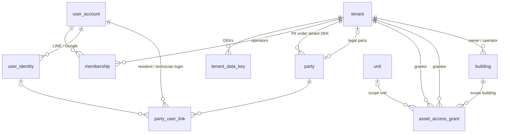

### 5.2 `core` — asset hierarchy, ownership, occupancy, meters, documents
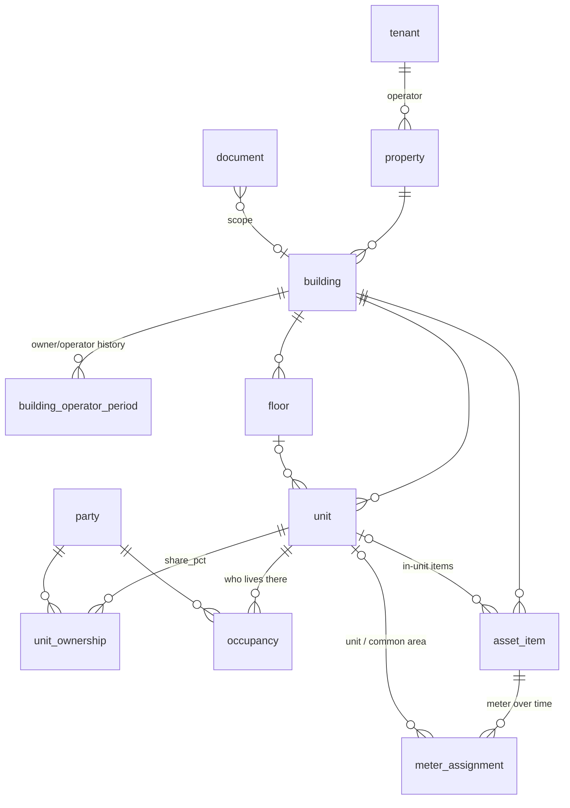

### 5.3 `platform` — settings, utility tariffs, identity & roles
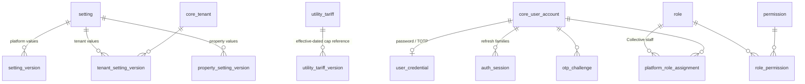

### 5.4 `platform` — tenant-side records, flags, audit, events
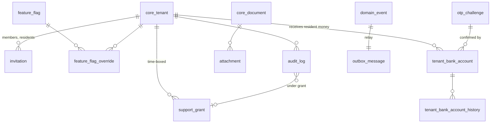

### 5.5 `platform` — notifications & privacy
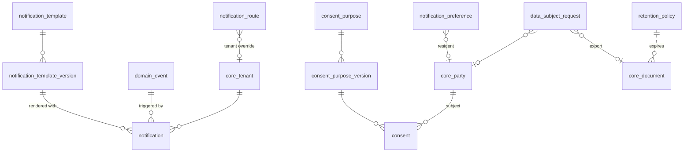

### 5.6 `platform` — compliance, subscriptions, platform AR, HaaS, AI usage
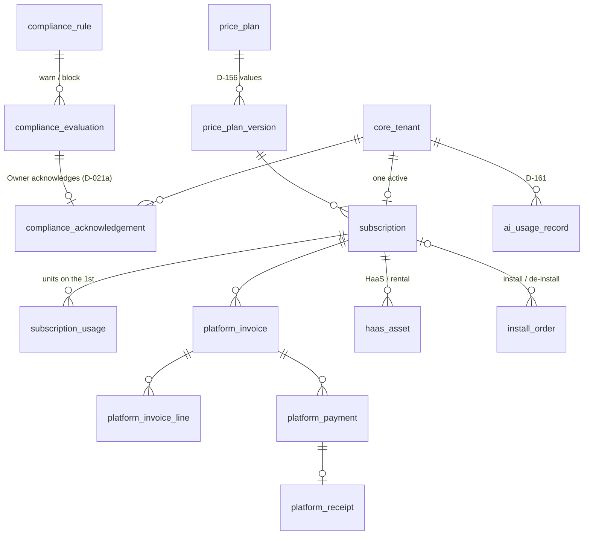

### 5.7 `ops` — workflow, leases, deposits, inspections
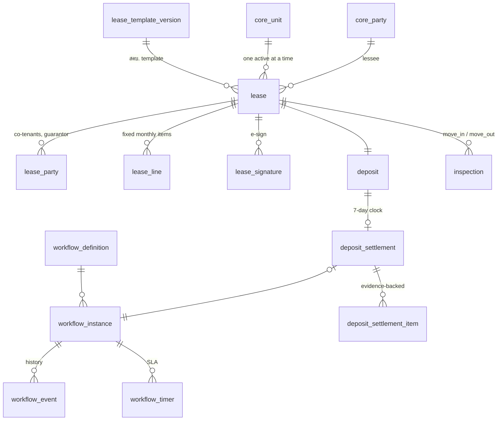

### 5.8 `ops` — rate plans, invoices, payments
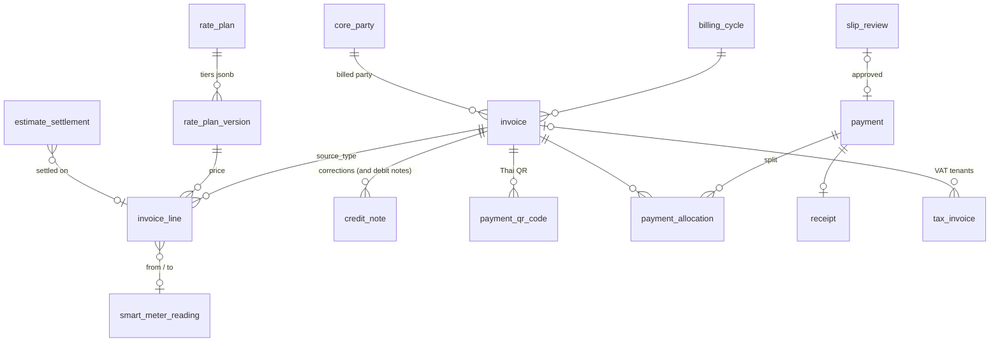

### 5.9 `ops` — receivables, numbering, utility loss
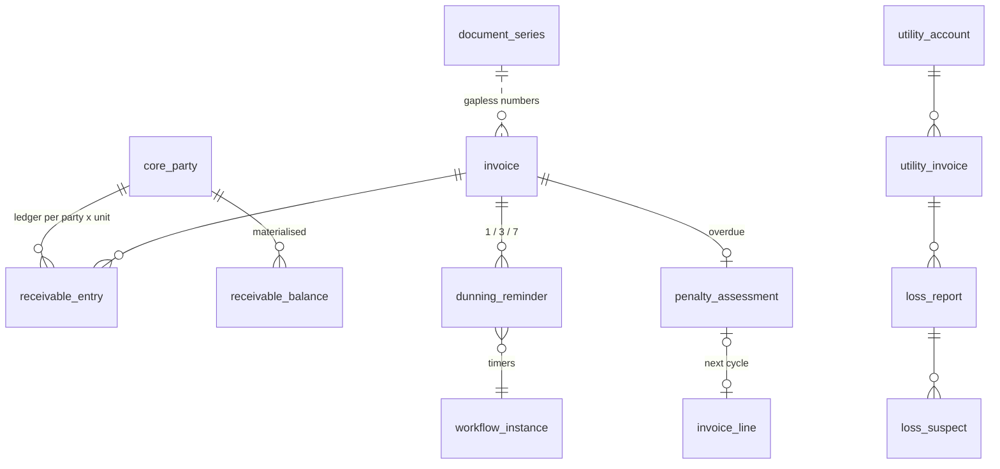

### 5.10 `ops` — service & community (R2)
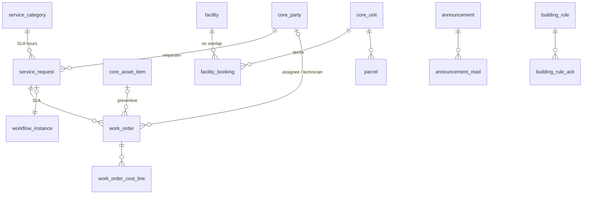

### 5.11 `smart` — devices, provisioning, channels, OTA
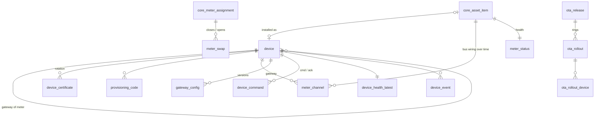

### 5.12 `smart` — readings, telemetry, access (R2)
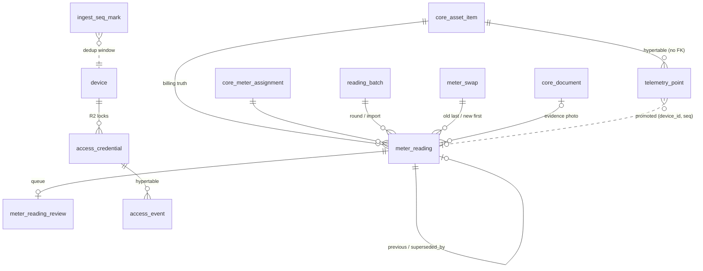

### 5.13 `bridge` — integration events
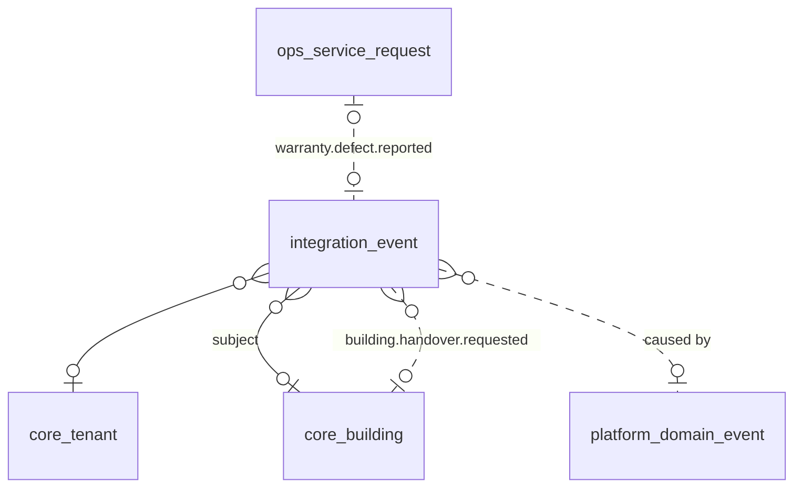

---

## 6. Decision → tables/columns coverage

| Decision | Data implication | Tables / columns | ⚖ placeholder until confirmed |
|---|---|---|---|
| D-001 | Platform company data for Collective's own documents | `platform.setting` keys `platform.company.*`; `ops.document_series.tenant_id null` series; `platform.platform_invoice` | — |
| D-002 | One DB (PG 18 + Timescale), contract-generated enums | every enum here is a named OpenAPI component; hypertables §4.3; repos now incl. `getproperty-liff` (D-154) | — |
| D-003 | No getpack tables copied | own schema; only platform *patterns* (idempotency, outbox, actor) reused | — |
| D-004 | Multi-tenant from day one — **naming superseded by D-151/D-152** (org → tenant) | `tenant_id` on every row, RLS (§4.5) | — |
| D-005 | th default, en; resident languages | `core.user_account.language`, `core.party.language` (th\|en\|my\|km\|lo\|zh), `*_template_version.language`, `name_th/name_en` on catalogues | — |
| D-010 | Target apartments 30–300 rooms — **scope widened by D-150**; solo-owner defaults stay | `core.tenant.type = apartment` default; `core.membership.module_scopes.buildingIds` for staff | — |
| D-011 | Zero-touch loop as event chain | `platform.domain_event` + `outbox_message`; subscribers: notifications, PDFs, receipts, reminders, integration events | — |
| D-012 | Reading sources, estimates flagged and settled | `smart.meter_reading.source` (`iot\|ocr\|manual\|estimated`), `confidence`, `estimate_basis`; `ops.invoice_line.is_estimated`; `ops.estimate_settlement` | — |
| D-013 | Hardware-agnostic drivers | `smart.device.driver`, `smart.meter_channel.bus_type/address/pin/litres_per_pulse/custom_register_map`, `smart.gateway_config.document` | — |
| D-014 | R1/R2/R3 scoping | §3 tables marked **R2** migrate in B5/B6.2; R3 (listing/booking) = D2 sketch | — |
| D-020 | Rules in code with settings and legal refs | `platform.compliance_rule` (legal_ref, default_severity, status), `compliance_evaluation`, `ops.lease_template_version.legal_ref/forbidden_clause_types`, settings for thresholds | ⚖ O-002: rules `pending_legal_verification` (D-149) |
| D-021 | Utility tariffs platform-maintained, versioned (lock **superseded by D-021a**) | `platform.utility_tariff`, `platform.utility_tariff_version` (structure, effective_from, source_url, verified_by, state) | seed `state = 'entered'`, `verified_by = null` |
| D-021a | Cap = warning + acknowledgement; `above_cap` flag on lines; admin may set `block` | `ops.rate_plan_version.cap_check/above_cap/compliance_acknowledgement_id`; `ops.invoice_line.cap_per_unit/above_cap/compliance_acknowledgement_id` + CKs; `ops.invoice.has_above_cap_line`; `platform.compliance_acknowledgement` (who, when, IP, values shown); setting `compliance.tariff_cap.severity` (platform + per-tenant override) | ⚖ legal wording (legal-reference §4) |
| D-022 | Per-utility line disclosure + raw readings as evidence | `ops.invoice_line.reading_from_id/reading_to_id/register_from/register_to/reading_source/units/unit_price/amount/utility_tariff_version_id`; `ops.invoice.snapshot.meters[]`; `smart.meter_reading.evidence_document_id` | — |
| D-023 | Deposit cap, 7-day settlement, evidence-backed deductions | `ops.lease.deposit_amount/advance_rent_amount`, setting `deposit.max_months`; `ops.deposit`, `ops.deposit_settlement.deadline_at/status/is_late/workflow_instance_id`, `ops.deposit_settlement_item.evidence_document_ids/wear_category CK`, `ops.inspection` | ⚖ O-002: `deposit.max_months_short = 3`, `deposit.refund_days = 7` seeded Proposed |
| D-024 | No cut-off / lockout for arrears; late fee only if allowed | no column links `smart.access_credential` → receivables; no breaker command (`smart.device_command.type` has none); `ops.penalty_assessment.allowed`, setting `late_fee.enabled = false`; rule `compliance.no_cutoff` | ⚖ O-002 |
| D-025 | PDPA: consent versions, encrypted IDs, retention, DSR, controller roles | `platform.consent_purpose(+version)`, `platform.consent`, `core.party.id_number_enc/_hash` (tenant DEK, §4.7), `core.document.retention_class`, `platform.retention_policy`, `platform.data_subject_request`, `pii.decrypted` audit, `core.party.anonymised_at` | DPA template = setting `privacy.dpa_template_version` (⚖) |
| D-030 | Cumulative registers; telemetry for insight only | `smart.meter_reading` (normal table) vs `smart.telemetry_point` ★; invoice lines FK only to `smart.meter_reading` | — |
| D-031 | Cut-off per property, ±2 h window, estimate policy | settings `billing.cutoff` (property scope), `readings.iot_window_minutes = 120`, `billing.grace_hours`, `estimate_policy`; `ops.billing_cycle.cut_off_at/readings_window_minutes/grace_deadline_at/estimate_policy`; `smart.reading_batch.kind = cycle_estimate` | — |
| D-032 | Utility loss per building per cycle, suspects | `ops.utility_account`, `ops.utility_invoice`, `ops.loss_report`, `ops.loss_suspect`, `smart.telemetry_15m`, `core.meter_assignment.purpose = common_area\|main` | — |
| D-033 | Device registry, states, QR provisioning, swaps keep history | `smart.device.status` (7 states), `smart.provisioning_code`, install reading (`smart.meter_reading.is_install`), `smart.meter_swap` closing/opening `core.meter_assignment` | — |
| D-034 | Stale/silent thresholds, heartbeat, auto-request | settings `health.*`; `smart.meter_status.health`; `smart.device_health` ★, `smart.device_health_latest.missed_heartbeats`; `smart.device_event` → `ops.service_request.source_device_event_id` (R2) | — |
| D-035 | OCR with monotonic + plausibility band, review queue | `smart.meter_reading.ocr_raw_value/ocr_confidence/typed_value/review_state`, `smart.meter_reading_review`, settings `readings.require_photo`, `readings.plausibility_band_pct = 60` | — |
| D-040 | Immutable invoices, snapshot, credit/debit notes | `ops.invoice.snapshot/snapshot_sha256`, trigger §4.9, `ops.credit_note`/`ops.debit_note`, invoice-line no-update trigger | — |
| D-041 | Line types with a compliance flag; pro-rata | `ops.invoice_line.source_type` (blueprint) + `line_kind` (D-041 detail), `ops.invoice_line_kind_rule`, `pro_rata`, `ops.lease_line` | — |
| D-042 | Thai QR per invoice via per-tenant adapter, idempotent webhooks, settlement reconcile, no funds held | `platform.tenant_bank_account.payment_provider/promptpay_*`, `ops.payment_qr_code`, `ops.payment.provider_ref UQ`, `ops.payment_settlement_file`, `ops.invoice.promptpay_ref/qr_*` | ⚖ O-001: `payment_provider` default `none`; provider flags off |
| D-043 | Slip fallback, duplicate check, review queue | `ops.slip_review` (`trans_ref UQ`, `duplicate_of_id`), setting `payments.allow_slip = true` | — |
| D-044 | Receipt on full payment, partial payments, series per tenant per year | `ops.receipt` (kind payment\|deposit\|advance), `ops.payment_allocation`, `ops.document_series(receipt)`, setting `payments.allow_partial` | — |
| D-045 | Reminders 1/3/7, aging, late fee only when allowed | `ops.dunning_reminder` + workflow timers, setting `reminders.schedule = [1,3,7]`, `ops.receivable_balance.aging/days_overdue`, `ops.penalty_assessment` | ⚖ O-002 |
| D-046 | Money numeric(14,2), quantities numeric(12,3), THB | §1.2 types; `CK(amount = round(amount, 2))`; `unit_price numeric(14,4)` | — |
| D-050 | Document types, gapless series per tenant/type/year; e-Tax adapter | `ops.document_series.doc_type` (13 values); numbered tables keep `number` + `document_id`; `ops.etax_submission` (R2) | ⚖ O-004: tax invoice types only when `core.tenant.vat_registered` |
| D-051 | No GL; income/expense, VAT figures, exports; WHT as deduction | `ops.export_job.kind`, `ops.payment.wht_amount`, `ops.work_order_cost_line` + `ops.utility_invoice` as expenses | — |
| D-052 | TM30 data pack | `core.party.nationality/id_document_type/id_number_enc/date_of_birth/gender`, `ops.occupant_profile.visa_type/arrival_date`, `ops.tm30_export` (R2) | — |
| D-060 | LIFF-first (now `getproperty-liff`, D-154), magic-link fallback | `core.user_identity(provider = line\|line_liff)`, `platform.otp_challenge.purpose = resident_login`, audience `resident` in `platform.auth_session` | — |
| D-061 | Invite → link → consent → sign; one LINE account many units | `platform.invitation.kind = lease_resident`, `core.party_user_link` (one user ↔ many parties across tenants), `platform.consent`, `ops.lease_signature` | — |
| D-062 | e-signature evidence | `ops.lease_signature.method/otp_challenge_id/line_user_id/signature_image_document_id/signed_pdf_document_id/pdf_sha256/ip/user_agent`, `ops.lease.contract_sha256` | ⚖ counsel: `scan_upload` fallback kept |
| D-063 | Residents see invoices, receipts, daily usage, notices, docs, consent | `ops.invoice` by `billed_party_id`/lease; `ops.receipt`; `smart.telemetry_1d` by the lease unit's meter assignments; `ops.lease.notice_*`; `platform.consent` | — |
| D-064 | Languages | `core.party.language` 6 values; `platform.notification_template_version.language`; `ops.announcement.translations` (R2) | — |
| D-070 | Locks as devices, credentials, access log visible to the resident | `core.asset_item.category = lock` + `smart.device.kind = lock`, `smart.access_credential`, `smart.access_event` ★ (R2) | — |
| D-071 | Access follows the lease | `smart.access_credential.lease_id` required for residents; revoke on `lease.ended/terminated`; no link to billing | — |
| D-072 | Service requests, SLA per category, auto-requests | `ops.service_category.default_sla_hours`, `ops.service_request.workflow_instance_id/source_device_event_id`, `ops.work_order`, `ops.work_order_cost_line` (R2) | — |
| D-073 | Announcements with read receipts, parcels, rules, contacts | `ops.announcement(+read)`, `ops.parcel`, `ops.building_rule(+ack)`, `ops.contact`, + `ops.facility(+booking)` (blueprint) (R2) | — |
| D-080 | Pricing — **superseded by D-156** | (see D-156) | — |
| D-081 | HaaS asset register | `platform.haas_asset(+event)`, `smart.device.ownership = platform_haas`, `platform.install_order.kind = deinstall` | — |
| D-082 | Subscription lifecycle, read-only suspension, unit counting | `platform.subscription.state`, `core.tenant.status = read_only`, `platform.subscription_usage.units_counted` (units ≠ inactive on the 1st), setting `subscription.trial_days = 30` | — |
| D-083 | Pilot agreement, KPIs | `platform.pilot_agreement`, `platform.subscription.discount_pct/pilot_agreement_id`, `platform.kpi_snapshot` | — |
| D-090 | Tenant roles, platform roles, support grants | `platform.role` (8 seeded), `core.membership.role/module_scopes`, `platform.platform_role_assignment`, `platform.support_grant`, `platform.audit_log.support_grant_id` | — |
| D-091 | Permission catalogue, maker-checker | `platform.permission`, `platform.role_permission`; `platform.tenant_bank_account.confirmed_by_otp_id` + CK; `platform.platform_credit_note` CK; `platform.utility_tariff_version` CK | — |
| D-100 | Design — no data | `core.tenant.logo_document_id` only | — |
| D-130 | Envelope, dedup `(meterId, seq)`, clock_suspect | `smart.telemetry_point` columns = `Reading` DTO; `smart.meter_reading.seq/quality`; `smart.ingest_seq_mark`; `smart.device.last_seq/mqtt_client_id`; `smart.device_certificate` | — |
| D-131 | Config push, applied version, OTA rings | `smart.gateway_config`, `smart.device.config_applied_version/ota_ring`, `smart.device_event` config types, `smart.ota_release/rollout/rollout_device` | — |
| D-132 | Gateway hardware baseline | `smart.device.hardware_rev/model/firmware_version`, `smart.device_health.link/rssi/disk_free_mb` | ⚖ O-003: model/driver free text |
| D-140 | Cap basis = effective average rate; service charge folded in | `platform.utility_tariff_version.cap_basis = effective_average_rate`, `ops.invoice_line.cap_per_unit`, §4.2.1 formula; no service-charge line kind | ⚖ |
| D-141 | Water minimum ≤ utility minimum | `ops.rate_plan_version.minimum_charge`, `ops.lease_line.kind = water_minimum`, `utility_tariff_version.structure.minimumCharge`, rule `compliance.water_minimum` | — |
| D-142 | Reading corrections supersede; UQ stays | `smart.meter_reading.superseded_by_reading_id`, `UQ(asset_item_id, read_at, source)` | — |
| D-143 | Dedup = seq marks + watermark + UQ | `smart.ingest_seq_mark`, `smart.device.last_seq`, `smart.meter_reading UQ(device_id, seq)` | — |
| D-144 | One settings catalogue with `scope_allowed` | `platform.setting.scope_allowed`, `platform.tenant_setting_version`, `platform.property_setting_version` | — |
| D-145 | One invitations table with `kind` | `platform.invitation.kind` (`tenant_member`, `lease_resident` — renamed values of `org_member`, `tenant_lease`) | — |
| D-146 | Platform document series with NULL tenant | `ops.document_series.tenant_id null`, UQ on `coalesce` | — |
| D-147 | No native partitioning in R1 | `platform.audit_log`, `smart.device_event`, `platform.compliance_evaluation` plain + indexes | — |
| D-148 | Phones clear + hash; ID numbers encrypted | `core.user_account.phone_e164/phone_hash`, `core.party.phone_e164/phone_hash`, `core.party.id_number_enc/_hash` (tenant DEK) | — |
| D-149 | Legal reference file; rules seeded pending | `platform.compliance_rule.legal_ref/status = pending_legal_verification` | ⚖ legal review |
| D-150 | Building Operations platform, 4 tenant types, groups A–D, Phase 1 = A | `core.tenant.type`; schemas §1.4; group B–D sketches §3.7 | — |
| D-151 | Naming: tenant, party, resident, property/building/floor/unit, asset_item, meter_assignment, invoice/invoice_line.source_type, rate_plan, utility_tariff_version, service_request/work_order, workflow | the whole of §3; rename map §8 | — |
| D-152 | One DB, six schemas, uuidv7 ids, tenant_id + audit columns, RLS on `app.tenant_id`, grants | §1.2, §1.4, §4.5; `core.asset_access_grant` | — |
| D-153 | `collective-asset-core` owns `core`, contracts, grant rules | §3.1, §7.1; `bridge.integration_event.contract_version`; `core.asset_access_grant.modules` (package rule set) | — |
| D-154 | `getproperty-liff` repo for residents/technicians/landlords | audiences `resident`, `technician` (`platform.auth_session.audience`), `platform.otp_challenge.purpose` | — |
| D-155 | `collective-shared` later | no schema impact; workflow tables kept product-neutral for extraction | — |
| D-156 | Pricing per blueprint (Proposed) | `platform.price_plan(+version)` (billing_unit, tiers, min_units, annual discount, allowances), `platform.subscription_usage.units_counted/meter_points_counted`, `platform.platform_invoice_line.kind` | values seeded as Proposed versions |
| D-157 | Prepaid/cut-off out of scope; breakers modelled as assets | `core.asset_category = breaker`, `smart.device_kind = breaker`; no command type | — |
| D-158 | สคบ. scope ≥ 3 units | setting `tenant.subject_to_ocpb_2568` (default true for apartment/landlord); legal-reference §1 | — |
| D-159 | Workflow engine | `ops.workflow_definition/instance/event/timer`; `workflow_instance_id` on deposit settlement, service request, work order, dunning | — |
| ~~D-160~~ D-230, D-233 | ~~GCP~~ Collective AWS platform deployment (locked infrastructure decisions 2026-10-21) | no table; KMS key refs in `core.tenant_data_key.kek_ref`; storage keys in `core.document.storage_bucket` (S3 bucket) | TimescaleDB available — hypertables + compression in prod (D-234) |
| D-234 | Telemetry on TimescaleDB (supersedes D-162) | `smart.telemetry_point` (prod: hypertable, compressed after 30 days, platform-only), `smart.device_health_sample` (hypertable), rollups unchanged | optional migration step 2 = blueprint T-12, UNVERIFIED |
| D-235 – D-238 | EMQX HTTP authn/authz, `pdf-render`, AI workers placement, outbox → webhook | no table change; `smart.mqtt_acl` stays the source of the authz endpoint; `bridge.integration_event` unchanged | — |
| D-161 | Admin: onboarding, IoT inventory, support, AI usage cost | `platform.ai_usage_record`, `platform.price_plan_version.included_allowances`, `platform_invoice_line.kind = ai_overage`; inventory = `smart.device.tenant_id null` | allowance values Proposed |
| O-001 | Payment provider | `platform.payment_provider` enum `kbank\|scb\|opn\|none`; `tenant_bank_account.payment_provider` default `none` | ⚖ flags decide |
| O-002 | สคบ. values | settings `deposit.*`, `late_fee.enabled`, `estimate_policy`; `platform.compliance_rule.status` | ⚖ Proposed values; rules pending |
| O-003 | Pilot meter/gateway models | `smart.device.model/driver`, `smart.meter_channel.bus_type` | ⚖ free text |
| O-004 | Pilot VAT | `core.tenant.vat_registered`, `ops.invoice.vat_amount`, `ops.tax_invoice`, `export_kind = vat_pp30` | ⚖ default false |
| ~~O-005~~ | TimescaleDB on GCP — resolved by D-162 / D-230 | `smart.telemetry_point`, `smart.device_health`, `smart.access_event`, `platform.analytics_fact`, continuous aggregates | ⚖ fallback = native partitions + rollup tables (§4.3) |

Every D-### and O-### in `decisions.md` appears above; D-003, D-100, D-155 and D-160 have no tables of their own and say so.

---

## 7. Migration plan & open questions

### 7.1 `collective-asset-core` v0.1.0 (separate repository, ADR-0010) — B1.2 step 2a
| Migration | Content |
|---|---|
| `0001_extensions_helpers` | schema `core`; extensions `pgcrypto`, `citext`, `btree_gist`, `pg_trgm`; `uuidv7()` guard (PG < 18); roles `gp_owner`, `gp_app`, `gp_platform`, `gp_reporting` (created if missing) and default privileges; trigger functions `core.set_updated_at()`, `core.deny_mutation()`, `core.close_previous_period()`; `core.current_tenant_id()` |
| `0002_enums` | `tenant_type`, `tenant_legal_form`, `tenant_status`, `data_key_state`, `membership_status`, `user_status`, `identity_provider`, `property_status`, `building_type`, `building_status`, `operator_change_reason`, `unit_type`, `unit_status`, `party_type`, `id_document_type`, `party_link_state`, `ownership_source`, `occupancy_role`, `asset_category`, `asset_status`, `meter_purpose`, `utility`, `meter_close_reason`, `document_scope`, `document_kind`, `document_scan_status`, `document_upload_state`, `grant_scope`, `grant_access`, `grant_reason` |
| `0003_tenancy_identity` | `core.tenant`, `core.tenant_data_key`, `core.user_account`, `core.user_identity`, `core.membership` |
| `0004_assets` | `core.property`, `core.building`, `core.building_operator_period`, `core.floor`, `core.unit` |
| `0005_parties` | `core.party`, `core.party_user_link`, `core.unit_ownership`, `core.occupancy`; deferred FK `core.tenant.legal_party_id` |
| `0006_asset_items_documents` | `core.asset_item`, `core.meter_assignment`, `core.document`; FKs `core.tenant.logo_document_id`, `core.floor.plan_document_id` |
| `0007_grants_rls` | `core.asset_access_grant`; functions `core.accessible_building_ids()`, `core.accessible_unit_ids()`, `core.acts_for()`, `core.tenant_dek()`; `ENABLE`/`FORCE` RLS and policies on every core table; grants to `gp_app` / `gp_platform` / `gp_reporting` |
| package contents | `prisma/core.prisma` (`@@schema("core")`), zod contracts (8 event types + envelope), grant rule set (module keys), TS enum constants, `assetCoreMigrate()`; tests: RLS matrix, exclusion constraints, enum parity |

**v0.1.0 = 18 tables:** `tenant`, `tenant_data_key`, `membership`, `user_account`, `user_identity`, `property`, `building`, `building_operator_period`, `floor`, `unit`, `party`, `party_user_link`, `unit_ownership`, `occupancy`, `asset_item`, `meter_assignment`, `document`, `asset_access_grant`.

### 7.2 getproperty-api B1.2 step 2b (after installing `collective-asset-core@0.1.0`)
The unreviewed v1 SQL files in `prisma/migrations/` (2026-10-16, v1 names, never applied to any database) are **replaced**, not edited — B1.2 step 2b starts the migration history from the files below.
| Migration (Prisma + raw SQL tail) | Tables / objects |
|---|---|
| `0001_app_schemas` | schemas `platform`, `ops`, `smart`, `bridge`, `juristic` with owner/default privileges; extension `timescaledb` created **if available** (O-005; the embedded local cluster has none) |
| `0002_platform_config` | `platform.setting`, `setting_version`, `tenant_setting_version`, `property_setting_version`, `feature_flag`, `feature_flag_override`, `utility_tariff`, `utility_tariff_version`, `business_calendar` |
| `0003_platform_identity` | `platform.user_credential`, `auth_session`, `otp_challenge`, `role`, `permission`, `role_permission`, `platform_role_assignment`, `support_grant`, `invitation` (`lease_id` without FK until B2.3), `tenant_bank_account`, `tenant_bank_account_history` |
| `0004_platform_audit_events` | `platform.attachment`, `audit_log`, `domain_event`, `outbox_message`, `idempotency_key` |
| `0005_platform_notifications_privacy` | `platform.notification_template`, `notification_template_version`, `notification_route`, `notification_preference`, `notification`, `web_push_subscription`, `consent_purpose`, `consent_purpose_version`, `consent`, `data_subject_request`, `retention_policy`, view `platform.v_consent_state` |
| `0006_platform_compliance` | `platform.compliance_rule`, `compliance_evaluation`, `compliance_acknowledgement` (`compliance_score` waits for B4.1) |
| `0007_ops_workflow_numbering` | `ops.workflow_definition`, `workflow_instance`, `workflow_event`, `workflow_timer`, `ops.document_series` |
| `0008_bridge` | `bridge.integration_event` |
| `0009_rls` | `ENABLE`/`FORCE` RLS + policies on every table above (helper `platform.apply_rls(table, kind, module)` reused by later migrations); grants to `gp_app` / `gp_platform` / `gp_reporting` |
| seeds (step 3) | roles/permissions, settings + versions with D-### descriptions (incl. D-021a severity, D-158 scope, D-156 price plans as Proposed in B6.1), utility tariff versions (MEA/PEA 1.1/1.2 + Ft, MWA/PWA residential), compliance rules (pending), workflow definitions, notification template skeletons, consent purposes, Thai holidays 2026–2027; dev seed: tenant "หอพักตัวอย่าง" (`apartment`) with its legal party, property, building (owner = operator), 2 floors × 6 units, meter asset items + assignments, users |

**B1.2 step 2b creates 45 tables**: `platform` 39 (9 + 11 + 5 + 11 + 3 by migration), `ops` 5 (workflow ×4 + `document_series`), `bridge` 1 — plus the view `platform.v_consent_state` and the empty `smart` and `juristic` schemas.

### 7.3 Later deliverables
| Deliverable | Tables |
|---|---|
| B2.1 | `ops.unit_profile`, `ops.unit_detail` (`current_lease_id` without FK until B2.3), `ops.utility_account` |
| B2.2 | `ops.occupant_profile` |
| B2.3 | `ops.lease_template(+version)`, `ops.lease`, `ops.lease_party`, `ops.lease_line`, `ops.lease_signature`, `ops.lease_event`; FKs `platform.invitation.lease_id`, `ops.unit_detail.current_lease_id` |
| B2.4 | `ops.deposit`, `ops.deposit_settlement`, `ops.deposit_settlement_item`, `ops.inspection_template`, `ops.inspection`, `ops.inspection_item` (`deposit.received_payment_id`/`receipt_id` and `settlement.final_invoice_id` without FK until B4) |
| B3.1 | `smart.device`, `device_certificate`, `provisioning_code`, `meter_channel`, `gateway_config`, `meter_swap` (reading FKs in B3.3), `ota_release`, `ota_rollout`, `ota_rollout_device`, `device_command`, `meter_status` |
| B3.2 | `smart.telemetry_point` ★ + `telemetry_15m/1h/1d`, `ingest_seq_mark`, `device_health` ★, `device_health_latest`, `device_event` |
| B3.3 | `smart.reading_batch`, `smart.meter_reading` (+ monotonicity trigger), `smart.meter_reading_review`; FKs from `meter_swap`, `meter_status` |
| B3.4 | `ops.utility_invoice`, `ops.loss_report` (`billing_cycle_id` FK when B4.2 has landed), `ops.loss_suspect` |
| B4.1 | `platform.compliance_score` |
| B4.2 | `ops.rate_plan`, `ops.rate_plan_version`, `ops.billing_cycle`, `ops.invoice` (+ trigger), `ops.invoice_line` (+ trigger), `ops.invoice_line_kind_rule`, `ops.credit_note(+line)`, `ops.debit_note(+line)`, `ops.estimate_settlement`; FKs `ops.lease.power_rate_plan_id/water_rate_plan_id` |
| B4.3 | `ops.export_job` (series already in B1.2) |
| B4.4 | `ops.payment_qr_code`, `ops.payment`, `ops.payment_allocation`, `ops.slip_review`, `ops.payment_settlement_file`, `ops.receipt`, `ops.tax_invoice`; FKs from `ops.deposit` |
| B4.5 | `ops.receivable_entry`, `ops.receivable_balance`, `ops.dunning_reminder`, `ops.penalty_assessment` |
| B5.1 (R2) | `ops.service_category`, `ops.service_request`, `ops.work_order`, `ops.work_order_cost_line` |
| B5.2 (R2) | `smart.access_credential`, `smart.access_event` ★ |
| B5.3 (R2) | `ops.announcement(+read)`, `ops.parcel`, `ops.facility`, `ops.facility_booking`, `ops.building_rule(+ack)`, `ops.contact` |
| B5.4 (R2) | view `ops.staff_task` |
| B6.1 | `platform.price_plan(+version)`, `subscription(+event)`, `subscription_usage`, `platform_invoice(+line)`, `platform_payment`, `platform_receipt`, `platform_credit_note`, `haas_asset(+event)`, `pilot_agreement`, `site_survey_request`, `install_order`; FK `haas_asset.device_id` |
| B6.2 (R2) | `ops.etax_submission`, `ops.tm30_export` |
| B6.3 | `platform.analytics_fact` ★, `analytics_rollup`, `kpi_snapshot`, `benchmark_bucket`, `csat_response` (KPI snapshot in R1) |
| B6.4 | `platform.ai_usage_record` |
| Phase 2–4 | §3.7 sketches; `juristic` tables; `core` additions only through new `collective-asset-core` minor versions |

Forward references across deliverables use **nullable columns without FK** at creation and `ALTER TABLE … ADD CONSTRAINT … NOT VALID; VALIDATE CONSTRAINT` in the later migration, so each deliverable's migration is self-contained and the Prisma drift check stays green. Every migration that creates a tenant table also applies its RLS policy in the same migration.

### 7.4 Open questions for the reviewer (max 10)
1. **Singular table names** — the blueprint uses singular names (`tenant`, `invoice_line`); v1 used plural. v2 adopts singular everywhere for one convention across `collective-asset-core` and getbuild. Confirm before the package is published (renaming later is a major version).
2. **uuidv7 primary keys only** (D-152) — v1's `bigint` + `public_id` pair is dropped. Index size grows (~2× per key) but ids travel between products unchanged. Confirm, or keep bigint internally in app schemas only (not recommended: two id styles).
3. **`invoice_line.source_type` adds `adjustment`** to the blueprint's seven values (prior-balance carry-over, discounts, rounding). Alternative: map prior balance to `rent` and discounts to `service` (misleading in reports). Proposed: add `adjustment`.
4. **`core.meter_assignment` in the package** — the blueprint lists it among Phase 1 tables but not in the asset-core table list. Proposed in `core` because Lite (manual) meters need it without any `smart` row and getbuild hand-overs can carry meter positions. Readings stay in `smart`.
5. **RLS on hypertables** (`smart.telemetry_point`, `device_health`, `access_event`, `platform.analytics_fact`) — compatibility of RLS with compression and continuous aggregates must be proven on the chosen TimescaleDB build in B3.2; if not, those tables are read only through repositories (building filter) and by `gp_platform` jobs, documented as an exception.
6. **`tenant_id` on rows written for another tenant** — a PM company writing a juristic's invoices stamps `tenant_id = owner` (the legal issuer) via `core.acts_for`; a landlord stamps its own `tenant_id` in someone else's building. Confirm the "legal party owns the row" rule (affects document numbering series and exports).
7. **`core.user_account` RLS = platform-only** — identity lookups (login by phone/LINE) run as `gp_platform`; operators see users only through `core.membership` joins exposed by services. Alternative: a policy exposing users who share a tenant (heavier). Proposed: platform-only.
8. **Billing cycle per property** (v1 behaviour) while loss reports, rate plans and utility accounts are per building — keeps one cut-off for a two-tower apartment. Confirm, or move cycles to buildings.
9. **`ops.receivable_balance` per (party, unit)** instead of per lease — needed for condo co-owners and landlords paying common fees; apartments get the same numbers (one lessee per unit). Confirm.
10. **v1 migration files** in `prisma/migrations/` are superseded and must not be applied; B1.2 step 2b deletes them and starts the history from §7.2 (they were never applied anywhere).

### 7.5 Implementation notes — B1.2 step 2, B1.3, B2, B3 and B4 (2026-10-17, v2.4)
Applied by `collective-asset-core` v0.1.0 and getproperty-api migrations 0001–0009 (B3: 0015–0018). The founder accepted every §7.4
proposal (singular names, uuidv7-only ids, `adjustment` source type, `meter_assignment` in core, RLS on hypertables
verified in B3.2, owner-stamped rows via `acts_for`, platform-only `user_account`, cycles per property, receivables per
(party, unit), v1 files archived). Deviations from §3/§4 made while migrating (this section is the PR to the design):

| # | Where | Change | Why |
|---|---|---|---|
| 1 | all tables | `created_by`/`updated_by` (and `deleted_by`, `revoked_by`, …) are logical references **without FK** to `core.user_account` | system/device actors, PDPA erasure of users, no hot-row FK locks, no 100+ Prisma back-relations; real FKs remain where §3 names a relation (`membership.user_id`, `support_grant.requested_by`, `compliance_acknowledgement.acknowledged_by`, …) |
| 2 | `platform.audit_log` | new column `actor_id uuid null` (= `actor.id` for user/device actors) indexed `(actor_id, occurred_at)` instead of the expression index on `actor->>'id'` | Prisma cannot model expression indexes (ADR-0011); same lookup |
| 3 | `notification_route`, `workflow_definition`, `document_series` | `UNIQUE … NULLS NOT DISTINCT (tenant_id, …)` instead of `UQ(coalesce(tenant_id, '0…0'), …)` | same semantics (PG 15+), representable in Prisma |
| 4 | `platform.utility_tariff_version` | + `needs_check bool` (true while any value awaits confirmation; `structure.needsCheck` lists the JSON paths); maker-checker CHECK written `verified_by IS NULL OR entered_by IS NULL OR verified_by <> entered_by` (the §3 form rejected unverified rows); verified/published rows need `verified_by`, `verified_at` and `needs_check = false`; `entered_by` nullable (seeded rows) | O-006, "never invent precision" |
| 5 | settings | the no-backdating CHECK also on `tenant_setting_version` and `property_setting_version`; `property_setting_version.tenant_id` is an FK + index | ADR-0004 applies to every scope |
| 6 | `bridge.integration_event` | `ack_due_at` default `now() + 24 h`, recomputed from `occurred_at` by a BEFORE trigger; status must match direction (CHECK); `event_type` limited to the eight contract types | §3.5 rule "ack within 24 h" |
| 7 | RLS (§4.5) | helper `platform.apply_rls(table, kind, module)` with kinds `tenant`, `tenant_or_shared`, `building`, `unit`, `platform`, `platform_only`; outbox: gp_app may INSERT/SELECT rows whose event it can see (relay = gp_platform); `idempotency_key`: open policy (scope = actor); `notification_preference`/`web_push_subscription`: tenant rows + the user's own rows (`app.actor_id`); `user_credential`, `auth_session`, `otp_challenge`: gp_platform only; `workflow_instance` uses module key `ops.workflow` (never grantable except `*`), events/timers inherit via the instance; catalogue tables are read-only for gp_app (grants) | concrete policies for the generic rules |
| 8 | core RLS | `user_account`/`user_identity`: a user reads its own row (`core.current_actor_id()`); `tenant_data_key` invisible to gp_app (only `core.tenant_dek()`); grant module key `core.occupancy` added, occupancy also visible to `ops.lease` grants; `property` readable when one of its buildings is; helpers `accessible_property_ids()`, `owns_or_operates()` (only an owner/operator may grant), `can_see_building()`; SECURITY DEFINER helpers owned by `gp_platform` | ADR-0010 package |
| 9 | append-only | `core.deny_mutation(col)` allows the single close of an open period/version (`valid_to`/`effective_to`); TRUNCATE is refused on audit/event/consent/compliance logs | §4.1 + §4.9 |
| 10 | names | `compliance_ack_tenant_id_rule_id_acknowledged_at_idx`, `property_setting_version_property_setting_from_key`, `notification_tenant_recipient_created_at_idx` (Prisma's default names exceed 63 bytes) | PostgreSQL identifier limit |
| 11 | `platform.compliance_rule` | + `created_at`/`updated_at`; `applies_to` values also `tenant`, `notice` | rules `compliance.scope`, notice rules |
| 12 | `platform.retention_policy.retain_for` | stays `interval` (Prisma `Unsupported("interval")`, written with SQL) | §3.2.7 |
| 13 | `ops.workflow_instance`, `platform.notification` | + `created_at`/`updated_at` | audit columns everywhere (§1.2) |
| 14 | 0001 | no `timescaledb` extension | D-162 |
| 15 | integration envelope (§4.8) | fields `eventId, type, version (int), occurredAt, idempotencyKey, sourcePlatform, tenantId, correlationId?, causationId?, payload`; `contract_version` column = package semver | B1.2 session spec |
| 16 | many tables | extra CHECKs (E.164 phones, language codes, period ranges, state ↔ timestamp consistency, `document_series` platform types ↔ `tenant_id` null) | defence in depth |
| 17 | `smart.device`, `smart.device_certificate`, `smart.provisioning_code` (B1.3, migration 0010) | migrated in B1.3 instead of B3.1 (device bootstrap is a B1.3 deliverable); `device_certificate` + `certificate_pem`, RLS `platform_only` (stricter than §4.5 P); `provisioning_code.tenant_id`/`building_id` NOT NULL, `code_hash` unique (HMAC) | D-165 |
| 18 | `smart.mqtt_acl` (new, B1.3) | `(device_id, tenant_id, username, permission allow|deny, action publish|subscribe|all, topic LIKE 'gp/v1/%', revoked_at)`, partial UQ `(username, action, topic) WHERE revoked_at IS NULL`; read by new role `gp_mqtt` (EMQX PostgreSQL authorizer) | D-165, D-130 |
| 19 | `platform.event_consumption` (new, B1.3) | inbox per `(event_id, subscriber)` UQ: `state processed|failed|dead`, `attempts`, `last_error`, `first_attempt_at`, `processed_at`, `replayed_at/by` | D-166 exactly-once subscribers |
| 20 | `platform.auth_session.device_id` | FK to `smart.device` + index (device sessions) | D-165 |
| 21 | `core` 0.2.0 / 0.2.1 (asset-core) | `party_link_via.phone_match` + cross-tenant party lookup indexes (0008); fix of the `access` argument of `core.accessible_building_ids/unit_ids` shadowed by the grant column (0009) | D-061, D-152 |
| 22 | `ops.unit_profile` (B2.1, migration 0011) | + `default_advance_rent_months numeric(3,1) default 1` next to `default_deposit_months`; CHECKs on name length, rent rounding, months ≥ 0, `default_lease_lines` is an array; `inspection_template_id` without FK until B2.4 | new leases propose deposit **and** advance rent from the room type (both are capped together, D-023) |
| 23 | `ops.unit_detail` (B2.1) | RLS kind `unit` with module `ops.lease` (a landlord with a unit grant sees its unit's detail); `current_lease_id` without FK until B2.3 | §3.3.2 `RLS: U(ops.lease)` made concrete |
| 24 | `ops.utility_account` (B2.1) | CHECK utility ↔ provider (`electric` → mea/pea, `water` → mwa/pwa) and customer number format | defence in depth |
| 25 | `core` 0.3.0 (asset-core, B2) | `document_kind.signature`; partial index `occupancy_lease_id_idx` | e-signature evidence (D-062), occupancies per lease |
| 26 | `ops.occupant_profile` (B2.2, migration 0012) | + `occupation text` (TM30 / tenant screening field kept with the resident, not on the party); CHECKs on country code and lengths | the TM30 data pack (D-052) and the contract annex use it |
| 27 | `ops.lease*` (B2.3, migration 0013) | `lease_template_version` + `tenant_id` (RLS without a join) and its `state` reuses `platform.template_version_state`; published versions are immutable (trigger); `ops.lease` + lifecycle columns `sent_for_signature_at`, `activated_at`, `ended_at`, `cancelled_at`, `cancel_reason`, `contract_document_id` (the unsigned PDF residents sign; `signed_document_id` = the countersigned version), `notice_evidence_document_ids uuid[]`, `termination_evidence_document_ids uuid[]`; exclusion `lease_no_overlap` on `(unit_id, daterange(start_date, end_date, '[]'))` for `active/notice_given/ending`; `lease_signature` UQ … `NULLS NOT DISTINCT` (instead of coalesce); `lease_event` append-only incl. TRUNCATE; child tables (`lease_party`, `lease_line`, `lease_signature`, `lease_event`) carry `tenant_id` and RLS through their lease; FKs `platform.invitation.lease_id` and `ops.unit_detail.current_lease_id` added | D-062, D-173, D-174 |
| 28 | activation (B2.3) | occupancies, unit status and current lease are written by the countersignature transaction, not by a subscriber (§3.3.3 comment) | D-173 |
| 29 | `ops.inspection*`, `ops.deposit*` (B2.4, migration 0014) | `inspection_template.tenant_id` nullable (platform default checklist, RLS `tenant_or_shared` instead of T); `inspection_item` + `area`, `photo_document_ids uuid[]`, `sort_order`, `condition` nullable until inspected, CHECK meter register ⇒ meter asset item; partial UQ `(lease_id, type)` for move-in/move-out; `deposit` + `unit_id` (RLS U needs it), `receipt_number`/`receipt_document_id`/`receipt_reference` (receipt before B4.3), `carried_from_deposit_id` (renewals), `received_payment_id`/`receipt_id` without FK until B4.3/B4.4; `deposit_settlement` + `unit_id`, `lease_id`, `move_out_at`, `late_flagged_at`, `is_late` a **plain boolean** set by the SLA breach or a late refund (a generated column could not record the breach of an unpaid settlement), `final_invoice_id` without FK until B4; CHECKs: transfer refund ⇒ slip, refunded ⇒ amount/method/time, response ⇔ time; `deposit_settlement_item` CHECK damage/missing ⇒ inspection item + ≥ 1 evidence; FK `unit_profile.inspection_template_id`; children RLS through their parent | D-023, D-177, D-178 |
| 30 | workflow engine (B2.4) | `SlaPolicy.remindBefore` (ISO durations → `reminder` timers → `workflow.sla_reminder`); `start(… clockStart)` lets an instance clock start before it is created (move-out recorded after the fact); `deposit_settlement` v2 | D-159, D-177 |
| 31 | `smart.device` (B3.1, migration 0015) | + `arch` (`arm64\|x64\|armv7`, from the bootstrap hardware; OTA targets by architecture) and `bus_config jsonb[]` (configured buses; protocol defaults otherwise); inventory CHECK relaxed to `status IN (inventory, retired) OR tenant_id IS NOT NULL` (an inventory device can be retired) | D-183 |
| 32 | `smart.meter_channel` (0015) | channel = meter asset item ↔ meter device ↔ gateway bus wiring with `valid_from/to`; gist exclusions: one open channel per meter, per meter device, per `(gateway, bus, address)` and per `(gateway, bus, pin)`; CHECKs wiring per bus type, `register_map = custom` ⇔ `custom_register_map`, closing needs `unbound_reason` | D-131, CR-005 |
| 33 | `smart.gateway_config` (0015) | + `document_sha256` (content hash without the version — unchanged content is never re-published), `rejected_at`/`reject_error`, `drift_flagged_at`; CHECK `document.version = version` | D-183 |
| 34 | `smart.meter_swap` (0015/0017) | UQ on `old_assignment_id` and on `new_assignment_id`; `old_last_reading_id`/`new_first_reading_id` FKs added in 0017 (after `meter_reading` exists) | D-033 |
| 35 | `smart.ota_release`, `ota_rollout`, `ota_rollout_device`, `device_command` (0015) | release UQ `(version, arch)`, the signed `manifest jsonb` + `signature_key_id`/`signature`; `ota_channel` + `canary`; rollout `max_failures_pct`; rollout device ↔ its `ota_apply` command; command `tenant_id`/`building_id` nullable (platform commands), `attempts`, `ttl_s`, `expires_at`, CHECK finished ⇔ done/failed | D-131, D-183 |
| 36 | `smart.meter_status` (0015) | one row per meter asset item: `health` (`ok\|stale\|silent\|no_device\|unknown`), `health_changed_at`, `last_telemetry_at`, `last_reading_at`/`last_reading_id` | D-034, D-188 |
| 37 | telemetry (0016) | **native monthly range partitions instead of hypertables** (D-162/D-184; baseline kept by D-234, prod converts and compresses): `telemetry_point` PK `(device_id, seq, time)` without FKs on the write path; `device_health` named `device_health_sample` (partitioned PK `(gateway_device_id, time)`); rollups `telemetry_15m/1h/1d` are tables (PK `(asset_item_id, bucket)`, `usage`, `last_register`, `points`, averages) maintained by the worker from `rollup_cursor`; partition helpers are SECURITY DEFINER functions executable by `gp_platform`; `gp_app` reads rollups, health and events only | D-162, D-184 |
| 38 | `smart.device_health_latest` (0016) | + `missed_heartbeats`, `computed_status`, `ingest_lag_ms`, `is_lwt` | D-034, D-185 |
| 39 | `smart.device_event` (0016) | + `event_id` UQ (the gateway's `eventId`, idempotent re-delivery); cloud-raised types `unbound_meter`, `config_drift`, `batch_too_large`, `invalid_payload`, `gateway_online`, `gateway_offline` | D-185 |
| 40 | `smart.ingest_dead_letter` (new, 0016) | refused payloads (`ingest_failure`: malformed_json, invalid_payload, gateway_mismatch, unknown_gateway, batch_too_large, unknown_topic, processing_error) ≤ 1 MiB with replay columns; RLS `platform_only` | D-185 |
| 41 | `smart.ingest_seq_mark` (0016) | the D-143 dedup window, RLS `platform_only`, purged after `telemetry.retention.seqMarks` (90 days) | D-143 |
| 42 | `smart.meter_reading` (0017) | `UQ (asset_item_id, read_at, source)` **partial on live states** (`accepted`, `pending_review`) so a correction can supersede (D-142); partial UQ `(device_id, seq)`; trigger `meter_reading_monotonic` refuses an accepted register below the previous accepted one of the assignment (rollover top 10 % → bottom 10 % allowed); trigger `meter_reading_immutable` (only the review transition and supersede link may change); CHECKs `iot` ⇔ device + seq + quality, install/final ⇒ evidence, `estimated` ⇔ `estimate_basis`; + `submitted_via` (`reading_channel`), `typed_value`, `ocr_raw_value`, `ocr_confidence`, `is_rollover`, `telemetry_time` | D-030, D-035, D-142 |
| 43 | `smart.reading_batch` (0017) | + `period_key`; partial UQ one `staff_round` per building and period | D-187 |
| 44 | `smart.meter_reading_review` (0017) | + `band_low`, `band_high`, `trailing_avg`, `corrected_register`, `corrected_reading_id`; CHECKs decided ⇔ status ≠ open, corrected ⇔ corrected reading, a note of ≥ 3 characters to correct or reject | D-035 |
| 45 | `ops.utility_invoice` (0018) | UQ `(building_id, utility, period_start, period_end, utility_account_id) NULLS NOT DISTINCT`; + `source` (`manual\|ocr\|ebill_import`), `ocr_raw`, `ft`, `service_charge`, `vat`, registers; CHECKs provider ↔ utility, period ≤ 62 days | D-032, D-188 |
| 46 | `ops.loss_report`, `ops.loss_suspect` (0018) | report per building × utility × `period_start/period_end` (`billing_cycle_id` kept without FK until B4.2); + `price_basis`, `utility_tariff_version_id`, `billed_units_source` (`meter_readings_stub` until B4.2), `inputs_snapshot`; suspects with `loss_suspect_kind`, `score 0–100`, `detail jsonb` | D-032, D-188 |
| 47 | `platform.compliance_score` (B4.1, migration 0019) | + `invoices_within_rate` (numerator of the first component), `created_at`/`updated_at`; CHECKs month is the first day, score 0–100, every numerator ≤ its denominator; components with ratios kept in `details` | D-190 |
| 48 | `ops.rate_plan_version` (B4.2, migration 0020) | the closing of the previous open version is a trigger (`core.close_previous_period`), so a new version needs no update of the old one; the engine's `tiers` shapes are `flat \| tiered \| fixed \| budget` (§4.2.2 interpreted by one engine, D-194); a version is never backdated and immutable once in force (service rules) | D-194 |
| 49 | `ops.billing_cycle` (0020) | + `period_key` (UQ `(property_id, period_key)` beside `(property_id, period_start)`), `readings_requested_at`, `auto_issue_at` (setting `billing.auto_issue`), `version`; status `readings_pending` while a draft misses a reading | D-191 |
| 50 | `ops.invoice` (0020) | + `is_final` (lease final invoice, D-177), `review_flags text[]` (why a draft cannot be issued), `replaces_invoice_id` (the replaced/void invoice, both directions), `version`; CK `balance >= 0`, `total = subtotal + vat_amount`; CK issued ⇒ number + snapshot + issued_at + **due_date**; `promptpay_ref` = the number without separators (not UQ-indexed: the number is); trigger `invoice_immutable`: after issue only status/balance/payment/void/QR/reminder columns change, `document_id` once; never deleted once issued; **issuing is refused while a line is above the cap without an acknowledgement** | D-040, D-193 |
| 51 | `ops.invoice_line` (0020) | + `meter_segments jsonb` (a swap inside the period gives several register segments, each with its readings); the CK "above cap ⇒ acknowledgement" is **moved to the issue transition** (trigger on `ops.invoice`): a draft line may wait above the cap for the cycle/invoice acknowledgement; `line_kind` FK → `ops.invoice_line_kind_rule`; trigger `invoice_line_immutable` (no insert/update/delete once the invoice is issued) | D-021a, D-194 |
| 52 | `ops.invoice_line_kind_rule` (0020) | as specified, seeded from `src/modules/ops-billing/engine/line-kinds.ts` (reference seed); gp_app read-only | D-041 |
| 53 | `ops.invoice_charge` (new, 0020) | one-off / discount queued for the next invoice of a unit × party (`status pending\|applied\|cancelled`, `applied_invoice_line_id`), returned to the queue when that invoice is voided | D-193 |
| 54 | `ops.credit_note`, `ops.debit_note` (+ lines) (0020) | + `voided_at`; content immutable (trigger), lines append-only; series prefixes `CRN` / `DBN` | D-040, D-193 |
| 55 | `ops.estimate_settlement` (0020) | + `unit_id`, `meter_assignment_id`, `settled_at` (CK settled ⇒ actual reading + delta); status `pending → settled_on_invoice` at the next invoice of the meter; `smart.meter_reading_monotonic` replaced so `estimated` rows never constrain real ones (D-192) | D-192 |
| 56 | FKs closed in 0020 | `ops.lease.power_rate_plan_id / water_rate_plan_id → ops.rate_plan`, `ops.loss_report.billing_cycle_id`, `smart.reading_batch.billing_cycle_id → ops.billing_cycle`; `ops.deposit_settlement` + `final_invoice_id → ops.invoice`, `advance_rent_unused numeric(14,2)`; `ops.loss_report.billed_units_source` is now `invoices` (B4.2) | D-177, D-193, D-032 |
| 57 | `ops.export_job` (B4.3, migration 0021) | + `building_id` (Staff limited to buildings see and request their buildings' exports), `row_count`, `created_by/updated_by/version`; CHECKs done ⇒ file + finished_at, failed ⇒ error + finished_at; built by the `export.requested` subscriber; RLS `tenant` | D-051, D-195 |
| 58 | payments (B4.4, migration 0022) | `ops.payment_qr_code` (one `active` per invoice, partial UQ; `bank_account_id` = the merchant account it was issued for), `ops.payment` (+ `confirmed_via` enum incl. `webhook\|settlement_file\|slip_verified\|slip_review\|manual\|credit`, `allocated_total`, `credited_amount`, `wht_amount`, `qr_code_id`, `slip_review_id`, `evidence_document_id`, `reconciled_at`, reversal columns; UQ `(provider, provider_ref)`; CKs confirmed ⇒ confirmed_at, reversed ⇒ reason), `ops.payment_allocation` (+ `reversed_at`) | D-042, D-044, D-197, D-198 |
| 59 | `ops.payment_webhook`, `ops.payment_settlement_file` (0022) | callback log UQ `(provider, event_id)`, `signature_valid`, `outcome received\|processed\|ignored\|rejected`, only references/amounts stored (no account numbers), RLS `platform_only`; settlement file per provider × bank account × statement date with counts and `discrepancies jsonb`, RLS `tenant` | D-042, D-197 |
| 60 | `ops.slip_review`, `ops.payer_credit`, `ops.refund` (0022) | slip queue (status `pending_verification\|auto_confirmed\|pending_review\|duplicate\|approved\|rejected`, `reasons text[]`, `trans_ref` partial UQ per tenant excluding duplicate/rejected, `duplicate_of_id`); credit ledger and refunds **append-only** (triggers); `ops.refund.method` reuses `ops.refund_method` without `offset` (CK) | D-043, D-044, D-198 |
| 61 | `ops.receipt`, `ops.tax_invoice` (0022) + `platform.tenant_bank_account` | receipt `kind payment\|deposit\|advance`, `lines jsonb`, `voided_at/void_reason`; tax invoice `kind tax_invoice\|receipt_tax_invoice`; both immutable apart from `document_id` and the void (`ops.receipt_guard_immutable`); series `RCP` / `TIV` / `RTI`; bank account: `provider_merchant_ref_enc` (existing column, now written sealed) + new `provider_merchant_ref_hash` (callback lookup, index) | D-044, D-050, D-196, D-197 |
| 62 | `ops.receivable_entry`, `ops.receivable_balance` (B4.5, migration 0023) | entry + `event_id` (the domain event that posted it; partial UQ) — postings are event subscribers; append-only trigger; balance unique per (tenant, party, unit) as two partial unique indexes (unit / no unit) instead of the `coalesce` expression, + `version`, CK counts ≥ 0; `balance` is net of `credit_balance` | D-044, D-199 |
| 63 | `ops.dunning_reminder` (0023) | + `timer_id → ops.workflow_timer` (the step's timer), `created_by`; UQ `(invoice_id, step)` only for `triggered_by = 'schedule'` (the owner's "send now" is step 0 and may repeat); CK sent ⇒ `sent_at`; RLS `building` (no unit column); `ops.workflow_timer.kind = 'step'` fires `workflow.step_due` | D-045, D-159, D-200 |
| 64 | `ops.penalty_assessment` (0023) | + `party_id`, `unit_id`, `invoice_charge_id → ops.invoice_charge` (the queued late-fee charge the next invoice picks up), `updated_*`/`version`; CK not allowed ⇒ waived without charge, applied ⇔ `applied_invoice_line_id`; setting `late_fee.amount` (money, default 0.00) | D-045, D-201, ⚖ O-002 |
| 65 | `ops.lease_party` (contract requests, migration 0024) | + `rules_acknowledged_at`, `rules_acknowledged_by → core.user_account` (CK both or none) | LIFF #8: the resident acknowledges the building rules of the addendum per party (D-203) |
| 66 | `ops.deposit_settlement` (0024) | + `dispute_document_ids uuid[]` (≤ 6, CK) | LIFF #9: photos of a dispute; uploads of the resident (`inspection_photo` of the unit), checked by the service (D-203) |
| 67 | `platform.notification_topic_preference` (0024, new) | per login × topic (`notification_topic` enum: billing, lease, service_requests, announcements, parcels) × channel, `enabled`; CK billing/lease never off; RLS `platform_only` (gp_platform, like the user rows of `notification_preference`) | LIFF #10: §3.2.6 modelled preferences per channel only; topics are what residents choose (D-203) |
| 68 | `platform.price_plan` + `platform.price_plan_version` (B6.1, migration 0025, new split) | §3.2.10 `price_plan` carried its price; the price is now an effective-dated **version** (`unit_price numeric(14,4)`, `price_range`, `tiers` volume or flat steps, `min_units`, `min_monthly`, `annual_discount_pct`, `term_months`, `setup_fee`, `included_allowances` (OCR 500 / 0.50, D-161), `vat_rate`, `terms`, `state template_version_state`, `published_at/_by`); EXCLUDE no overlap of published versions; trigger: published versions are never edited or deleted; `price_plan.kind` + `hardware_rental`, `is_active` (sold now); RLS `platform` (readable by every role, written by gp_platform) | D-156, ADR-0004, D-204 |
| 69 | `platform.subscription` (0025) | + `plan_key`, `addon_plan_version_ids uuid[]` (meter rental of Smart), `trial_ends_at`, `activated_at`, `discount_pct/_reason`, `pilot_agreement_id`, `past_due_since`, `suspended_at`, `cancelled_at`, `cancel_reason`, `cancel_effective_date`, `deinstall_order_id`, `version`; CK states ⇒ timestamps; partial UQ one open subscription per tenant; `billing_day` fixed at 1 (CK); new `platform.subscription_event` (append-only history) | D-082, D-083, D-204 |
| 70 | `platform.subscription_usage` (0025) | + `meter_points_counted`, `ocr_images` (previous month), `units_by_building jsonb`, `plan_version_id`, `lines jsonb`; append-only; UQ (subscription, month), CK month is the 1st | D-082, D-156, D-161 |
| 71 | `platform.platform_invoice` (+ `_line`, `platform_payment`, `platform_receipt`, `platform_credit_note`) (0025) | invoice + `kind` (first / monthly / adjustment), `usage_id`, `credited_total`, `overdue_since`, `snapshot` (plan versions, usage, issuer), `qr_reference` (UQ), `qr_expires_at`, CK total = subtotal − discount + VAT and paid + credited ≤ total, partial UQ one first/monthly invoice per period; payment + `state`, `recorded_by`, `evidence_document_id`, partial UQ (provider, provider_ref); receipt per payment (PRC series, pro-rata VAT); credit note `state requested → issued / rejected` with `requested_by ≠ approved_by` (CK, D-091), number only when issued; guard trigger: immutable apart from payment state, QR and document; numbers in `ops.document_series` with tenant_id NULL (PIV / PRC / PCN) | D-091, D-146, D-156, D-204 |
| 72 | `platform.haas_asset` + `platform.haas_asset_event` (0025) | + `kind` (from the device), `building_id` nullable while allocated, `installed_at` nullable until installed (CK), `term_end`, `replaced_by_asset_id` (CK ⇔ replaced), `deinstall_order_id`; partial UQ one live asset per device; history append-only | D-081 |
| 73 | `platform.install_order` + `platform.site_survey_request` (0025, new) | install / de-install / replace orders per building with `items jsonb` (per unit: gateway, meter device, the device placed, done), `assigned_to` (field engineer); surveys requested by the owner (Starter → Smart), `findings`, the install order they open; RLS `tenant` (owner/staff read, gp_app may INSERT a survey) | D-081, D-156 |
| 74 | `platform.pilot_agreement`, `platform.ai_usage_record`, `platform.kpi_snapshot` (0025) | pilot: CK discount < 100 (paid pilot), `kpi_targets`, `baseline`, review > signed; AI usage + `invoice_ocr` feature, `outcome`, `cost_thb numeric(14,4)`, append-only (written in its own transaction by the adapter call site); KPI snapshot UQ (tenant, window, as_of), window 30d / 90d | D-083, D-161, D-204 |
| 75 | `ops.export_kind` (contract requests, migration 0026) | + `loss_report_csv` | web F2 2.5: the loss report with its suspects as a server export (D-208) |
| 76 | `smart.reading_request` (0026, new) | PK · ten · bld · `billing_cycle_id → ops.billing_cycle` null · `meter_assignment_id → core.meter_assignment` · `asset_item_id → core.asset_item` · `assignee_user_id → core.user_account` null · `status reading_request_status(open\|fulfilled\|cancelled)` · `requested_at` · `due_at` · `fulfilled_reading_id → smart.meter_reading` · `fulfilled_at` · `cancelled_at` · `note` · audit; partial UQ one open request per meter assignment; CK status ⇔ timestamps; RLS `B(smart.metering)` | web F2 2.3 "request reading → staff task" with an assignee; fulfilled by the next accepted / pending reading; listed as a staff task by B5.4 (D-208) |
| 77 | `ops.service_category` (0027) | `UNIQUE NULLS NOT DISTINCT (tenant_id, key)` (as row 3) without the soft-delete predicate — removing a tenant override soft-deletes it and putting the key again restores it; + `sort_order`, `is_active`; CK key snake_case, SLA 1–2160 h; RLS `tenant_or_shared` | D-072; platform defaults seeded with their SLA hours (electrical 24 · plumbing 24 · aircon 48 · appliance 72 · structure 120 · pest 72 · cleaning 48 · other 72) |
| 78 | `ops.service_request` (0027) | + `asset_item_id → core.asset_item` null (auto-requests, equipment, the warranty decision and the 24 h dedup index `(asset_item_id, created_at)`), `reporter_user_id` (logical), `sla_hours` (the category SLA when reported — also the workflow context `slaHours`), `auto_reason`, `warranty_resolution`, `triaged_at / done_at / cancelled_at / cancel_reason / rated_at`; no `etag` column name — `version`; status mirrors the workflow state (`referred` shows as `triaged`); CKs rating 1–5, rating ⇔ rated_at, closed/cancelled timestamps, system ⇒ auto_reason; RLS `U(ops.service)` | D-034, D-072, D-153, D-159 |
| 79 | `ops.work_order` + `ops.work_order_cost_line` (0027) | work order + `unit_id`, `maintenance_plan_id`, `title`, `priority`, `scheduled_until` (visit window → B5.2 time-boxed codes), `assigned_at / accepted_at / verified_at / cancelled_at / cancel_reason / completion_note`; CK one assignee (party xor user), assigned states need one, window order, cost rounding; cost line + `kind work_order_cost_kind(part\|labour\|travel\|other)`, `unit_price`, CK `amount = round(quantity × unit_price, 2)`; RLS work order `B(ops.service)`, cost lines via the work order (custom policies) | D-072, B4.5 expenses (Σ cost_total of done/verified work orders by completion month) |
| 80 | `ops.maintenance_plan` (0027, new) | PK · ten · bld · `asset_item_id → core.asset_item` · `category_id` null · title · `interval_days` (1–3660) · `lead_days` (0–90) · `next_due_on date` · assignee party xor user · `is_active` · `last_work_order_id → ops.work_order` · version · audit; partial IX `next_due_on WHERE is_active`; RLS `B(ops.service)` | preventive maintenance on `core.asset_item` (B5.1): the hourly job opens a `preventive` work order lead days before the due date, one at a time |
| 81 | `smart.lock` (0028, new) | PK · ten · bld · `unit_id` null (CK ⇔ scope `unit`) · `device_id → smart.device` UQ · `asset_item_id → core.asset_item` UQ · `scope lock_scope(unit\|building_door\|common_area)` · `vendor lock_vendor` · `vendor_lock_id` (UQ with vendor) · name · battery %, checked / low-since · online · `last_log_sync_at` · `is_active` · version · audit; RLS `U(smart.access)` | the vendor's lock id and the lock's place had no home in §3.4.4 (`smart.device` is the hardware registry, `core.asset_item` the asset); building doors give residents and work-order holders access without a unit (D-070) |
| 82 | `smart.access_credential` (0028) | + `lock_id`, `unit_id` (RLS `U(smart.access)`), `holder_user_id → core.user_account` (staff logins), `holder_name`, `holder_party_id` nullable (visitors, staff), `pin_enc bytea` (tenant data key, AAD row), `vendor_synced_at` / `vendor_error` (pending → vendor after the commit, retried), `revoked_by`, version; CKs resident ⇒ lease + party, technician ⇒ work order, staff / visitor / technician ⇒ `valid_to` (time box), window order, revoked ⇒ `revoked_at`; **no column or FK towards receivables or invoices** | D-024, D-070, D-071, D-148, D-157 |
| 83 | `smart.access_event` (0028) | native monthly range partitions (D-162, like `telemetry_point`; `smart.ensure_month_partition` / `drop_month_partitions_before` now accept it), + `id` (PK `(id, time)`), `unit_id`, `lock_id`, `received_at`, `detail jsonb`; UQ `(device_id, vendor_event_id, time)` dedups vendor events; `access_source` + `fingerprint`; RLS `U(smart.access)` (partitions forced, no policies — read through the parent); no automatic retention drop until a retention class is decided | D-025, D-070, D-162 |
| 84 | `ops.announcement` + `ops.announcement_read` (0029) | announcement + `archived_at` (taken down, kept with its receipts), `version`; CK title 1–200, body 1–10 000, expiry after publication; IX `(tenant_id, building_id, published_at)`. Read + `user_id` (who read it); RLS of the read: own tenant, or `EXISTS` its announcement (read through the announcement's RLS) — writes only in the announcement's tenant | D-073; `translations` keyed `en, my, km, lo, zh` (`{title?, body}`), unknown keys dropped; `audience_filter` `{floorIds?, unitIds?}` (empty = everyone of the building / tenant) |
| 85 | `ops.parcel` (0029) | + `carrier`, `tracking_no`, `notified_at`, `pickup_pin_enc bytea` (6-digit pick-up PIN, tenant data key, AAD row), `pickup_confirmed_by pickup_confirmation(resident_pin\|staff)`, `picked_up_by_party_id`, `handed_over_by`, `returned_at / return_reason`, `notes`, `version`; `photo_document_id` NOT NULL; CKs picked-up ⇔ time + confirmation, returned ⇔ time; RLS `U(ops.community)` | D-073; the PIN is never stored in clear, shown only in the resident's app |
| 86 | `ops.facility` + `ops.facility_booking` (0029) | facility (`kind facility_kind(meeting_room\|fitness\|pool\|bbq\|parking_visitor\|other)`, `capacity`, `rules jsonb`, `booking_policy jsonb` — slot minutes, opening hours, longest booking, days ahead, quota per unit per week, approval — `is_active`, soft delete, version; RLS `B`); booking + `decided_by / decided_at`, `cancel_reason`, `note`, `version`, `party_id` nullable; CK `ends_at > starts_at`; **EXCLUDE gist `facility_booking_no_overlap (facility_id =, tstzrange(starts_at, ends_at) &&) WHERE status IN (requested, confirmed)`** (needs `btree_gist`); RLS `U(ops.community)` | blueprint A1.6; the drift check ignores the EXCLUDE (as CHECKs) |
| 87 | `ops.building_rule` + `ops.building_rule_ack` (0029) | rule + `title`, `published_at` (published at once; never backdated in code), UQ `(building_id, version)`; ack + `user_id`, append-only; RLS of the ack as row 84 | D-073; B2.3 hook: `lease.signed` / `lease.rules_acknowledged` record acks of the version in force |
| 88 | `ops.contact` (0029) | + `sort_order smallint`; CK a phone, a LINE id or a party; `building_id` null = tenant-wide; RLS `B(ops.community)` | D-073 |
| 89 | `ops.staff_task` (view, 0030) | `WITH (security_invoker = true)` — the caller's RLS applies to every source; columns `type` (`reading`, `inspection`, `install`, `work_order`, `parcel`), `id` (the source's), `tenant_id`, `building_id`, `unit_id`, `source_status`, `priority` (work order priority, else `normal`), `due_at` (reading due, inspection `scheduled_for`, install due, work order `scheduled_at`, null for parcels), `assignee_user_id`, `subject`, `asset_item_id`, `created_at`; open rows only (reading request `open`, inspection `scheduled / in_progress`, install order `open / in_progress`, work order `open … in_progress`, parcel `received / notified`); SQL-only (no Prisma model, like `platform.v_consent_state`) | D-213; floors come from the unit; completion goes through each source's service, never the view |
| 90 | `ops.etax_submission` (0031) | + `building_id` (RLS `B(ops.billing)` like receipts, not `T`), `number`, `document_type_code` (ETDA: T01 / T03 / 388 / 80 / 81), `issued_at`, `subtotal` / `vat_amount` / `total`, `provider_meta jsonb` (transaction codes, artefact links), `attempts` + `next_attempt_at` (retry with backoff, claim lease), `source_document_id` (our PDF); CK signed ⇒ both artefacts + reference; the signed PDF is a new `core.document` (`version_of_document_id` = our PDF, `version_no` 2) — the receipt row keeps our PDF (its `document_id` is final), `e_tax_ref` gets the provider reference | D-050, D-215; R2 |
| 91 | `ops.tm30_export` (0031) | + `unit_id` (RLS `U(ops.lease)` needs it), `moved_in_at`, `due_at`, `workflow_instance_id` (`tm30_notification`), `generated_by`, `downloaded_at`, `submitted_at / _by`, `submission_ref`, `cancel_reason`, `version`; status enum `tm30_status(due \| generated \| downloaded \| submitted_manually \| cancelled)` (adds `due`, `cancelled`); UQ(lease_id, party_id); CK format `immigration_xlsx_v1` | D-052, D-216; R2 |
| 92 | `platform.analytics_fact` (0031) | native monthly range partitions (D-162, not a hypertable) created on demand by `platform.ensure_analytics_partition(at)` (SECURITY DEFINER, advisory lock); + `id` (PK with `time`), `recorded_at`; UQ(fact, subject_id, time) makes every writer idempotent; `subject_type` / `subject_id` NOT NULL; RLS `T` | D-217 |
| 93 | `platform.analytics_rollup` (0031) | `tenant_id` NOT NULL (platform-wide figures are benchmark buckets, never tenant rollups), `building_id` NULL = all buildings; + `min_value`, `max_value`; `bucket` enum `rollup_bucket(day \| week \| month)` on Bangkok dates (ISO weeks); UQ(tenant_id, building_id, fact, bucket, bucket_start) NULLS NOT DISTINCT | D-217 |
| 94 | `platform.benchmark_bucket` (0031) | + `computed_at`; CK `k >= 5`, CK metric ∈ (loss_pct, on_time_payment_pct, rent_per_m2), CK p25 ≤ p50 ≤ p75; no tenant column; RLS `P`; gp_app read-only | D-083, D-217 |
| 95 | `platform.csat_response` (0031) | + `unit_id`, `answered_by` (login); CK rating 1–5, comment ≤ 1000, `question_key` versioned (`csat.overall_v1`); repair ratings stay on `ops.service_request`; RLS `T` | D-083, D-217 |
| 96 | `ops.service_message` (0032, new) | PK · ten · bld · `service_request_id → ops.service_request` null · `work_order_id → ops.work_order` null (CK one of them) · `author_kind service_message_author(resident\|office\|technician\|system)` · `author_user_id → core.user_account` null · `author_party_id → core.party` null (CK one unless system) · `author_name` (1–200, a display name — never a phone) · `body` (1–2000) · created_at / created_by; IX (service_request_id, created_at), (work_order_id, created_at); RLS `B(ops.service)`; append-only for gp_app (SELECT, INSERT), gp_platform keeps UPDATE for PDPA anonymisation | LIFF #23 (D-072, D-218): one thread per request (resident, office, technician — a technician's message on the request's work order joins it, `work_order_id` kept), a work order without a request has its own office ↔ technician thread |
| 97 | `ops.service_request` (0032) | + `preferred_visit visit_preference(anytime\|morning\|afternoon\|evening)` null, `visit_confirmed_at`, `visit_confirmed_for` (the visit start confirmed; CK both or neither) | LIFF #24 (D-218): the resident's preferred time and confirmation of the planned visit — a confirmation counts only while the earliest scheduled work order keeps that start (a moved visit asks again) |
| 98 | `ops.payment` (0033) | + `held_reason` (CK qr_already_paid \| possible_duplicate_transfer) null, `duplicate_of_payment_id → ops.payment` null, `dismissed_at`, `dismissed_by → core.user_account`, `dismiss_reason` (CK dismissed_at ⇔ dismiss_reason); IX duplicate_of_payment_id, dismissed_by | Review #2 (D-220): a provider payment that repeats a transfer already booked is held `pending` for the owner (confirm or dismiss), never booked twice |
| 99 | `smart.access_credential` (0034) | + `sync_claimed_until` null | Review #8 (D-223): claim lease of the vendor sync — one creation per credential, no orphaned live code |
| 100 | `ops.party_link_request` (0035, new) | PK · ten · `party_id → core.party` · `user_id → core.user_account` · `via` (CK phone_match) · `state party_link_request_state(pending\|confirmed\|rejected)` · requested_at · decided_at / decided_by → core.user_account (CK decided ⇔ not pending) · reject_reason (CK required when rejected) · `link_id → core.party_user_link` null · created_at / updated_at; UQ (party_id, user_id) WHERE pending; IX (tenant_id, state), user_id; RLS `T`; data step: active `phone_match` links → pending requests, links unlinked | Review #6 (D-226): an SMS-OTP phone match is linked only after the Owner confirms |
| 101 | `smart.ingest_seq_mark`, `smart.meter_reading` (0036) | + `seq_stream text NOT NULL DEFAULT ''` (`<gatewayId>/<seqEpoch>`, '-' before protocol 1.1); PK ingest_seq_mark (device_id, seq_stream, seq); UQ meter_reading (device_id, seq_stream, seq) WHERE seq IS NOT NULL (replaces (device_id, seq)) | Review #4 (D-227): a replaced / re-flashed gateway or a re-homed meter restarts its seq without its readings being dropped as duplicates |
| 102 | `smart.device` + `smart.mqtt_acl` (0037) | `smart.device` + `mqtt_ws_fallback bool NOT NULL DEFAULT false` (CK only gateways); `smart.mqtt_acl` no longer read by the broker: policy `mqtt_acl_rls_broker` and every `gp_mqtt` grant dropped (the API's EMQX HTTP authz reads it as `gp_platform`); the wildcard publish row `gp/v1/<id>/+` replaced by `…/telemetry`, `…/health`, `…/events` | D-235, D-239, D-244 (T-7, T-9, O-012) |
| 103 | `platform.provider_credential` (0038, new) | PK · `tenant_id → core.tenant` null (NULL = the platform merchant, payments only) · `kind provider_credential_kind(payment\|lock\|etax)` · `provider` (CK slug) · `account_ref_hash bytea` (payments: merchant-reference lookup hash, CK ⇔ kind payment) · `account_ref_hint` (last 4) · `secret_enc bytea` (tenant DEK envelope, AAD row; platform field key when tenant_id NULL) · `key_names text[]` · `fingerprint` · `source` (CK admin\|import) · created_at / created_by · revoked_at / revoked_by / revoke_reason (CK both or neither); UQ (tenant_id, kind, provider, account_ref_hash) NULLS NOT DISTINCT WHERE revoked_at IS NULL; RLS `P` (platform only; no gp_app / gp_reporting grant) | D-240 (O-013) |
| 104 | `smart.telemetry_15m` dropped, `smart.device_health_sample` (0039) | the 15-minute rollup table is removed (one row per raw point at 15-min polling); functions `smart.telemetry_15m_rows(uuid[], timestamptz, timestamptz)` (gp_platform only) and `smart.telemetry_15m_series(…)` (tenant check = the former read policy; gp_app, gp_platform, gp_reporting), both SECURITY DEFINER owned by `gp_platform`; `device_health_sample.meters` dropped; enum value `device_event_type.meter_status_changed`; `telemetry_point` re-asserted platform-only | D-234, D-241 (T-12–T-14, ADR-0014) |
| 105 | `platform.storage_usage_daily`, `platform.storage_notice` (0040, new) | usage_daily: PK · ten · `day date` · `file_bytes bigint` · `record_counts jsonb` ({type: count}) · `counted_bytes bigint` (CK ≥ file_bytes) · `allowance_bytes bigint` null (null = metering not active for the tenant type) · `policy_version text` (setting version ids used) · computed_at; UQ (tenant_id, day); append-only; notice: PK · ten · `threshold_pct int` (CK 1–1000) · `crossed_on date` · used_bytes · allowance_bytes · sent_at · cleared_at; IX (tenant_id, threshold_pct); UQ (tenant_id, threshold_pct) WHERE cleared_at IS NULL; both RLS `T`, written by `gp_platform` (daily job); enum value `platform_line_kind.storage` | D-276 (template: `@collective/documents/sql/storage-metering.sql`) |
| 106 | `ops.unit_detail` + enums (0041); `platform.otp_purpose` | unit_detail + `kind ops.portfolio_unit_kind(condo_unit\|house\|townhouse\|room)` null · `bedrooms`, `bathrooms` smallint null (CK 0–50) · `floor_label` text null (CK ≤ 20) · `furnishing ops.furnishing(unfurnished\|partly_furnished\|fully_furnished)` null; otp_purpose + `landlord_signup`; requires asset-core 0.5.0 (external stub buildings with null operator, `building_type.house`, `ownership_source.self_declared`, identity providers `phone_otp`/`firebase_google`/`firebase_apple`, RLS: own-unit buildings and properties readable) | D-251, D-255 (B7.1) |
| 107 | `ops.listing` + enums (0042) | New table (B7.2, D-252): tenant, unit, building, `state ops.listing_state(draft\|pending_review\|published\|paused\|closed\|rejected)`, `slug` UQ (CK kebab ≤ 80), `title_th/en`, `description_th/en`, `rent` numeric(14,2), deposit/advance/min-term months, `available_from`, `furnishing`, pets/smoking, `facilities text[]`, `show_unit_no`, transit name/line/distance; **snapshot of the unit** (`unit_kind`, `size_sqm`, bedrooms, bathrooms, floor, province, district, `address_text`, lat/lng) so the public search reads one table; review (`review_reasons text[]`, `rejected_reason`, reviewer), moderation (`hidden_at/reason`, `report_count`), life (`published_at`, `paused_at`, `closed_at`, `closed_reason ops.listing_close_reason(leased\|withdrawn\|hidden)`). Partial UQ one live listing per unit; partial search indexes on published, not hidden. RLS tenant. | Public search without joins; full address is public (D-252) but the unit number only with `show_unit_no`. |
| 108 | `ops.listing_photo` (0042) | listing, `document_id` (core.document kind `listing_photo`), `sort_order` (0 = cover), caption; UQ (listing, document). RLS tenant. | Photos stay documents (metering, retention); the scan job strips EXIF and writes w480/w960/w1600 WebP renditions. |
| 109 | `ops.listing_availability` (0042) | PK listing; `weekly` jsonb [{weekday, from, to}], `exceptions` jsonb, `slot_minutes`. RLS tenant. | Viewings (B7.3) book against it. |
| 110 | `platform.listing_verification` + enums (0042) | tenant, unit, `state (pending\|approved\|rejected)`, `evidence_kind (title_deed\|condo_title\|sale_contract)`, `evidence_document_ids uuid[]` (certificate documents), reviewer / checker (maker-checker setting), decision note, `evidence_purge_after` / `evidence_purged_at` (O-018). Partial UQ one pending per unit. RLS tenant. | The owner sees its own; Support decides on the admin surface. |
| 111 | `platform.listing_report` + enums (0042) | listing, tenant, `reason`, details, `reporter_user_id`, `reporter_hash` (keyed hash of user or client address), `state (open\|upheld\|dismissed)`; partial UQ one open report per reporter. **platform_only** RLS. | The owner never sees who reported; the count is on the listing. |
| 112 | `platform.audience` + `prospect`; `platform.notification_audience` + `prospect` (0043) | enum values only | D-281: prospects sign in to their own audience and receive their own LINE templates (consent `prospect.enquiry`). |
| 113 | `ops.listing_lead` + enums (0043) | New table (B7.3, D-252): tenant, `listing_id`, `party_id` (the prospect's copy in the owner's tenant, D-152), `user_id` (the prospect's login), `state ops.listing_lead_state(new\|contacted\|viewing_booked\|viewed\|applied\|won\|lost)`, move-in date, term months (CK 1–120), occupants (CK 1–20), nationality (CK ISO alpha-2, optional), owner `notes` (≤ 2000), `lost_reason ops.listing_lead_lost_reason(price\|location\|unit_unsuitable\|chose_other\|no_response\|not_qualified\|unit_leased\|other)` (CK ⇔ lost), `lost_note`, `last_prospect_at`, `last_owner_at`, `nudged_at`. Partial UQ (listing_id, user_id) WHERE not won/lost; IX (tenant_id, state, last_prospect_at DESC), partial IX for the unanswered nudge. RLS tenant. | One open enquiry per listing and prospect; prospects read theirs through gp_platform by `user_id`. |
| 114 | `ops.listing_lead_message` + `ops.listing_lead_author` (0043) | lead (cascade), `author (prospect\|owner)`, `author_user_id`, `body` (CK 1–2000), created_at; IX (lead_id, created_at). Append-only. RLS tenant. | The owner's reply reaches the prospect in LINE (notifications subscriber). |
| 115 | `ops.listing_viewing` + `ops.listing_viewing_state` (0043) | listing, lead, `starts_at` / `ends_at` (CK ends > starts), `state (requested\|confirmed\|declined\|cancelled\|completed\|no_show)`, note, decline reason, `cancelled_by ops.listing_lead_author` (CK ⇔ cancelled), `rescheduled_to → ops.listing_viewing`, decided by / at, `reminded_at`. **EXCLUDE USING gist (listing_id =, tstzrange(starts_at, ends_at) &&) WHERE state IN (requested, confirmed)**; partial IX for the reminder. RLS tenant. | No double booking (409 `listing.viewing_slot_taken`); slots come from `ops.listing_availability`. |
| 116 | `ops.listing_lead` + `lease_id` (0044) | `lease_id → ops.lease` null (SET NULL); IX lease_id | B7.4: the lease drafted from the lead; its activation wins the lead and loses the others (`unit_leased`). |
| 117 | `ops.listing` + `lease_id`, `relist_reminded_at` (0044) | `lease_id → ops.lease` null (the lease that closed it, `closed_reason leased`); `relist_reminded_at` timestamptz; IX lease_id | B7.4 / D-253: re-list reminder `listing.relist.remind_days_before` the lease ends (once); `actions/relist` copies the closed listing into a new draft. |
| 118 | `ops.lease` + stamp duty (0045) + `ops.stamp_duty_payer`, `ops.stamp_duty_channel` | `stamp_duty_payer (lessor\|lessee\|shared)` default lessor; `stamp_duty_amount numeric(14,2)` (CK ≥ 0, fixed at send-for-signature); `stamp_duty_channel (e_stamp\|manual)`, `stamp_duty_reference` (CK ≤ 100), `stamp_duty_paid_at`, `stamp_duty_document_id → core.document` (CK paid ⇔ channel, paid ⇒ amount); IX document | B7.5 / D-253 / O-019: duty = ceil(rent over the term / 1000) × `lease.stamp_duty.baht_per_thousand`; due `lease.stamp_duty.due_days` after signing; paid through the e-Stamp adapter or recorded by the owner. |
| 119 | `ops.lease_notice` + `ops.lease_notice_kind`, `ops.document_type` + `notice` (0046) | tenant, lease, building, unit; `kind (rent_increase\|renewal_offer\|non_renewal\|termination\|late_payment)`, `number` (series notice, UQ tenant+number), `language` (CK th/en), `issued_on`, `effective_date` (CK required except late_payment), `respond_by`, `notice_days`, `new_rent` (CK required for rent_increase/renewal_offer), `renewal_months` (CK 1–120), `amount_due` (CK required for late_payment), `reason_code`, `message` (CK ≤ 2000), `details` jsonb (overdue items), `document_id → core.document` (pdf_notice), `sent_at`; IX (lease_id, issued_on DESC). Append-only. RLS tenant. | B7.5 / D-253: written notices; periods `lease.notice.*`; non-renewal / termination also record the lessor's notice on the lease (D-020); late payment never cuts a service (D-024). |
| 120 | `ops.rent_certificate` + `ops.rent_certificate_purpose`, `ops.rent_certificate_state`; `ops.document_type` + `rent_certificate`, `income_summary` (0047) | tenant, lease, building, unit, `requested_by_party_id` (null = issued directly by the owner), `purpose (visa\|bank\|employer\|other)`, `period_from` ≤ `period_to`, `language` (th/en), `note` (≤ 500), `state (requested\|issued\|declined)`, `number` (series RPC, partial UQ tenant+number), `document_id → core.document` (pdf_certificate), `total_paid`, `decline_reason`, requested / decided at, decided by; CK issued ⇒ number + document + total; CK declined ⇒ reason; **partial UQ (lease_id) WHERE state = requested** (one open request). RLS tenant. | B7.5 / D-253: the resident asks in LIFF, the owner issues (receipts of the period + overdue) or declines; income summaries are documents only (`pdf_summary`, series ISM). |
| 121 | `ops.lease` + `bilingual` (0047) | boolean, default false | B7.5: Thai and English texts of the template in one signed PDF (Thai prevails); only for templates published in both languages. |
| 122 | `platform.otp_purpose` + `prospect_login` (0048) | enum value | B7.8 sign-in (D-255, D-283): SMS code for a prospect outside LINE — sent to any phone (no account needed), rate-limited per phone like every OTP. |
| 123 | `ops.service_request` + `handled_by`, `cost_bearer`, `tenant_share_percent`, `decided_at` (0049) | enums `ops.service_handler` (owner_technician, tenant, partner), `ops.service_cost_bearer` (owner, tenant, shared); CHECKs: all-or-nothing decision, a share only (and 0 < p < 100) with `shared` | B7 deliverable 7.8, D-263: landlords decide who fixes and who pays; apartments keep D-210. |
| 124 | `ops.service_decision` (0049) | append-only history of decisions (RLS tenant) | Every change of who fixes / who pays, with a note. |
| 125 | `ops.service_cost` (0049) | quotations and receipts: amount ≥ 0, `paid_by` (owner, tenant) on receipts only, vendor, `core.document` file, `issued_on`; voided with a reason, never deleted (RLS tenant) | Receipts drive the settlement and the owner-borne repair expenses of the annual income summary (B7.5). |
| 126 | `ops.service_settlement` (0049) | amount ≠ 0 (positive billed, negative credited), the pending `ops.invoice_charge` it created (unique), the party (RLS tenant) | The tenant's share on the next invoice (`service_charge_work`) or a credit (`discount`). |
| 127 | `platform.messaging_channel` (0050) | enum `platform.messaging_channel_state` (pending, verified, failing, revoked); tenant or one building (`building_id` null = every building), `line_channel_id`, `secret_enc` / `token_enc` sealed with the tenant data key (D-148), unique opaque `webhook_key`, bot id / name / picture, verified / checked / error; one live channel per scope (two partial unique indexes); revoked with `revoked_at`, never deleted (RLS tenant) | B7 deliverable 7.7, D-254: the operator's own LINE OA. No row = the shared getproperty OA. |
| 128 | `platform.messaging_channel_user` (0050) | channel × login → the OA's `line_user_id` (LINE ids are per provider); one live link per login and per OA user on a channel; `unlinked_at` on unfollow or re-link (RLS tenant) | Delivery picks the own OA only for a linked recipient (a party through its active logins); everyone else stays on the shared OA. |
| 129 | `platform.messaging_link_token` (0050) | single-use account-linking token: SHA-256 hash (unique), channel, OA user, `expires_at` (setting `messaging.link_token.ttl_minutes`, 30), `used_at` + `used_by` together (RLS tenant) | Sent as a reply to a follow / message on the OA; confirmed by the signed-in resident in the LIFF (`/link/oa`). |
| 130 | `platform.messaging_rate` (0051) | enum `platform.messaging_rate_state` (entered, published, withdrawn); `effective_from`, `free_per_tenant`, `free_per_unit`, `price_per_message` numeric(10,4), `vat_percent`; maker `entered_by` ≠ checker `published_by`; one published version per day (partial unique); RLS platform (read all) | B7.7 part 2, D-254: the shared getproperty OA's charge. None published = not charged, no allowance. |
| 131 | `platform.message_usage` (0051) | enums `platform.messaging_oa` (shared, own), `platform.message_kind` (push, reply); tenant, building, own channel (null = shared), notification (unique), `counted` (replies 0), Bangkok `month`; append-only (RLS tenant) | Written by the delivery worker for messages to residents, technicians and prospects; the owner's usage page and the monthly platform invoice read it. |
| 132 | `platform.messaging_notice` (0051) | enum `platform.messaging_notice_kind` (allowance_80, allowance_100, quota); unique tenant × month × kind (RLS tenant) | Each messaging notice to the owner once a month. |
| 133 | `ops.listing.show_utility_history` (0052) | boolean NOT NULL DEFAULT true | D-265 (B7.9): the public listing shows the average of the unit's last confirmed utility bills (only with at least `listing.utility_history.min_bills`); the rates are always shown. No new table: comparables, areas and the owner page are aggregates of `ops.listing`, `ops.rate_plan*`, `ops.invoice*`, `platform.listing_verification`. |

---

## 8. v1 → v2 rename map
Every v1 table, where it lives in v2, and what changed. "→" = renamed; "⇉" = split; "∪" = merged into.

| v1 table | v2 table(s) | Change |
|---|---|---|
| `orgs` | `core.tenant` | → `type` enum added (D-151), `legal_party_id`, `plan`; `org_kind` → `legal_form` |
| `org_members` | `core.membership` | → `role` + `module_scopes` (blueprint) replace `user_roles` rows for tenant roles |
| `user_roles` | `core.membership.role` / `platform.platform_role_assignment` | ⇉ tenant roles on membership; platform roles in their own table; `property:` scope → `module_scopes.buildingIds` |
| `users` | `core.user_account` + `platform.user_credential` | ⇉ identity in core (shared with getbuild); password/TOTP app-specific |
| `user_identities` | `core.user_identity` | → |
| `auth_sessions`, `otp_challenges` | `platform.auth_session`, `platform.otp_challenge` | → audiences `operator|resident|technician|platform|device`; OTP purposes renamed |
| `roles`, `permissions`, `role_permissions`, `support_grants` | `platform.role`, `platform.permission`, `platform.role_permission`, `platform.support_grant` | → `role_scope_kind` `org` → `tenant` |
| `invitations` | `platform.invitation` | → kinds `org_member` → `tenant_member`, `tenant_lease` → `lease_resident`; `property_ids` → `building_ids` |
| `org_bank_accounts`, `org_bank_account_history` | `platform.tenant_bank_account`, `platform.tenant_bank_account_history` | → `building_ids` added; PII under the tenant DEK |
| `settings`, `setting_versions` | `platform.setting`, `platform.setting_version` | → scope enum `org` → `tenant` |
| `org_setting_versions` | `platform.tenant_setting_version` | → |
| `property_setting_versions` | `platform.property_setting_version` | → (property = group of buildings) |
| `feature_flags`, `feature_flag_overrides` | `platform.feature_flag`, `platform.feature_flag_override` | → |
| `tariffs`, `tariff_versions` | `platform.utility_tariff`, `platform.utility_tariff_version` | → `cap_per_unit` → `ceiling_per_unit` (hint) + `cap_basis = effective_average_rate` (D-140); hard CK on bill lines removed (D-021a) |
| `file_objects` | `core.document` | → scope + `kind` + versioning (blueprint `document`) |
| `attachments` | `platform.attachment` | → |
| `audit_logs`, `domain_events`, `outbox_messages`, `idempotency_keys` | `platform.audit_log`, `platform.domain_event`, `platform.outbox_message`, `platform.idempotency_key` | → `org_id` → `tenant_id`, `property_id` → `building_id`; no partitioning (D-147) |
| `notification_templates` … `web_push_subscriptions` (6) | `platform.notification_template`, `…_version`, `notification_route`, `notification_preference`, `notification`, `web_push_subscription` | → audience `tenant` → `resident` (+ `technician`); preferences by `party_id` |
| `consent_purposes`, `consent_purpose_versions`, `consents`, `data_subject_requests`, `retention_policies` | `platform.consent_purpose`, `…_version`, `platform.consent`, `platform.data_subject_request`, `platform.retention_policy` | → consent subject `tenant` → `party` |
| `business_calendars` | `platform.business_calendar` | → |
| `properties` | `core.property` + `core.building` | ⇉ v1 property = one building; v2 property = group, building carries owner/operator tenants, registration, hand-over |
| `property_utility_accounts` | `ops.utility_account` | → per building |
| `floors` | `core.floor` | → under building; `plan_document_id` |
| `room_types` | `ops.unit_profile` | → |
| `rooms` | `core.unit` + `ops.unit_detail` | ⇉ `code` → `unit_no`, `type` (room…parking), `area_sqm`, `ownership_ratio`, `base_rent`; `current_lease_id`/`status_reason` in `ops.unit_detail` |
| `amenities`, `room_amenities` | `core.asset_item` (category `appliance`/`furniture`) | ∪ |
| `meter_points` | `core.asset_item` (category `meter_*`) + `core.meter_assignment` + `smart.meter_status` | ⇉ the physical meter, its unit/common-area binding over time, its health |
| `tenants` (renters) | `core.party` + `ops.occupant_profile` | → **never "tenant"** (D-151); TM30 extras in the profile |
| `tenant_links` | `core.party_user_link` | → |
| — | `core.unit_ownership`, `core.occupancy`, `core.building_operator_period`, `core.asset_access_grant`, `core.tenant_data_key` | new (blueprint) |
| `lease_templates`, `lease_template_versions` | `ops.lease_template`, `ops.lease_template_version` | → |
| `leases` | `ops.lease` | → `room_id` → `unit_id`, primary tenant → `lessee_party_id`, `state` → `status`, `terms` jsonb, org rates → `power_rate_plan_id`/`water_rate_plan_id`; `water_minimum_charge` → `lease_line.kind = water_minimum` |
| `lease_tenants` | `ops.lease_party` | → roles `primary` → `lessee` |
| `lease_lines`, `lease_signatures`, `lease_events` | `ops.lease_line`, `ops.lease_signature`, `ops.lease_event` | → signer `tenant`/`owner` → `lessee`/`lessor` |
| `deposits`, `deposit_settlements`, `deposit_settlement_items` | `ops.deposit`, `ops.deposit_settlement`, `ops.deposit_settlement_item` | → settlement on a workflow instance (D-159); `tenant_response` → `resident_response` |
| `inspection_templates`, `inspections`, `inspection_items` | `ops.inspection_template`, `ops.inspection`, `ops.inspection_item` | → meter register item references the meter asset item |
| `devices` | `smart.device` (+ `core.asset_item` once installed) | ⇉ hardware registry vs building asset; `org_id`/`property_id` → `tenant_id`/`building_id`; ownership `org_owned` → `tenant_owned` |
| `device_certificates`, `provisioning_codes`, `gateway_configs`, `ota_releases`, `ota_rollouts`, `ota_rollout_devices`, `device_commands` | `smart.device_certificate`, `smart.provisioning_code`, `smart.gateway_config`, `smart.ota_release`, `smart.ota_rollout`, `smart.ota_rollout_device`, `smart.device_command` | → |
| `device_bindings` | `core.meter_assignment` (unit binding) + `smart.meter_channel` (gateway/bus wiring) | ⇉ |
| `meter_swaps` | `smart.meter_swap` | → closes/opens meter assignments |
| `telemetry_points`, `ingest_seq_marks`, `device_health`, `device_health_latest`, `device_events` | `smart.telemetry_point`, `smart.ingest_seq_mark`, `smart.device_health`, `smart.device_health_latest`, `smart.device_event` | → keyed by meter `asset_item_id`; `ticket_id` → `service_request_id` |
| `telemetry_15m/1h/1d` | `smart.telemetry_15m/1h/1d` | → |
| `readings` | `smart.meter_reading` | → keyed by `asset_item_id` + `meter_assignment_id` (blueprint); `reading_batch_id` added |
| `reading_reviews` | `smart.meter_reading_review` | → |
| — | `smart.reading_batch` | new (blueprint `reading_batch_id`) |
| `utility_invoices`, `loss_reports`, `loss_suspects` | `ops.utility_invoice`, `ops.loss_report`, `ops.loss_suspect` | → per building |
| — | `ops.rate_plan`, `ops.rate_plan_version` | new: tenant-set tariffs (replace `leases.electric_rate_per_unit/water_rate_per_unit`) |
| `billing_cycles` | `ops.billing_cycle` | → |
| `bills` | `ops.invoice` | → `tenant_id` (renter) → `billed_party_id`; `qr_reference` → `promptpay_ref`; `has_above_cap_line` |
| `bill_lines` | `ops.invoice_line` | → `line_type` → `source_type` (blueprint) + `line_kind`; meter refs via asset item/assignment; `above_cap` + acknowledgement instead of the hard cap CK |
| `bill_line_type_rules` | `ops.invoice_line_kind_rule` | → |
| `credit_notes`, `debit_notes`, `credit_note_lines`, `debit_note_lines`, `estimate_settlements` | `ops.credit_note`, `ops.debit_note`, `ops.credit_note_line`, `ops.debit_note_line`, `ops.estimate_settlement` | → |
| `payment_qr_codes`, `payments`, `payment_allocations`, `slip_reviews`, `payment_settlement_files` | `ops.payment_qr_code`, `ops.payment`, `ops.payment_allocation`, `ops.slip_review`, `ops.payment_settlement_file` | → payer is a party; `evidence_file_id` → `slip_document_id` |
| `documents` (issued, numbered) | `ops.receipt`, `ops.tax_invoice` + `number`/`document_id` columns on each numbered table | ⇉ generic table dropped; PDFs are `core.document` |
| `document_series` | `ops.document_series` | → `doc_type` `bill` → `invoice`, + `deposit_receipt` kept |
| `export_jobs` | `ops.export_job` | → |
| `receivable_entries`, `receivable_balances` | `ops.receivable_entry`, `ops.receivable_balance` | → per (party, unit) instead of per lease |
| `reminders` | `ops.dunning_reminder` | → on workflow timers |
| `late_fee_assessments` | `ops.penalty_assessment` | → (`source_type = penalty`) |
| `compliance_rules`, `compliance_evaluations`, `compliance_scores` | `platform.compliance_rule`, `platform.compliance_evaluation`, `platform.compliance_score` | → severity overridable (D-021a) |
| — (named in D-021a) | `platform.compliance_acknowledgement` | new |
| `price_plans`, `price_plan_versions` | `platform.price_plan`, `platform.price_plan_version` | → D-156 plans; per-unit / per-building / per-report billing units |
| `subscriptions`, `subscription_events`, `subscription_usage` | `platform.subscription`, `platform.subscription_event`, `platform.subscription_usage` | → `rooms_counted` → `units_counted` |
| `platform_invoices` … `platform_credit_notes` (5) | `platform.platform_invoice`, `…_line`, `platform.platform_payment`, `platform.platform_receipt`, `platform.platform_credit_note` | → |
| `haas_assets`, `haas_asset_events`, `pilot_agreements`, `site_survey_requests` | `platform.haas_asset`, `platform.haas_asset_event`, `platform.pilot_agreement`, `platform.site_survey_request` | → |
| `install_work_orders` | `platform.install_order` | → (tenant work orders are `ops.work_order`) |
| `maintenance_categories` | `ops.service_category` | → |
| `tickets`, `ticket_events` | `ops.service_request` + `ops.work_order`, `ops.workflow_event` | ⇉ request vs work (blueprint); events on the workflow engine |
| `ticket_cost_lines` | `ops.work_order_cost_line` | → |
| `access_credentials`, `unlock_events` | `smart.access_credential`, `smart.access_event` | → holder is a party |
| `announcements`, `announcement_reads`, `parcels`, `building_rules`, `building_rule_acks`, `contacts` | `ops.announcement`, `ops.announcement_read`, `ops.parcel`, `ops.building_rule`, `ops.building_rule_ack`, `ops.contact` | → reads/acks by party |
| — | `ops.facility`, `ops.facility_booking` | new (blueprint) |
| `staff_tasks` (view) | `ops.staff_task` (view) | → |
| `etax_submissions`, `tm30_exports` | `ops.etax_submission`, `ops.tm30_export` | → e-Tax per receipt/tax invoice |
| `analytics_facts`, `analytics_rollups`, `kpi_snapshots`, `benchmark_buckets`, `csat_surveys` | `platform.analytics_fact`, `…_rollup`, `platform.kpi_snapshot`, `platform.benchmark_bucket`, `platform.csat_response` | → |
| — | `ops.workflow_definition/instance/event/timer` (D-159), `bridge.integration_event` (D-153), `platform.ai_usage_record` (D-161) | new |

Column-level renames that apply everywhere: `org_id` → `tenant_id`; `property_id` (below a building) → `building_id`; `room_id` → `unit_id`; `tenant_id` (renter) → `party_id` / role-specific (`lessee_party_id`, `billed_party_id`, `payer_party_id`, `recipient_party_id`); `meter_point_id` → `asset_item_id` (+ `meter_assignment_id`); `*_file_id` → `*_document_id`; `state` → `status` on business aggregates; `public_id` dropped (the `id` is the uuid). Enum values: audience `org`/`tenant` → `operator`/`resident`; notification audience `tenant` → `resident`; consent subject `tenant` → `party`; scopes `org:`/`property:` → `tenant:`/`building:`.

---
*Table count v2: **163 tables** — `core` 18, `platform` 61 (1 hypertable), `ops` 62, `smart` 21 (3 hypertables), `bridge` 1, `juristic` 0 — plus 3 continuous aggregates (`smart.telemetry_15m/1h/1d`) and 2 views (`platform.v_consent_state`, `ops.staff_task`). `collective-asset-core` v0.1.0 creates the 18 `core` tables; B1.2 step 2b creates 45 (`platform` 39, `ops` 5, `bridge` 1); R2 tables: 16 (`ops` 14 incl. e-Tax/TM30, `smart` 2). Phase 2–4 tables are sketches only (§3.7).*
